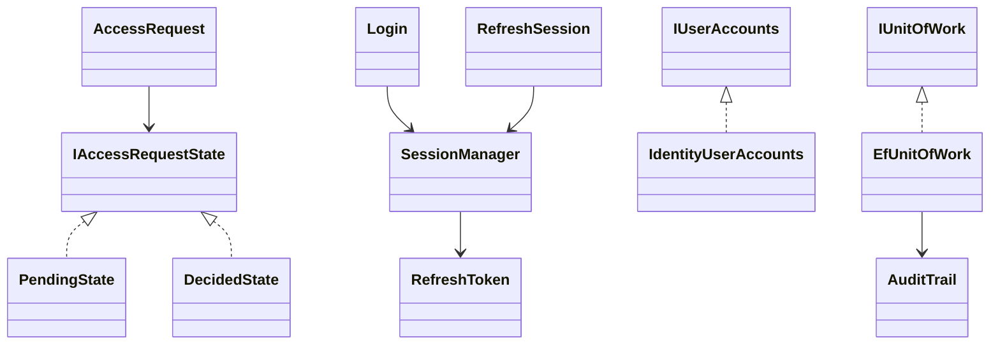

# Cheat sheet: Authentication & Access

**Requirements (5 bullets)**
- Request access (email = username) → admin approves in a console → temporary password.
- Temporary password ⇒ must set a new one before anything else.
- Access token 60 min; refresh token 30 days, **rotated on every use**, reuse ⇒ revoke the family.
- Lockout 5 fails / 15 min; roles Admin/Learner; sign out of all devices.
- Every security event audited; errors never reveal who has an account.

**Entities:** `EmailAddress` · `AccessRequest` (Pending → Approved | Rejected) · `UserAccount` · `RefreshToken` (family, hash, rotated-by) · `AuditEntry` · `Result/Error`

**Patterns, one line each**
- **State**: request lifecycle rules live in one class per state.
- **Strategy**: password policy, temp-password generator, token issuer, body-vs-cookie transport.
- **Repository + UoW**: use cases never see EF Core; one commit per use case.
- **Result**: expected failures are values with stable codes; one HTTP mapping.
- **Events + Observer**: audit trail without touching use cases.
- **Adapter**: `IUserAccounts` over ASP.NET Identity.

**3 gotchas**
1. Concurrent refreshes trip reuse detection → single-flight refresh, no retries on POST.
2. `UserManager` saves outside your unit of work → create the account last.
3. Never put the refresh token where JS can read it (no localStorage).

**30-second pitch**
"Short-lived JWTs plus rotating, hashed refresh tokens grouped in families: replaying an old token kills
the family. Access is by approval with a forced password change, enforced by one authorization policy
on a token claim. Use cases are single-purpose classes returning Results; persistence, Identity and JWT
sit behind ports; domain events feed an audit log in the same transaction."
