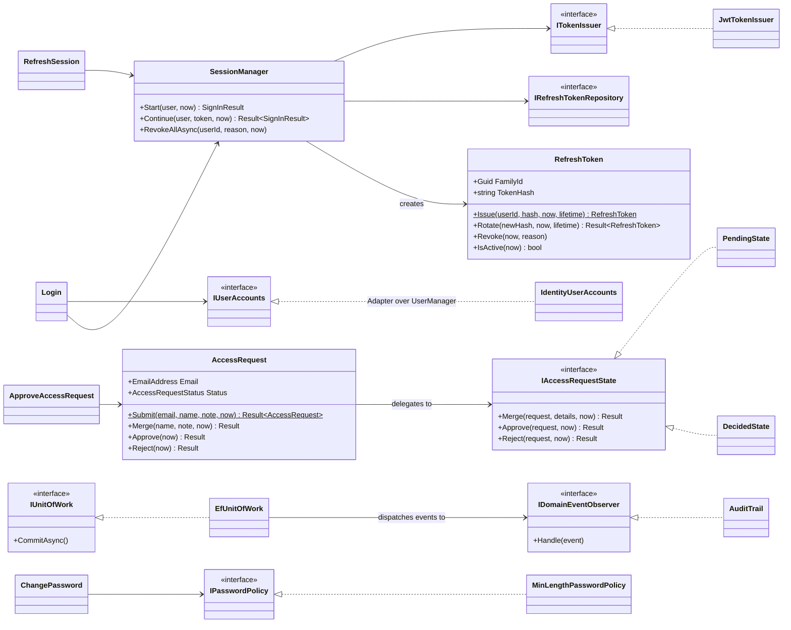
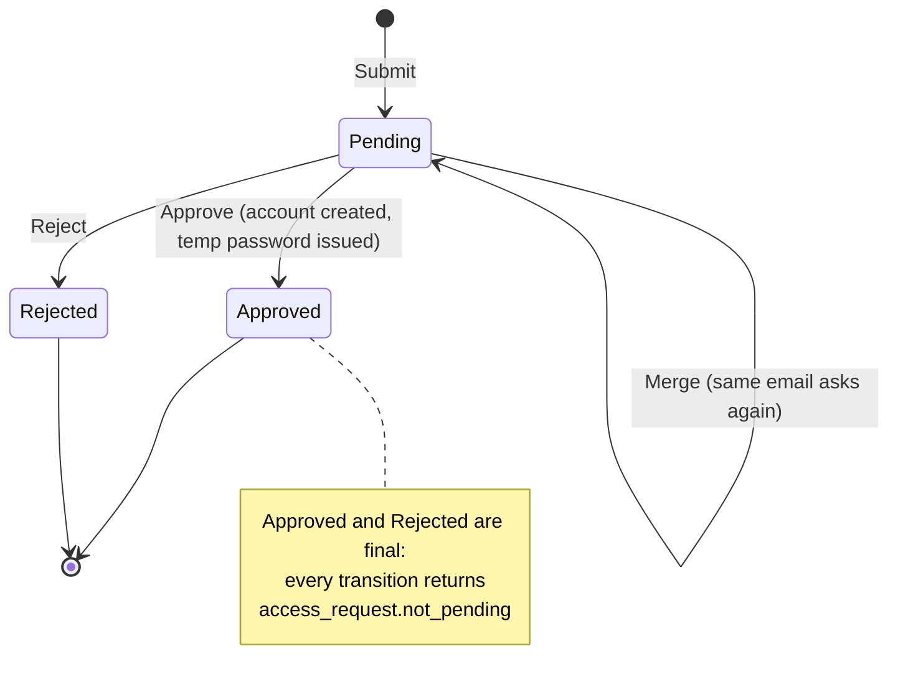
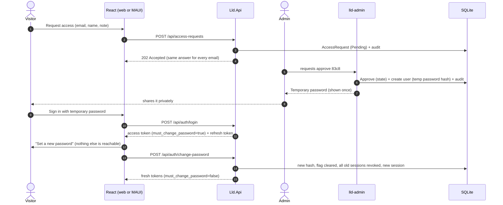
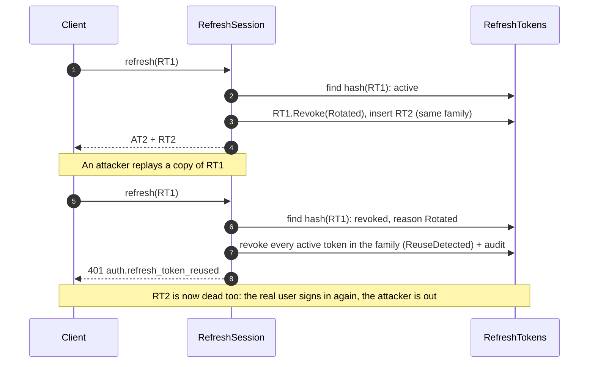

# Case Study 1: Authentication & Access

> **From consuming auth to building it.** Most of us have *used* auth that someone else built: a login
> form, an `[Authorize]` attribute, an identity provider. This case study is the other side: the LLD Guide
> app's own sign-in system, designed class by class. Every snippet links to the real code in this repo.

## 1. Problem statement

LLD Guide is used by 100–500 learners. Access is **by invitation**: people ask for access, the owner
approves them from a console on their PC, and the app hands out a **temporary password** that must be
replaced at first sign-in. Sessions must survive for weeks on a phone without ever exposing long-lived
secrets to JavaScript, and a stolen session token must be detected and shut down.

## 2. Requirements

**Functional**
1. Anyone can **request access** with an email (the username), a name and an optional note. A repeat request
   from the same email updates the pending one instead of creating a duplicate.
2. The admin can **approve or reject** requests, **create users** (Learner or Admin), **reset passwords** and
   **disable users** from a console. Approve, create and reset print a temporary password once.
3. A user signing in with a **temporary password must set a new one** before doing anything else.
4. Users can **sign in, refresh silently, sign out, and sign out of all devices**, and change their password.
5. After **5 failed sign-ins**, the account is **locked for 15 minutes**.
6. Users have **roles** (Admin, Learner) carried in their token.
7. Every security event is written to an **audit log**.

**Non-functional**
- Access tokens live **60 minutes**; refresh tokens **30 days**, **rotated on every use**.
- Re-using an already-rotated refresh token **revokes the whole session family** (theft detection).
- Passwords: **≥ 12 characters**, no composition rules, not equal to the email.
- The browser never lets JavaScript read the refresh token (httpOnly cookie); the app keeps it in OS secure storage.
- Sign-in errors are **generic**: they never reveal whether an email has an account.

## 3. Core entities

| Entity | Responsibility | Key fields |
|---|---|---|
| `EmailAddress` (value object) | Normalise + validate the username once | `Value` (lower-cased) |
| `AccessRequest` (aggregate) | A person's request and its lifecycle | `Email`, `Name`, `Note`, `Status`, `DecidedAt` |
| `UserAccount` (read model) | What use cases know about a user | `Id`, `Email`, `Roles`, `MustChangePassword`, `IsDisabled` |
| `RefreshToken` | A hashed long-lived credential in a family | `TokenHash`, `FamilyId`, `ExpiresAt`, `RevokedAt`, `ReplacedByTokenId` |
| `AuditEntry` | Append-only security event | `Type`, `Email`, `UserId`, `OccurredAt`, `Details` |
| `Result` / `Error` | Outcome of every operation | `IsSuccess`, `Error.Code`, `Error.Message` |

## 4. Class diagram



Layers (arrows only point inwards): **Domain** (`AccessRequest`, `RefreshToken`) ← **Application** (use cases + ports)
← **Infrastructure** (EF Core, Identity, JWT) ← **API** and **Admin console** (two clients of the same use cases).

## 5. Key flows

### 5.1 Access request lifecycle



### 5.2 From request to first real session



### 5.3 Refresh rotation and reuse detection



## 6. Patterns used & why

| Pattern | Where | What it buys | Without it |
|---|---|---|---|
| **State** | `AccessRequest` delegates to `PendingState` / `DecidedState` ([AccessRequestStates.cs](../../../src/Lld.Domain/Access/AccessRequestStates.cs)) | "What is allowed now" lives in one class per state; adding a state (e.g. `Expired`) adds a class, not `if`s in every method | `if (Status != Pending) ...` repeated in `Approve`, `Reject`, `Merge` and every future operation |
| **Strategy** | `IPasswordPolicy`, `ITemporaryPasswordGenerator`, `ITokenIssuer`, `IRefreshTokenTransport` (body vs cookie) | Swap a rule or mechanism without touching callers; the browser/app difference is one class each | `if (isBrowser)` branches inside every auth endpoint |
| **Repository + Unit of Work** | ports in [Ports.cs](../../../src/Lld.Application/Abstractions/Ports.cs), `EfUnitOfWork` in [Repositories.cs](../../../src/Lld.Infrastructure/Persistence/Repositories.cs) | Use cases don't know EF Core exists; one `CommitAsync` per use case | `DbContext` in every use case, scattered `SaveChanges` calls |
| **Result** | every use case returns `Result<T>` ([Result.cs](../../../src/Lld.Domain/Common/Result.cs)); one HTTP mapping ([AuthMapping.cs](../../../src/Lld.Api/Auth/AuthMapping.cs)) | Expected failures (wrong password, locked out) are values with stable codes; no exceptions as control flow | `try/catch` around every call, or exceptions mapped in many places |
| **Domain events + Observer** | aggregates/use cases raise events; `AuditTrail` observes them ([AuditTrail.cs](../../../src/Lld.Application/Audit/AuditTrail.cs)) | Auditing is added in one place; use cases don't know it exists | `auditLog.Append(...)` sprinkled through every use case |
| **Adapter** | `IdentityUserAccounts` adapts ASP.NET Core Identity's `UserManager` to the `IUserAccounts` port ([IdentityUserAccounts.cs](../../../src/Lld.Infrastructure/Identity/IdentityUserAccounts.cs)) | The application layer stays framework-free and testable with a 100-line fake | Use cases depend on `UserManager<AppUser>` and its quirks |
| **Factory** | `RefreshToken.Issue` / `Rotate` ([RefreshToken.cs](../../../src/Lld.Domain/Sessions/RefreshToken.cs)) | A token can only be created valid: right expiry, right family | Public setters and "remember to set FamilyId" |

## 7. SOLID mapping

- **S**: one class per use case: [`Login`](../../../src/Lld.Application/Auth/Login.cs) only signs in; [`RefreshSession`](../../../src/Lld.Application/Auth/RefreshSession.cs) only refreshes.
- **O**: a new password rule is a new `IPasswordPolicy`; a new client transport is a new `IRefreshTokenTransport`. Existing code is not edited.
- **L**: `BodyRefreshTokenTransport` and `CookieRefreshTokenTransport` are interchangeable behind `IRefreshTokenTransport` ([RefreshTokenTransport.cs](../../../src/Lld.Api/Auth/RefreshTokenTransport.cs)).
- **I**: small ports (`ITokenIssuer` has one method) instead of one "AuthService" interface with fifteen.
- **D**: `Lld.Application` references only `Lld.Domain`; Identity, EF Core and JWT live in `Lld.Infrastructure` behind interfaces.

## 8. C# implementation (real code, short excerpts)

**State pattern**: the request asks its state object what to do ([AccessRequest.cs](../../../src/Lld.Domain/Access/AccessRequest.cs)):

```csharp
private IAccessRequestState State => AccessRequestStates.For(Status);

public Result Approve(DateTimeOffset now) => State.Approve(this, now);
public Result Reject(DateTimeOffset now) => State.Reject(this, now);
```

and every final state refuses with the same error ([AccessRequestStates.cs](../../../src/Lld.Domain/Access/AccessRequestStates.cs)):

```csharp
private sealed class DecidedState(string label) : IAccessRequestState
{
    public Result Approve(AccessRequest request, DateTimeOffset now) => NotPending();
    // ...
    private Error NotPending() => new("access_request.not_pending", $"This request was already {label}.");
}
```

**Rotation with reuse detection** ([RefreshSession.cs](../../../src/Lld.Application/Auth/RefreshSession.cs)):

```csharp
if (token.RevokedReason == RevocationReason.Rotated)
{
    await sessions.RevokeFamilyAsync(token.FamilyId, RevocationReason.ReuseDetected, now, cancellationToken);
    events.Raise(new RefreshTokenReuseDetected(token.UserId, token.FamilyId, now));
    await unitOfWork.CommitAsync(cancellationToken);
    return AppErrors.RefreshTokenReused;
}
```

**Unit of Work + Observer**: events become audit rows in the *same* save ([Repositories.cs](../../../src/Lld.Infrastructure/Persistence/Repositories.cs)):

```csharp
var aggregates = db.ChangeTracker.Entries<AggregateRoot>().Select(e => e.Entity).ToList();
var events = aggregates.SelectMany(a => a.DomainEvents).Concat(collector.Drain()).ToList();
aggregates.ForEach(a => a.ClearDomainEvents());

dispatcher.Dispatch(events);           // AuditTrail appends AuditEntry rows
await db.SaveChangesAsync(cancellationToken);
```

**Forced password change** is one authorization rule, not checks in every endpoint ([AuthSetup.cs](../../../src/Lld.Api/Auth/AuthSetup.cs)):

```csharp
.SetDefaultPolicy(new AuthorizationPolicyBuilder()
    .RequireAuthenticatedUser()
    .RequireAssertion(ctx => ctx.User.FindFirst(LldClaims.MustChangePassword)?.Value != "true")
    .Build())
```

**Strategy for token transport**: the browser can't read its refresh token ([RefreshTokenTransport.cs](../../../src/Lld.Api/Auth/RefreshTokenTransport.cs)):

```csharp
private static CookieOptions Options(DateTimeOffset expires) => new()
{
    HttpOnly = true, Secure = true, SameSite = SameSiteMode.Strict, Path = "/api/auth", Expires = expires,
};
```

The tests that prove all of this: [`tests/Lld.Domain.Tests`](../../../tests/Lld.Domain.Tests), [`tests/Lld.Application.Tests`](../../../tests/Lld.Application.Tests), [`tests/Lld.Api.Tests/AuthApiTests.cs`](../../../tests/Lld.Api.Tests/AuthApiTests.cs), [`tests/Lld.IntegrationTests/AuthFlowTests.cs`](../../../tests/Lld.IntegrationTests/AuthFlowTests.cs).

## 9. Trade-offs & extensions

- **Identity saves on its own.** `UserManager` commits immediately, outside our unit of work. `ApproveAccessRequest` therefore creates the account *last*, so a failure leaves nothing half-done. At larger scale: an explicit DB transaction around both, or an outbox.
- **Rotation vs. concurrency.** Two tabs refreshing at once would present the same token twice and trip reuse detection. Fix used here: **single-flight refresh** on each client (`HttpDataSource`, `SessionService`), and **no automatic retries** for POSTs in the MAUI HTTP pipeline. A server-side alternative is a short grace period for the previous token.
- **Symmetric signing (HS256).** One API both issues and validates tokens, so a shared secret is simplest. With several services validating tokens, switch to RS256/ES256 and publish the public key (JWKS).
- **SQLite.** Fine for one process and a few hundred users (WAL mode lets the API and the console share it). At 10× and beyond: PostgreSQL, and refresh tokens in a store with TTLs.
- **Rate limiting** is per IP. Behind a proxy or tunnel, use the forwarded client IP, or limit per email for login.
- **Enumeration resistance.** Request-access always answers `202`; login always says "Email or password is incorrect". The `423 Locked` status does reveal that an account exists: a conscious usability trade-off.
- **Extensions:** 2FA (TOTP) as another step before `SessionManager.Start`; external identity providers as another `IUserAccounts` adapter; an admin web UI as a third client of the same use cases.

## 10. Common interview follow-ups

1. **Why not keep the access token for 30 days and skip refresh tokens?** A stolen access token can't be revoked before it expires; keeping it short (60 min) limits the damage, and refresh tokens give a revocable long session.
2. **Why rotate refresh tokens?** Each token works once, so a copied token is detectable: the second use of a rotated token can only be a replay.
3. **Why store only a hash of the refresh token?** A database leak then can't be used to impersonate users, the same reason passwords are hashed.
4. **Where should a browser keep tokens?** Access token in memory; refresh token in an httpOnly, Secure, SameSite=Strict cookie scoped to the auth path. Not localStorage: any XSS can read it.
5. **How do you force a password change without touching every endpoint?** Put a claim in the token and make the default authorization policy reject it; whitelist only change-password, me and logout.
6. **How is "sign out of all devices" implemented with stateless JWTs?** Revoke every refresh-token family; access tokens expire within 60 minutes. For instant cut-off, add a per-user "sessions valid after" timestamp checked on each request.
7. **Why the State pattern for a three-state lifecycle?** It's small today, but rules like "merge only while pending" already exist; the pattern keeps each rule in one place as states are added.
8. **How do you audit without polluting business logic?** Use cases raise domain events; an observer turns them into audit rows inside the same commit.
