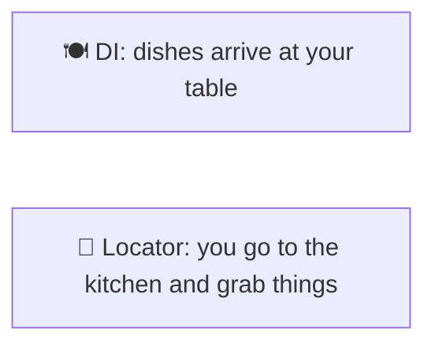
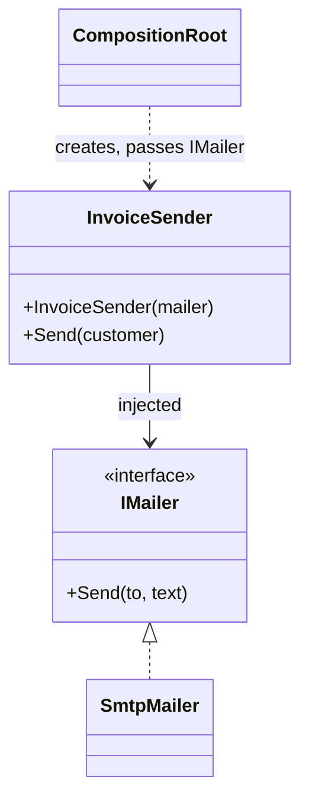

# DI vs Service Locator

> [!REMEMBER]
> Served at the table, not fetched. The waiter brings what you ordered; you don't wander into the kitchen.



## The idea

**Dependency injection:** a class lists what it needs in its **constructor**, and whoever creates it passes those in.
**Service locator:** the class asks a **global registry** for what it needs, from inside its methods. Both supply
dependencies; DI makes them **visible**, the locator hides them.

**Use it (DI) when:**

- Always, for business code: dependencies in the constructor, the container used only at start-up.
- The locator is a smell everywhere except the composition root and framework plumbing (factories).

## Structure



- **Client** (`InvoiceSender`): declares its needs in the constructor.
- **Service** (`IMailer`) and its implementation.
- **Composition root** (`Program.cs`): the one place that wires things up, usually with a DI container.

## See it

```csharp before title="Before: the class fetches a hidden dependency" snippet="samples/Lld.Samples.Patterns/Enterprise/DiVsServiceLocator/Before/InvoiceSender.cs#ServiceLocator,InvoiceSender"
```
```csharp after title="After: the dependency is in the constructor" snippet="samples/Lld.Samples.Patterns/Enterprise/DiVsServiceLocator/After/InvoiceSender.cs#InvoiceSender"
```

**What changed:** you can't create an `InvoiceSender` without a mailer, so a missing registration fails at start-up,
not when the first invoice is sent. A test passes a fake mailer; no global setup, nothing leaks between tests.

## Modern C#

```csharp snippet="samples/Lld.Samples.Patterns/Enterprise/DiVsServiceLocator/Modern/InvoicingRegistration.cs#InvoicingRegistration"
```

`Microsoft.Extensions.DependencyInjection` is the container. Register in one place, resolve the top-level object
(ASP.NET Core does it per request), and never inject `IServiceProvider` into business code: that's a locator again.

## Seen in .NET

- ASP.NET Core and MAUI: constructor injection everywhere, `AddScoped` / `AddSingleton` / `AddTransient`.
- `IServiceProvider.GetRequiredService<T>()`: the locator API, meant for the composition root and framework code.
- `ValidateOnBuild` / `ValidateScopes`: the container checks the whole graph at start-up.

## Travels with

- [Unit of Work](../unit-of-work/lesson.md): a scoped registration gives each request one.
- [Null Object](../null-object/lesson.md): a safe default to register for optional services.
- [Singleton](../../gof-patterns/singleton/lesson.md): `AddSingleton` replaces hand-written singletons.

> [!OVERUSE]
> - Constructors with 8+ parameters: DI isn't the problem, the class does too much
>   ([SRP](../../oop-solid/srp/lesson.md)).
> - Interfaces for every class "for DI", even with one implementation that never changes.
> - `IServiceProvider` injected "just in case": the locator returns through the back door.

## In this app

```csharp snippet="src/Lld.Application/Access/AccessRequests.cs#RejectAccessRequest"
```

Every use case takes its repository, unit of work and clock in its constructor. The API and the admin console wire
them up in their composition roots; the tests pass in-memory fakes.

## Interview questions

### What is the difference between DI and a service locator?

With DI, dependencies are passed in (usually through the constructor), so they are visible and required. With a
locator, the class asks a global registry from inside its code, hiding what it depends on.

### Why is service locator called an anti-pattern?

Hidden dependencies: you can't see what a class needs, errors appear at runtime, and tests must configure global
state.

### Is injecting `IServiceProvider` ever OK?

In the composition root and framework-style code (a factory that creates handlers by type), yes. In business classes,
it's a locator.

### DI vs DIP?

DIP is a design principle (depend on abstractions owned by the policy). DI is a technique for supplying dependencies.
You can do DI with concrete classes, and DIP without a container.

### What do the three lifetimes mean?

Singleton: one per app. Scoped: one per scope (request). Transient: a new one every time it's asked for.

## Go deeper

### The composition root

The single place (`Program.cs`, `MauiProgram.cs`) where the object graph is built. Everything else just declares
needs. Keeping the container there makes the rest of the code container-agnostic.

### Captive dependencies

A singleton that takes a scoped service keeps it forever. Turn on scope validation in development; it throws at
start-up (see [Singleton](../../gof-patterns/singleton/lesson.md)).

### Factories without a locator

When a class must create objects on demand, inject a factory (`Func<T>`, `IHttpClientFactory`, `IDbContextFactory<T>`)
instead of `IServiceProvider`.

### In a design interview

- Say the composition root and lifetimes out loud: "repositories scoped, the clock singleton".
- Mention testing: "constructor injection lets me pass fakes".

### Misconceptions

- "DI requires a container." A constructor and `new` in `Main` is DI too; the container just automates it.

> [!WORK]
> **From my work:** a service locator you replaced, or a constructor that showed a class doing too much. (Add your story here.)

### Related

- [Dependency Inversion (DIP)](../../oop-solid/dip/lesson.md) · [Singleton](../../gof-patterns/singleton/lesson.md) ·
  [Unit of Work](../unit-of-work/lesson.md)
