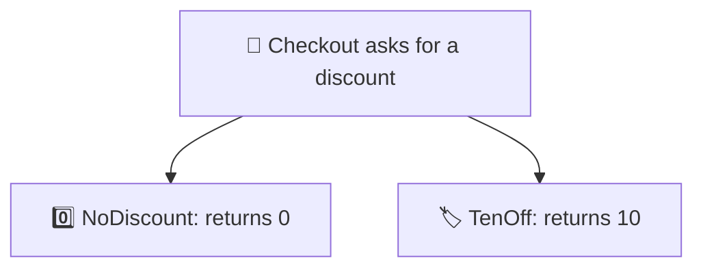
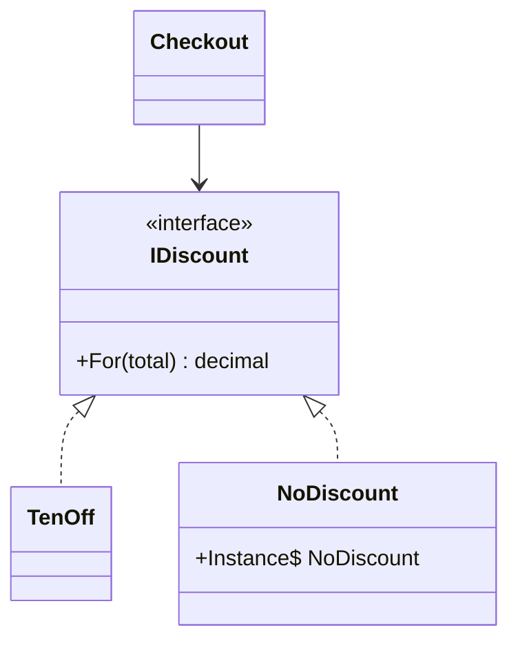

# Null Object

> [!REMEMBER]
> Nothing, done safely. A mute button doesn't break the TV; it just plays no sound.



## The idea

When "no discount" or "no logging" is a valid choice, don't pass `null`. Pass a **real implementation that does
nothing** (`NoDiscount`, `SilentLog`). Callers treat it like any other object, so the null checks disappear.

**Use it when:**

- `if (x != null)` checks for the same optional dependency are spread through the code.
- A missed check would be a `NullReferenceException` in a rare path.

## Structure



- **Abstraction** (`IDiscount`): what callers use.
- **Real objects** (`TenOff`): do something.
- **Null object** (`NoDiscount`): does nothing, safely; usually one shared instance.

## See it

```csharp before title="Before: null means none, so check everywhere" snippet="samples/Lld.Samples.Patterns/Enterprise/NullObject/Before/Checkout.cs#Checkout"
```
```csharp after title="After: a do-nothing object instead of null" snippet="samples/Lld.Samples.Patterns/Enterprise/NullObject/After/Checkout.cs#NoDiscount,Checkout"
```

**What changed:** checkout reads as the happy path, with no branches for "missing". Choosing "no discount" is explicit
(`NoDiscount.Instance`), not an accident.

## Modern C#

```csharp snippet="samples/Lld.Samples.Patterns/Enterprise/NullObject/Modern/Receipts.cs#Receipts"
```

.NET ships null objects: `TextWriter.Null`, `Stream.Null`, `NullLogger<T>.Instance`, `Enumerable.Empty<T>()`. Pair
them with nullable reference types, so the compiler flags any place that could still be `null`.

## Seen in .NET

- `NullLogger<T>.Instance` and `NullLoggerFactory`: logging that goes nowhere (handy in tests).
- `Stream.Null`, `TextWriter.Null`: sinks that swallow writes.
- `Enumerable.Empty<T>()`, `Array.Empty<T>()`: empty collections instead of `null` lists.

## Travels with

- [Singleton](../../gof-patterns/singleton/lesson.md): one shared null object is enough.
- [Strategy](../../gof-patterns/strategy/lesson.md): a null object is often the "do nothing" strategy.
- [DI vs Service Locator](../di-vs-service-locator/lesson.md): register the null object as the default.

> [!OVERUSE]
> - Hiding real errors: a missing payment gateway must fail loudly, not "do nothing".
> - Null objects that return made-up data (fake customers) that leaks into reports.
> - When "missing" needs different handling in different places, an explicit `null` (or a `Result`) is clearer.

## Interview questions

### What is the Null Object pattern?

Replacing `null` with an object that implements the expected interface but does nothing, so callers don't need null
checks.

### When is it a bad idea?

When "nothing" is actually an error: silently doing nothing hides the problem. Use it only when "do nothing" is a
correct behaviour.

### How do nullable reference types relate?

They make the compiler warn wherever `null` might reach code that doesn't expect it; null objects let you remove those
`null`s entirely for optional collaborators.

### Give .NET examples.

`NullLogger<T>.Instance`, `TextWriter.Null`, `Stream.Null`, `Enumerable.Empty<T>()`.

### Null Object vs Special Case?

Special Case (Fowler) is the general idea: a subclass for a special situation ("unknown customer"); Null Object is the
special case for "nothing".

## Go deeper

### Empty collections are null objects

Return `[]` (or `Enumerable.Empty<T>()`), never `null`, from methods that return lists. Every `foreach` and LINQ call
then just works.

### Testing with null objects

Tests often pass `NullLogger<T>.Instance` or a do-nothing clock to focus on one behaviour. That's the same pattern,
used for convenience.

### In a design interview

- Parking lot without a payment kiosk on some floors: `NoKiosk` instead of `null`.
- Say why "nothing" is a correct behaviour there.

### Misconceptions

- "Null Object = default values." It's an object with behaviour (doing nothing), not just empty fields.

> [!WORK]
> **From my work:** a NullReferenceException a null object would have prevented. (Add your story here.)

### Related

- [DI vs Service Locator](../di-vs-service-locator/lesson.md) · [Strategy](../../gof-patterns/strategy/lesson.md) ·
  [Value objects & immutability](../../oop-solid/value-objects-immutability/lesson.md)
