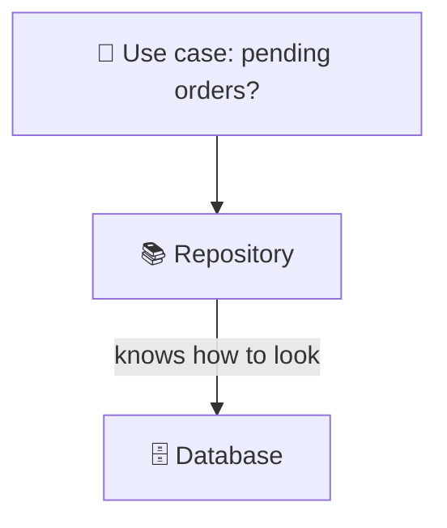
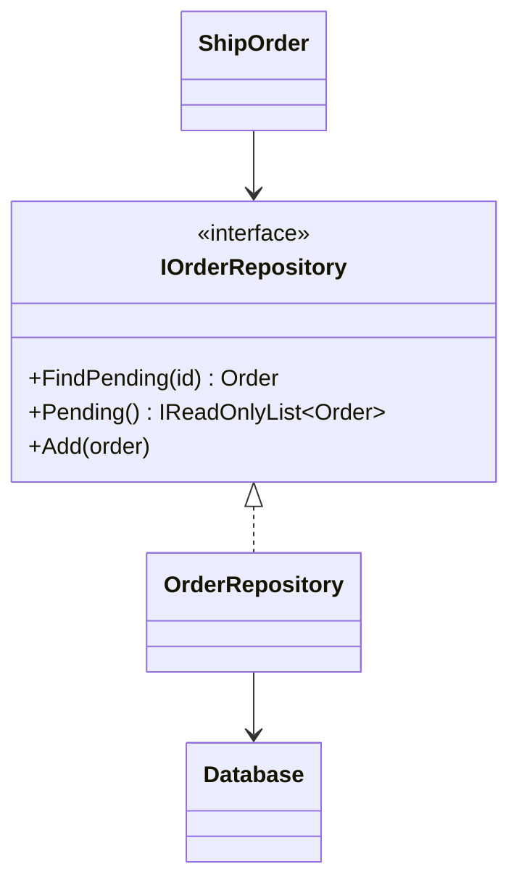

# Repository

> [!REMEMBER]
> Ask the librarian, not the shelves. You ask for "pending orders"; how they're found is not your problem.



## The idea

A **repository** looks like an in-memory collection of one kind of domain object (an *aggregate*): `FindPending(id)`,
`Pending()`, `Add(order)`. Business code depends on its interface; the implementation holds the queries and the
storage details.

**Use it when:**

- Queries are copied across handlers and drift apart.
- You want to test business rules without a database, or keep the domain free of persistence code.

## Structure



- **Repository interface** (`IOrderRepository`): owned by the domain / application layer, in business words.
- **Implementation** (`OrderRepository`, or `EfOrderRepository`): owned by infrastructure.
- **Clients** (use cases like `ShipOrder`): only see the interface.

## See it

```csharp before title="Before: handlers query the database themselves" snippet="samples/Lld.Samples.Patterns/Enterprise/Repository/Before/Handlers.cs#ShipOrder,PendingOrdersReport"
```
```csharp after title="After: they ask a repository" snippet="samples/Lld.Samples.Patterns/Enterprise/Repository/After/Orders.cs#IOrderRepository,OrderRepository,ShipOrder"
```

**What changed:** "pending" is defined once. `ShipOrder` is tested with a one-order fake, and moving to EF Core or
a document database means a new implementation, not edits to every handler.

## Modern C#

```csharp snippet="samples/Lld.Samples.Patterns/Enterprise/Repository/Modern/OrderQueries.cs#OrderQueries"
```

EF Core's `DbSet<T>` already is a repository and `DbContext` a unit of work. Many teams skip their own repository
classes and keep queries reusable as extension methods on `IQueryable<T>`; others keep thin repositories per aggregate
to protect the domain. Both are fine; a generic `IRepository<T>` over EF Core usually isn't.

## Seen in .NET

- EF Core `DbSet<T>`: `Find`, `Add`, `Remove`, LINQ queries.
- ASP.NET Core Identity's `IUserStore<T>`: a repository for users with EF Core and other implementations.
- `IDistributedCache`, `IBlobContainerClient`: storage behind collection-like interfaces.

## Travels with

- [Unit of Work](../unit-of-work/lesson.md): repositories add and change objects; the unit of work saves them together.
- [Specification](../specification/lesson.md): one `Find(spec)` instead of a method per filter.
- [Adapter](../../gof-patterns/adapter/lesson.md): an EF Core repository adapts `DbContext` to your interface.

> [!OVERUSE]
> - A generic `IRepository<T>` that wraps `DbSet<T>` one-to-one and adds nothing.
> - Returning `IQueryable<T>` from the repository: the query logic leaks back into every caller.
> - One repository per table instead of per aggregate.

## In this app

```csharp snippet="src/Lld.Infrastructure/Persistence/Repositories.cs#EfAccessRequestRepository"
```

`IAccessRequestRepository` lives in the application layer; this EF Core class implements it in infrastructure. The use
cases never see `DbContext`.

## Interview questions

### What is the Repository pattern?

An abstraction that looks like a collection of domain objects, hiding how they are stored and queried, so business
code depends on an interface in its own language instead of on the database.

### Isn't EF Core already a repository?

Yes: `DbSet<T>` is a repository and `DbContext` a unit of work. A custom repository still helps when you want
intention-revealing queries, a persistence-free domain, or a non-EF store; it doesn't help as a thin generic wrapper.

### Why not return `IQueryable<T>`?

Callers then build queries themselves, so query logic spreads again and may break when the provider changes. Return
materialised results (`IReadOnlyList<T>`) or accept a specification.

### One repository per table?

Per **aggregate**: the cluster of objects saved together (an order with its lines). Child objects are reached
through their root.

### How do repositories help testing?

Use cases can be tested with an in-memory fake; the real repository gets a few integration tests against the database.

## Go deeper

### Where the interface lives

In the application (or domain) layer, because the business decides what it needs. The infrastructure layer implements
it. That's [DIP](../../oop-solid/dip/lesson.md).

### Read side vs write side

Repositories shine for loading and saving aggregates. For screens and reports, a separate query service (or plain
EF Core projections) is often simpler than bending the repository to every view.

### In a design interview

- Library system: `IBookRepository.FindAvailable(title)`, `IMemberRepository.Find(id)`.
- Say where transactions are handled: in the unit of work, not in each repository.

### Misconceptions

- "Repository = DAO." A DAO mirrors tables; a repository speaks the domain's language for whole aggregates.

> [!WORK]
> **From my work:** a repository you added (or a generic one you removed). (Add your story here.)

### Related

- [Unit of Work](../unit-of-work/lesson.md) · [Specification](../specification/lesson.md) ·
  [Dependency Inversion (DIP)](../../oop-solid/dip/lesson.md)
