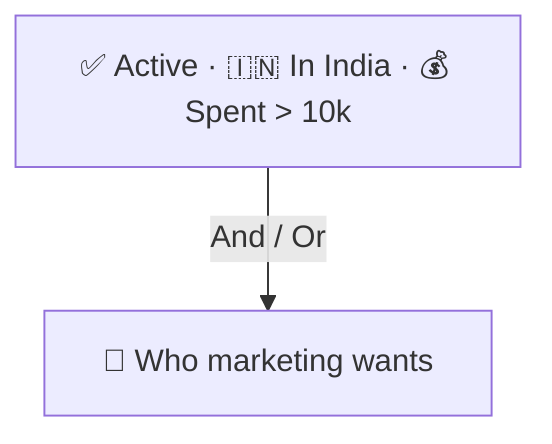
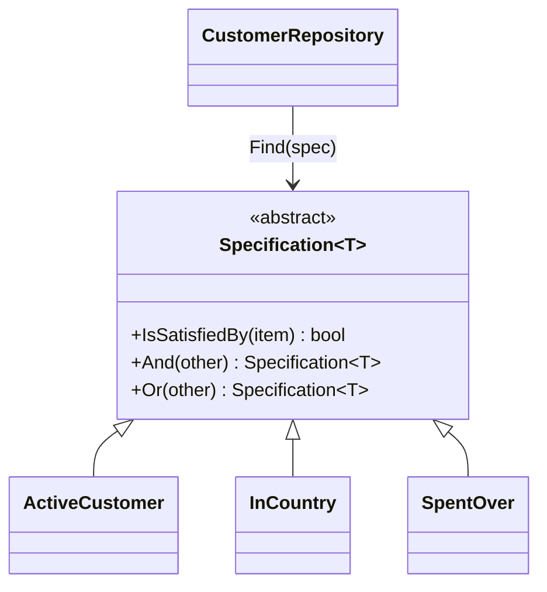

# Specification

> [!REMEMBER]
> Name the rule, then combine rules. "Active", "in India", "spent over ₹10,000": three rules, any mix.



## The idea

A **specification** is one business rule as an object with `IsSatisfiedBy(item)`. Rules combine with `And`, `Or` and
`Not` into bigger rules, and a repository needs only one `Find(spec)` instead of a method per combination.

**Use it when:**

- Repositories grow methods like `GetActiveIndianCustomersWhoSpentOver(...)`.
- The same rule ("active customer") is written in several queries and validations.

## Structure



- **Specification** (`Specification<T>`): the rule interface plus combinators.
- **Concrete specifications** (`ActiveCustomer`, `InCountry`): one rule each, in business words.
- **Composite specifications** (`And`, `Or`): rules built from rules ([Composite](../../gof-patterns/composite/lesson.md)).

## See it

```csharp before title="Before: a method per combination" snippet="samples/Lld.Samples.Patterns/Enterprise/Specification/Before/CustomerRepository.cs#CustomerRepository"
```
```csharp after title="After: rules as objects, combined" snippet="samples/Lld.Samples.Patterns/Enterprise/Specification/After/Specifications.cs#Specification,ActiveCustomer,InCountry,CustomerRepository"
```

**What changed:** "active" is written once. "UK customers or big spenders" needs no new method, just
`new InCountry("UK").Or(new SpentOver(40_000))`.

## Modern C#

```csharp snippet="samples/Lld.Samples.Patterns/Enterprise/Specification/Modern/Spec.cs#Spec"
```

Build the rule on an `Expression<Func<T, bool>>`: the same specification filters a list in memory and, passed to EF
Core's `Where`, becomes SQL. The Ardalis.Specification library adds includes, ordering and paging on top.

## Seen in .NET

- LINQ `Where(expression)`: an expression tree a provider can translate.
- EF Core global query filters (`HasQueryFilter`): a rule applied to every query.
- FluentValidation rules: named, composable rules for validation.

## Travels with

- [Repository](../repository/lesson.md): `Find(spec)` replaces a method per filter.
- [Interpreter](../../gof-patterns/interpreter/lesson.md): specifications are a small rule language.
- [Composite](../../gof-patterns/composite/lesson.md): `And` / `Or` build trees of rules.

> [!OVERUSE]
> - A specification class for a filter used once, in one place.
> - In-memory specifications on big tables: everything is loaded, then filtered (use expressions).
> - Rules so generic ("FieldEquals(name, value)") that the business words are lost.

## Interview questions

### What is the Specification pattern?

A business rule encapsulated as an object that says whether an item satisfies it; specifications combine with
`And` / `Or` / `Not` and can be used for querying, validation and selection.

### Why use it instead of repository methods?

It stops the explosion of query methods, writes each rule once, and lets callers combine rules without changing the
repository.

### How does it work with EF Core?

Base specifications on `Expression<Func<T, bool>>` so EF Core can translate them to SQL; compile the same expression
for in-memory checks.

### How is it related to Interpreter and Composite?

Combined specifications form a tree (Composite) that evaluates itself against an item (Interpreter).

### Where else is it useful besides queries?

Validation ("can this order be cancelled?"), eligibility checks, and routing decisions.

## Go deeper

### Combining expressions

`Expression.AndAlso` needs both sides to use the **same** parameter; the `SwapParameter` visitor rewrites one side's
parameter so the result is a single, translatable lambda. That's the [Visitor](../../gof-patterns/visitor/lesson.md)
pattern at work inside .NET.

### Specifications in the domain

DDD puts specifications in the domain model, named in the business's words ("OverdueInvoice"), so the same rule
drives queries, UI badges and checks.

### In a design interview

- Library: `AvailableBook.And(InGenre("history"))`; hiring: `HasSkill("C#").And(YearsOver(5))`.
- Mention translation to SQL to avoid loading everything.

### Misconceptions

- "Specification is only for queries." It's for any yes/no business rule.

> [!WORK]
> **From my work:** a filter or eligibility rule you made reusable. (Add your story here.)

### Related

- [Repository](../repository/lesson.md) · [Interpreter](../../gof-patterns/interpreter/lesson.md) ·
  [Composite](../../gof-patterns/composite/lesson.md)
