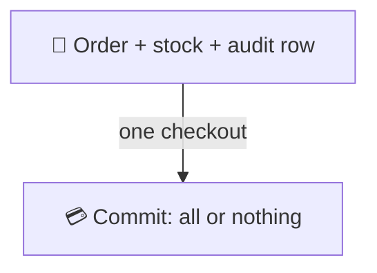
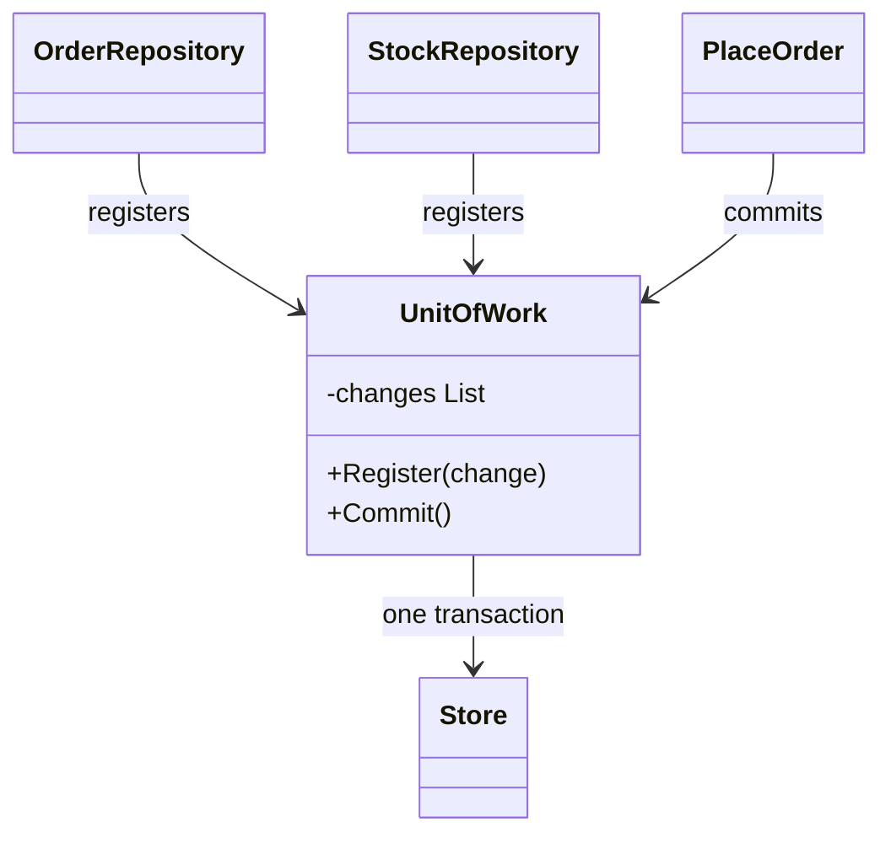

# Unit of Work

> [!REMEMBER]
> Fill the cart, pay once. Nothing leaves the shop until the whole basket is paid.



## The idea

During a business operation, repositories **register** what should change instead of saving straight away. The **unit
of work** keeps that list and, at the end, **commits** it in one transaction: either every change is saved or none is.

**Use it when:**

- One operation changes several things (an order and the stock) that must stay consistent.
- Repositories each call "save", and a failure halfway leaves half the data written.

## Structure



- **Unit of work** (`UnitOfWork`): tracks changes, commits once.
- **Repositories:** register changes with it.
- **Use case** (`PlaceOrder`): makes its changes, then commits.

## See it

```csharp before title="Before: each repository saves on its own" snippet="samples/Lld.Samples.Patterns/Enterprise/UnitOfWork/Before/PlaceOrder.cs#OrderRepository,StockRepository,PlaceOrder"
```
```csharp after title="After: changes are registered, then committed together" snippet="samples/Lld.Samples.Patterns/Enterprise/UnitOfWork/After/PlaceOrder.cs#UnitOfWork,OrderRepository,PlaceOrder"
```

**What changed:** in *Before*, a dropped connection after the first save leaves an order with stock never taken (the
test proves it). After, the same failure saves nothing, and a retry saves both.

## Modern C#

```csharp snippet="samples/Lld.Samples.Patterns/Enterprise/UnitOfWork/Modern/OrderingRegistration.cs#OrderingRegistration"
```

EF Core's `DbContext` is a unit of work: it tracks changes, and `SaveChangesAsync` writes them in one transaction. A
**scoped** registration gives each web request its own.

## Seen in .NET

- EF Core `DbContext`: change tracking + `SaveChanges` in a transaction.
- `TransactionScope` and `DbTransaction`: the underlying all-or-nothing.
- `ChangeTracker.Entries()`: see exactly what the unit of work will save.

## Travels with

- [Repository](../repository/lesson.md): repositories register changes; the unit of work saves them.
- [DI vs Service Locator](../di-vs-service-locator/lesson.md): a scoped registration gives one unit of work per request.
- [Observer](../../gof-patterns/observer/lesson.md): domain events can be dispatched at commit time.

> [!OVERUSE]
> - Calling `SaveChanges` inside every repository method: the unit of work is defeated.
> - A unit of work kept alive for a whole app session: it tracks more and more objects and goes stale.
> - Wrapping EF Core's `DbContext` in another `IUnitOfWork` that only forwards `SaveChanges`, with no other reason.

## In this app

```csharp snippet="src/Lld.Infrastructure/Persistence/Repositories.cs#EfUnitOfWork"
```

Each use case calls `CommitAsync` once at the end. The unit of work hands domain events to observers (the audit trail
adds its rows), then saves everything in one `SaveChangesAsync`: the change and its audit row succeed or fail together.

## Interview questions

### What is the Unit of Work pattern?

An object that tracks the changes made during a business operation and commits them together in one transaction,
keeping the data consistent.

### How does EF Core implement it?

`DbContext` tracks entities you load or add; `SaveChangesAsync` turns the tracked changes into SQL inside one
transaction.

### Should repositories call `SaveChanges`?

No. Repositories add and load; the use case decides when the work is complete and commits once.

### How long should a unit of work live?

One business operation, typically one web request (a scoped `DbContext`). Long-lived contexts track too much and
return stale data.

### What about changes across two databases or services?

One unit of work can't cover them. Use the outbox pattern, sagas or eventual consistency instead of a distributed
transaction.

## Go deeper

### Domain events at commit

Collect events while the use case runs and dispatch them right before saving (as this app does), so observers' writes
join the same transaction and nothing is announced for a change that was rolled back.

### Optimistic concurrency

The unit of work can check that rows didn't change since they were read (a row version); EF Core throws
`DbUpdateConcurrencyException` and the use case decides whether to retry.

### In a design interview

- Booking a seat: reserve the seat, charge, write the ticket; one commit.
- Say where the transaction boundary is and what happens on failure.

### Misconceptions

- "Unit of Work = transaction." The transaction is how it commits; the pattern also tracks what changed.

> [!WORK]
> **From my work:** a half-saved bug you fixed by committing once. (Add your story here.)

### Related

- [Repository](../repository/lesson.md) · [DI vs Service Locator](../di-vs-service-locator/lesson.md) ·
  [Observer](../../gof-patterns/observer/lesson.md)
