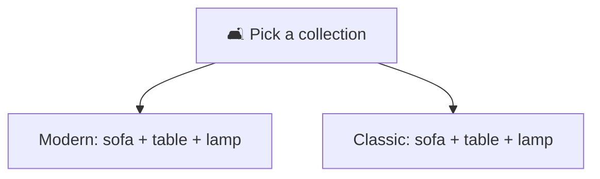
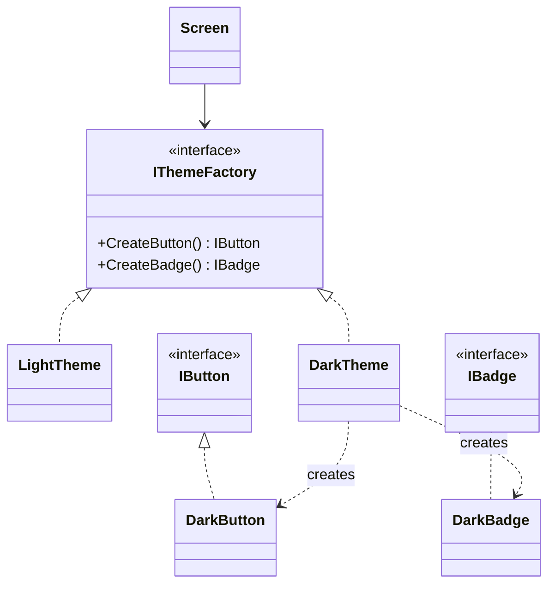

# Abstract Factory

> [!REMEMBER]
> One showroom, everything matches. Pick the family once; every piece comes from it.



## The idea

An interface with **one create method per product** (`CreateButton`, `CreateBadge`). Each implementation makes a
whole **family** of products that belong together. The client holds one factory and never names a concrete class.

**Use it when:**

- Products come in families that must **not be mixed** (light vs dark widgets, SQL Server vs SQLite objects).
- `if (theme == ...)` checks are spread over many classes.

## Structure



- **Abstract factory** (`IThemeFactory`) and **concrete factories** (`LightTheme`, `DarkTheme`): one per family.
- **Abstract products** (`IButton`, `IBadge`) and **concrete products** (`DarkButton`, ...).
- **Client** (`Screen`): only sees the interfaces.

## See it

```csharp before title="Before: every widget checks the theme" snippet="samples/Lld.Samples.Patterns/Creational/AbstractFactory/Before/Screen.cs#Screen"
```
```csharp after title="After: one factory per family" snippet="samples/Lld.Samples.Patterns/Creational/AbstractFactory/After/Themes.cs#IThemeFactory,DarkTheme,Screen"
```

**What changed:** the theme is decided in one place. A new theme is one new factory (plus its products), and a screen
can never show a dark button next to a light badge.

## Modern C#

```csharp snippet="samples/Lld.Samples.Patterns/Creational/AbstractFactory/Modern/ThemeRegistration.cs#ThemeRegistration"
```

The DI container picks the family at start-up. Keyed services (`AddKeyedSingleton`) help when you need several
families at once.

## Seen in .NET

- `DbProviderFactory`: `CreateConnection`, `CreateCommand`, `CreateParameter` for one database provider.
- ASP.NET Core's `IHostEnvironment` choosing different service families per environment (a DI version).

## Travels with

- [Factory Method](../factory-method/lesson.md): each create method is often one.
- [Singleton](../singleton/lesson.md): an app usually needs one factory per family.
- [Prototype](../prototype/lesson.md): a factory can clone ready-made products instead of building them.

> [!OVERUSE]
> - Only **one** family exists: plain classes are enough.
> - A new **product type** means changing every factory: if products change often, this hurts.
> - Factories for objects that don't need to match anything.

## Interview questions

### What is the Abstract Factory pattern?

An interface for creating families of related objects without naming their concrete classes. Each implementation
creates one consistent family.

### Abstract Factory vs Factory Method?

Factory Method creates **one** product, chosen by a subclass. Abstract Factory is an object with **several** create
methods that together make a matching family.

### What is easy and what is hard to change?

Adding a **family** is easy: one new factory. Adding a **product type** is hard: every factory gets a new method.

### Where does .NET use it?

`DbProviderFactory` creates connections, commands and parameters that all belong to one database provider.

### How does DI change it?

You still have the factory interface, but the container chooses the concrete family at start-up, so client code never
checks a setting.

## Go deeper

### A cross-platform example

A MAUI-style app could have `IPlatformFactory` with `CreateFilePicker()` and `CreateNotifier()`: `WindowsFactory`
and `AndroidFactory` make pieces that work together on one platform.

### Choosing the family

- At start-up from configuration (most common).
- Per tenant or per request, with keyed services.
- Never with `if` checks scattered in the client: that's what the pattern removes.

### In a design interview

- Notification system: `IChannelFactory` makes a `Formatter` and a `Sender` that must match (SMS vs e-mail).
- Say the trade-off: "new channels are cheap, a new kind of part touches every channel".

### Misconceptions

- "It's a factory that is abstract." It's a **family** of factories with one method per product.
- "Use it for every object." Only when products must match.

> [!WORK]
> **From my work:** a provider or theme family you introduced. (Add your story here.)

### Related

- [Factory Method](../factory-method/lesson.md) · [Builder](../builder/lesson.md) ·
  [Dependency Inversion (DIP)](../../oop-solid/dip/lesson.md)
