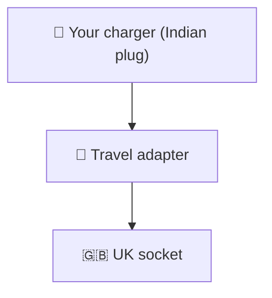
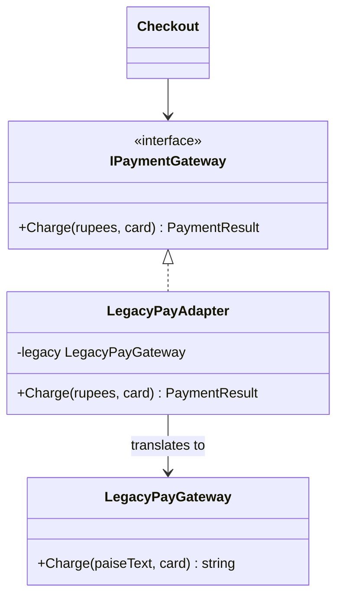

# Adapter

> [!REMEMBER]
> Make it fit, don't rewrite it. A travel plug: the socket and the charger stay as they are.



## The idea

A small class that **implements the interface you want** and **translates** each call to a class that has a different
one (an old library, a third-party SDK). Neither side changes.

**Use it when:**

- You must use a class whose methods, units or data shapes don't match your code.
- Conversion code (units, XML, error codes) is copied wherever that class is called.

## Structure



- **Target** (`IPaymentGateway`): the interface the client wants.
- **Adaptee** (`LegacyPayGateway`): the class that doesn't fit.
- **Adapter** (`LegacyPayAdapter`): implements the target, calls the adaptee.

## See it

```csharp before title="Before: checkout speaks the old library's language" snippet="samples/Lld.Samples.Patterns/Structural/Adapter/Before/Checkout.cs#Checkout"
```
```csharp after title="After: an adapter translates; checkout sees our interface" snippet="samples/Lld.Samples.Patterns/Structural/Adapter/After/Payments.cs#IPaymentGateway,LegacyPayAdapter,Checkout"
```

**What changed:** paise and XML live in one class. Checkout can be tested with a fake gateway, and a new payment
provider is a new adapter, not edits all over the app.

## Modern C#

```csharp snippet="samples/Lld.Samples.Patterns/Structural/Adapter/Modern/LegacyPayExtensions.cs#LegacyPayExtensions"
```

C# 14 extension members add a method in your words to a class you don't own. Nice for a few call sites; keep the
adapter class when callers must depend on an interface.

## Seen in .NET

- `StreamReader` / `StreamWriter`: adapt a byte `Stream` to the text-based `TextReader` / `TextWriter`.
- `Task.Factory.FromAsync`: adapts the old Begin/End async pattern to `Task`.
- `ToBlockingEnumerable()`: adapts an `IAsyncEnumerable<T>` to a plain `IEnumerable<T>`.

## Travels with

- [Facade](../facade/lesson.md): a facade often sits on top of adapters for each outside system.
- [Bridge](../bridge/lesson.md): looks the same, but is designed up front instead of added later.

> [!OVERUSE]
> - Adapting **your own** code: change it instead.
> - Adapters around adapters: the call goes through three translations.
> - An "adapter" that adds rules and decisions: that's a service, not a translator.

## In this app

```csharp snippet="src/Lld.Infrastructure/Identity/IdentityUserAccounts.cs#IdentityUserAccounts.FindByIdAsync,IdentityUserAccounts.FindByEmailAsync"
```

`IdentityUserAccounts` implements the app's own `IUserAccounts` port with ASP.NET Core Identity's `UserManager`: the
use cases never see Identity's types. This is "ports and adapters".

## Interview questions

### What is the Adapter pattern?

A wrapper that implements the interface a client expects and translates calls to an existing class with a different
interface, so two incompatible pieces work together without changing either.

### Object adapter vs class adapter?

An object adapter holds the adaptee and delegates to it (the usual C# way). A class adapter inherits from the adaptee
and implements the target; it needs multiple inheritance of classes, which C# doesn't have.

### Adapter vs Facade?

Adapter makes **one** class fit an interface that already exists. Facade invents a **new, simpler** interface over a
whole subsystem.

### Adapter vs Decorator?

Adapter changes the interface. Decorator keeps the same interface and adds behaviour.

### Where does it show up in clean architecture?

Infrastructure classes that implement application ports (repositories, gateways, clocks) are adapters: "ports and
adapters" is the hexagonal architecture name for it.

## Go deeper

### Two-way adapters

Sometimes both sides must call each other (an old UI framework and a new view model). A two-way adapter implements
both interfaces. Rare, but it explains why an adapter isn't always a thin pass-through.

### Where to put the adapter

- In the **infrastructure** layer, next to the library it wraps.
- The target interface belongs to the **caller** (see [DIP](../../oop-solid/dip/lesson.md)): the app says what it
  needs; the adapter does the translating.

### Testing

Test the adapter against the real library once (an integration test). Everything above it is tested with a fake
target, which is the main pay-off.

### In a design interview

- "Payment providers differ: one `IPaymentGateway`, one adapter per provider."
- Mention error translation: provider codes become your own `PaymentResult` or exceptions.

### Misconceptions

- "Adapter = any wrapper." The point is a **different interface**; same interface plus extras is a decorator.

> [!WORK]
> **From my work:** a third-party SDK you wrapped behind your own interface. (Add your story here.)

### Related

- [Facade](../facade/lesson.md) · [Decorator](../decorator/lesson.md) · [Bridge](../bridge/lesson.md) ·
  [Dependency Inversion (DIP)](../../oop-solid/dip/lesson.md)
