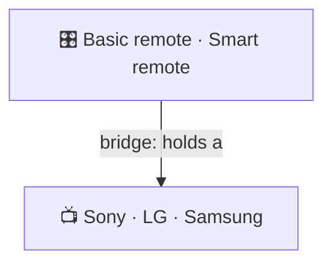
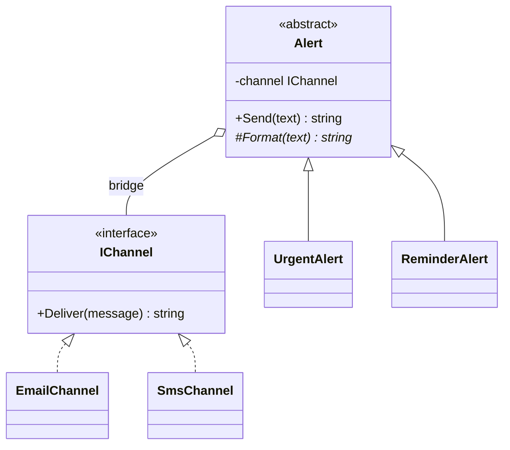

# Bridge

> [!REMEMBER]
> Split what from how; vary both. One remote works any TV; any TV works with a new remote.



## The idea

When a class varies in **two directions** (what kind of alert, and how it's sent), don't make a subclass for every
pair. Make **two hierarchies**: the *abstraction* (`Alert`) holds a reference to the *implementation* (`IChannel`). The
reference is the bridge.

**Use it when:**

- Class names combine two ideas (`UrgentEmailAlert`, `ReminderSmsAlert`) and the count grows as a product (m × n).
- You want to choose or swap the implementation at runtime.

## Structure



- **Abstraction** (`Alert`) and **refined abstractions** (`UrgentAlert`): the "what".
- **Implementor** (`IChannel`) and **concrete implementors** (`SmsChannel`): the "how".

## See it

```csharp before title="Before: one class per pair (2 × 2)" snippet="samples/Lld.Samples.Patterns/Structural/Bridge/Before/Alerts.cs#UrgentEmailAlert,UrgentSmsAlert,ReminderEmailAlert"
```
```csharp after title="After: two small hierarchies (2 + 2)" snippet="samples/Lld.Samples.Patterns/Structural/Bridge/After/Alerts.cs#IChannel,Alert,UrgentAlert"
```

**What changed:** adding push notifications is one `PushChannel`, and every kind of alert can use it at once. In
*Before* it would be one new class per kind.

## Modern C#

```csharp snippet="samples/Lld.Samples.Patterns/Structural/Bridge/Modern/AlertRegistration.cs#AlertRegistration"
```

With DI, pairing a kind with a channel is configuration: keyed services choose the implementation.

## Seen in .NET

- `ILogger` (what you log) over logging providers (console, file, Application Insights: how it's written).
- ADO.NET's `DbConnection` / `DbCommand` over each database provider.
- `Stream` over its backing store (file, memory, network).

## Travels with

- [Abstract Factory](../abstract-factory/lesson.md): can create the right implementor for a platform.
- [Adapter](../adapter/lesson.md): looks the same, but is added after the fact.

> [!OVERUSE]
> - Only **one** direction varies: a plain interface is enough.
> - Splitting "just in case" a second dimension appears
>   ([YAGNI](../../oop-solid/dry-kiss-yagni/lesson.md)).
> - The abstraction leaks implementor details (`if (channel is SmsChannel)`).

## Interview questions

### What is the Bridge pattern?

It separates an abstraction from its implementation into two hierarchies linked by composition, so each can be
extended independently, avoiding a class for every combination.

### What problem does it solve?

The "class explosion" when a type varies in two dimensions: m kinds × n implementations becomes m + n classes.

### Bridge vs Adapter?

Bridge is designed up front to let two sides vary. Adapter is added later to make an existing class fit an
interface it wasn't built for.

### Bridge vs Strategy?

Both hold an interface and delegate to it. Bridge is about the structure of two hierarchies; Strategy is about
swapping one algorithm. In code they can look the same; the intent differs.

### How is it related to composition over inheritance?

Bridge is that principle applied to two dimensions: inherit along one, compose along the other.

## Go deeper

### Naming the two sides

"Abstraction" and "implementation" confuse people: here they mean the **high-level idea** (an alert) and the
**low-level work** it relies on (a channel), not abstract classes vs concrete ones.

### Choosing the implementor

- Passed in the constructor (as here).
- Chosen by a factory per platform or per tenant.
- Swapped at runtime, for example falling back from push to SMS.

### In a design interview

- Shapes × renderers (vector, raster), payments × providers, reports × export formats.
- Show the class count before and after.

### Misconceptions

- "Bridge is just an interface." The point is **two** hierarchies that grow independently.

> [!WORK]
> **From my work:** a class explosion you split into two hierarchies. (Add your story here.)

### Related

- [Adapter](../adapter/lesson.md) · [Abstract Factory](../abstract-factory/lesson.md) ·
  [Composition over inheritance](../../oop-solid/composition-over-inheritance/lesson.md)
