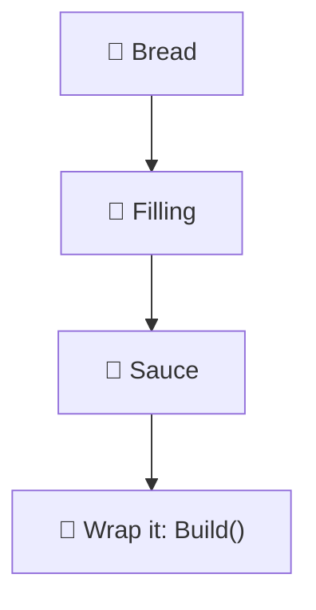
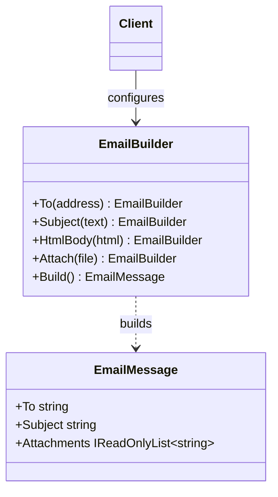

# Builder

> [!REMEMBER]
> Step by step, check at the end. Name each part; `Build()` hands over the finished thing.



## The idea

A separate **builder** object collects the parts through small named methods (`To(...)`, `Subject(...)`), in any
order. `Build()` checks the parts together and returns a finished, usually read-only, object.

**Use it when:**

- A constructor has **many parameters**, several optional, several of the same type (`bool, bool, string?`).
- The object must be **valid as a whole** (e.g. "needs a recipient") and should never exist half-built.

## Structure



- **Builder** (`EmailBuilder`): one method per part, each returns `this` (a fluent interface).
- **Product** (`EmailMessage`): finished and immutable.
- **Director** (optional): code that runs a fixed sequence of steps, like `Emails.Welcome`.

## See it

```csharp before title="Before: seven parameters, which bool is which?" snippet="samples/Lld.Samples.Patterns/Creational/Builder/Before/EmailMessage.cs#Emails"
```
```csharp after title="After: named steps" snippet="samples/Lld.Samples.Patterns/Creational/Builder/After/EmailBuilder.cs#Emails"
```

**What changed:** each part has a name, optional parts are simply skipped, and `Build()` refuses an e-mail without a
recipient. The builder itself:

```csharp snippet="samples/Lld.Samples.Patterns/Creational/Builder/After/EmailBuilder.cs#EmailBuilder.To,EmailBuilder.Build"
```

## Modern C#

```csharp snippet="samples/Lld.Samples.Patterns/Creational/Builder/Modern/EmailMessage.cs#EmailMessage"
```

`required` + `init` gives named, optional parts with no builder class, and the compiler checks the required ones.
Keep a builder when building has **steps**, **rules across fields**, or produces a different type.

## Seen in .NET

- `StringBuilder`, `UriBuilder`, `ImmutableArray.CreateBuilder<T>()`.
- `WebApplication.CreateBuilder(args)` → configure services → `Build()`.
- `DbContextOptionsBuilder`, `HostApplicationBuilder`, `ConfigurationBuilder`.

## Travels with

- [Composite](../composite/lesson.md): builders are a handy way to assemble trees.
- [Abstract Factory](../abstract-factory/lesson.md): a builder can get its parts from a factory.

> [!OVERUSE]
> - A builder for an object with **two or three** fields: use a constructor or an initializer.
> - The builder hands out objects that are still mutable, so the checks in `Build()` mean nothing.
> - Builders that just copy every property one to one, with no rules.

## In this app

```csharp snippet="src/Lld.Content.Authoring/Parsing/FlowchartMap.cs#FlowchartMap.Parse"
```

The module map parser feeds each Mermaid line to a private `MapBuilder` (`Add`), then calls `Build()` once to get the
finished groups and links.

## Interview questions

### What problem does Builder solve?

Objects with many optional parts: it replaces telescoping constructors with named steps, and makes sure the object is
complete and valid before anyone uses it.

### What is a telescoping constructor?

A chain of constructor overloads, each adding one more parameter. Callers can't tell which argument is which, and the
number of overloads grows fast.

### Builder vs Abstract Factory?

Abstract Factory makes a family of objects in one call each. Builder makes **one** complex object over several calls.

### Do you still need Builder in modern C#?

Less often: `required` and `init` properties cover named optional parts. Builders still help with step order,
cross-field validation and immutable results (`StringBuilder`, `WebApplication.CreateBuilder`).

### What is the director?

An optional class that knows a recipe of builder steps (e.g. "welcome e-mail"), so clients don't repeat it.

## Go deeper

### Making the product immutable

Give the product an `internal` constructor and get-only properties, and copy collections in `Build()`
(`[.. _attachments]`). Then the builder can be reused without changing e-mails it already built.

### Step builders

When the order matters, each step can return a different interface: `To()` returns `INeedsSubject`, which only has
`Subject()`. The compiler then enforces the order. Powerful, but heavy; use it for public libraries.

### Test data builders

Tests often use builders with sensible defaults: `new UserBuilder().WithRole("admin").Build()`. Each test sets only
what matters to it.

### In a design interview

- A pizza order, a SQL query, an HTTP request: "many optional parts, valid only as a whole".
- Mention `required` / `init` as the lighter option.

### Misconceptions

- "Fluent API = Builder." Fluent is the style; Builder is about assembling one product and checking it once.

> [!WORK]
> **From my work:** a constructor with too many parameters you replaced. (Add your story here.)

### Related

- [Abstract Factory](../abstract-factory/lesson.md) · [Prototype](../prototype/lesson.md) ·
  [Value objects & immutability](../../oop-solid/value-objects-immutability/lesson.md)
