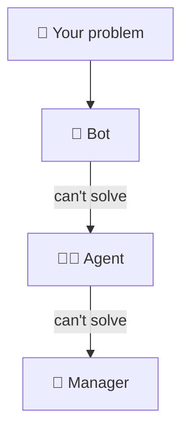
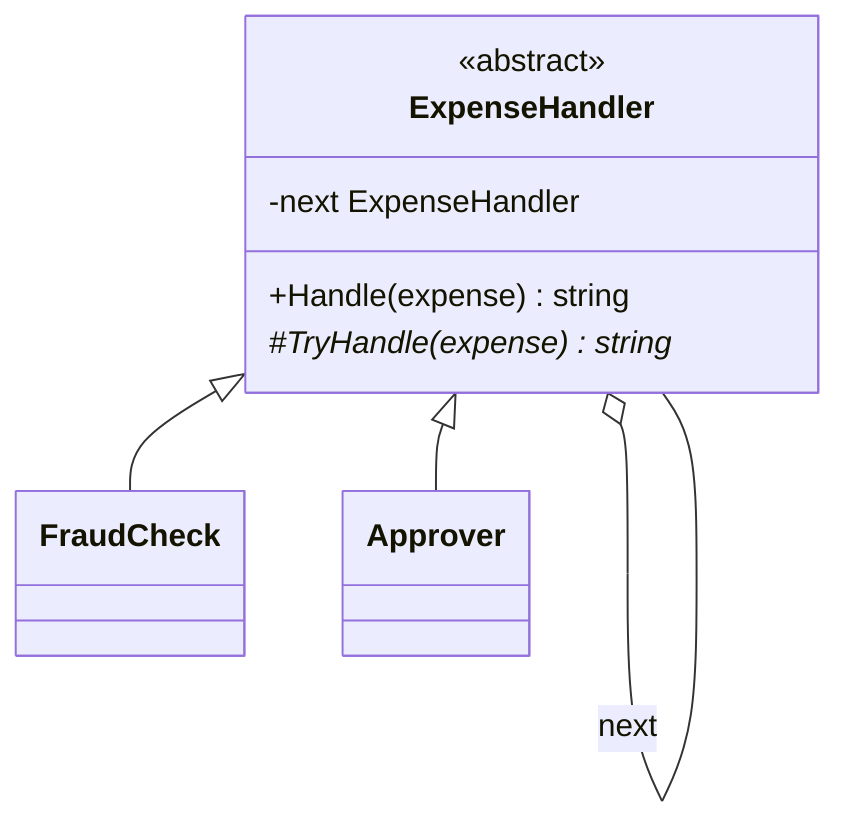

# Chain of Responsibility

> [!REMEMBER]
> Pass it on until someone can. Support goes bot, then agent, then manager.



## The idea

Handlers are linked in a line. A request goes to the **first** one; each handler either **deals with it** (and may
stop the chain) or **passes it to the next**. The sender doesn't know who will answer.

**Use it when:**

- A long `if / else if` decides who handles a request, and the list of handlers keeps changing.
- Several steps may each look at a request (checks, logging, auth) and any of them may stop it.

## Structure



- **Handler** (`ExpenseHandler`): holds the next link and passes on what it can't handle.
- **Concrete handlers** (`FraudCheck`, `Approver`): each decides "mine, stop" or "not mine, pass on".
- **Client:** sends to the first link only.

## See it

```csharp before title="Before: one if-chain decides everything" snippet="samples/Lld.Samples.Patterns/Behavioral/ChainOfResponsibility/Before/Approvals.cs#Approvals"
```
```csharp after title="After: a chain of handlers" snippet="samples/Lld.Samples.Patterns/Behavioral/ChainOfResponsibility/After/Approvers.cs#ExpenseHandler,Approver,Approvals"
```

**What changed:** each rule is its own link, and the order is written in one place. A CFO between director and board
is one more link; the tests insert one without editing the others.

## Modern C#

```csharp snippet="samples/Lld.Samples.Patterns/Behavioral/ChainOfResponsibility/Modern/Pipeline.cs#Step,Pipeline.Build"
```

Chains of delegates are how ASP.NET Core builds its middleware pipeline: each step gets `next` and decides whether
to call it.

## Seen in .NET

- ASP.NET Core middleware: authentication, CORS, rate limiting each may answer early or call `next`.
- `HttpClient` `DelegatingHandler`s: each handler can return a response without going further.
- MediatR pipeline behaviours, exception filters that handle only some exception types.

## Travels with

- [Composite](../composite/lesson.md): in a tree, a node's parent is a natural "next" handler (UI events bubble up).
- [Decorator](../decorator/lesson.md): same wrapping shape; a decorator always passes on, a chain may stop.
- [Command](../command/lesson.md): the request travelling down the chain is often a command object.

> [!OVERUSE]
> - Requests fall off the end silently: always decide what happens when nobody handles it.
> - The order of links matters but is spread across many registrations.
> - Debugging which link answered needs logging in every handler.

## In this app

```csharp snippet="src/Lld.Api/Hosting/RequestBudgetMiddleware.cs#RequestBudgetMiddleware.InvokeAsync"
```

One link of the API's middleware chain: it counts tunnelled traffic, then calls `next`. Links further down the same
chain can stop a request early: authorization answers 401, the rate limiter answers 429, and the endpoint never runs.

## Interview questions

### What is the Chain of Responsibility pattern?

Handlers are linked in a sequence; a request is passed along until one handles it. The sender is decoupled from the
receiver and the chain can be changed without touching either.

### What happens if nobody handles the request?

That must be designed: a default at the end of the chain (as "nobody can approve this" here), an error, or a logged
"unhandled" result.

### Chain vs Decorator?

Both wrap the next object. A decorator always calls the wrapped object and adds behaviour; a chain link may handle
the request itself and stop.

### Where does ASP.NET Core use it?

The middleware pipeline: each middleware receives `next` and decides whether to call it, short-circuit with a
response, or do work before and after.

### Can more than one handler handle the request?

In the classic form one handler handles it and stops. Pipelines often let every link do something (logging, metrics)
and only some links stop it.

## Go deeper

### Building the chain

Build it in one place (a factory, the DI setup, `app.Use...` calls in order) so the order is visible and reviewed.
Order bugs (auth after the endpoint) are the most common chain bugs.

### Chain vs a list of rules

If every handler must run and none stops the others, a simple loop over a list is clearer than a chain.

### In a design interview

- Expense approvals, support ticket escalation, ATM cash dispensing (500s, then 200s, then 100s), logging levels.
- Say what the end of the chain does.

### Misconceptions

- "Middleware is Decorator." Middleware that can short-circuit is a chain; middleware that always calls `next` acts as a decorator. ASP.NET Core does both.

> [!WORK]
> **From my work:** a middleware or approval flow you built as a chain. (Add your story here.)

### Related

- [Decorator](../decorator/lesson.md) · [Command](../command/lesson.md) · [Composite](../composite/lesson.md)
