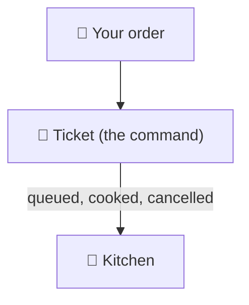
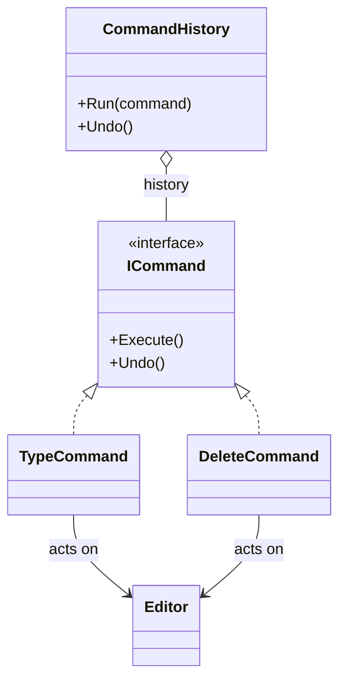

# Command

> [!REMEMBER]
> A request you can hold, queue, undo. The waiter writes your order on a ticket; the kitchen cooks from the ticket.



## The idea

Wrap **what to do and with what** in an object with `Execute()` (and often `Undo()`). The code that triggers it (a
button, a queue) only knows the interface, and because commands are objects they can be **stored**: in a history for
undo, a queue for later, or a log for replay.

**Use it when:**

- You need undo / redo, or a history of what was done.
- Requests must be queued, scheduled, retried or sent elsewhere.

## Structure



- **Command** (`ICommand`) and **concrete commands**: the request plus what's needed to undo it.
- **Receiver** (`Editor`): does the real work.
- **Invoker** (`CommandHistory`, a button): runs commands without knowing what they do.

## See it

```csharp before title="Before: buttons call the editor; one level of undo" snippet="samples/Lld.Samples.Patterns/Behavioral/Command/Before/Toolbar.cs#Toolbar"
```
```csharp after title="After: each action is an object in a history" snippet="samples/Lld.Samples.Patterns/Behavioral/Command/After/Commands.cs#ICommand,DeleteCommand,CommandHistory"
```

**What changed:** any number of steps undo in order, and each command remembers exactly what it changed (the deleted
text). In *Before*, the second undo does nothing.

## Modern C#

```csharp snippet="samples/Lld.Samples.Patterns/Behavioral/Command/Modern/Edits.cs#EditAction,Edits"
```

A command can be a record of two delegates. Use real command classes when they must be serialised, sent to a queue
or logged with their data (MediatR-style request objects are commands too).

## Seen in .NET

- `System.Windows.Input.ICommand` in MAUI / WPF: buttons bind to commands (`Execute`, `CanExecute`).
- Background job libraries (Hangfire) and message queues: the job or message is a stored command.
- `DbCommand`: SQL plus parameters packaged as an object to run later.

## Travels with

- [Memento](../memento/lesson.md): a command can save a snapshot to undo with.
- [Composite](../composite/lesson.md): a macro is a command made of commands.

> [!OVERUSE]
> - A class per button for actions that will never be queued, logged or undone.
> - Commands that reach into everything: they should hold only what they need.
> - Undo that "mostly works" because some commands forgot what they changed.

## Interview questions

### What is the Command pattern?

It turns a request into an object containing the action and its data, so requests can be passed around, queued,
logged and undone, separating who asks from who does the work.

### How do you implement undo?

Each command stores what it needs to reverse itself (the deleted text, the old value) and implements `Undo()`; an
invoker keeps a stack of executed commands and pops them to undo.

### Command vs Strategy?

Both are objects with one main method. A strategy says **how** to do a job the context always does; a command says
**what** to do and **when**, and is often stored.

### Where do commands show up in back-end systems?

Job queues, message handlers, CQRS command objects (`PlaceOrder`), and retryable operations.

### What is a macro command?

A command that holds a list of commands and runs them in order (Composite); undo runs their undos in reverse.

## Go deeper

### Redo

Keep a second stack: undo pops from "done" and pushes onto "undone"; redo does the reverse. Running a new command
clears "undone".

### Commands across processes

To queue a command for another process, it must be **data**: a serialisable record (`ResizeImage { Id, Width }`)
plus a handler on the other side. That's the command / handler split you see in CQRS and message buses.

### In a design interview

- Text editor undo, smart-home remote buttons, an order pipeline where each step is retryable.
- Say what each command stores to undo itself.

### Misconceptions

- "Command means CQRS." CQRS borrows the name for "a request that changes state"; the GoF pattern is broader.

> [!WORK]
> **From my work:** an undo feature, job queue or retry mechanism you built. (Add your story here.)

### Related

- [Strategy](../strategy/lesson.md) · [Observer](../observer/lesson.md) · [Composite](../composite/lesson.md)
