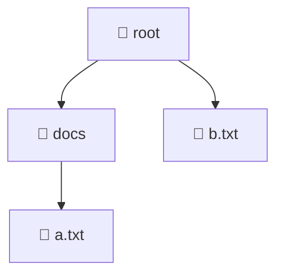
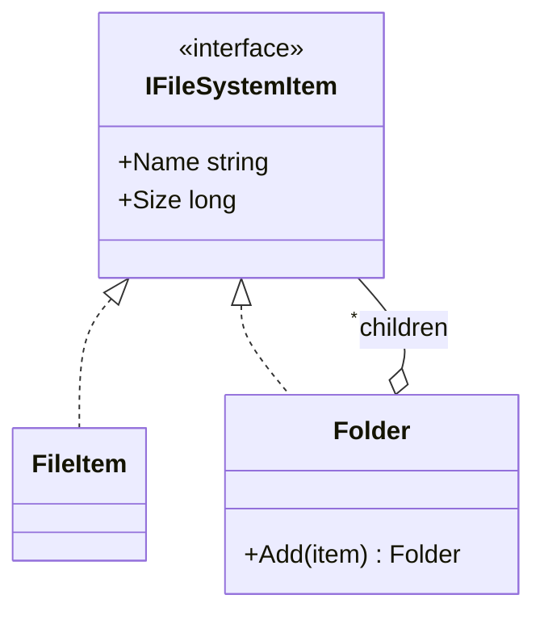

# Composite

> [!REMEMBER]
> One or many, treat them the same. Ask a folder its size: it asks everything inside.



## The idea

Leaves (a file) and groups (a folder) implement **one interface**. A group holds children of that interface and
answers by **asking each child**, so the tree works out sizes, counts or prices by itself, at any depth.

**Use it when:**

- Your data is a **tree** (folders, menus, org charts, UI controls, order bundles).
- Callers keep writing `if (item is Folder) ... else ...` and recursing by hand.

## Structure



- **Component** (`IFileSystemItem`): what every node can do.
- **Leaf** (`FileItem`): no children.
- **Composite** (`Folder`): holds children and combines their answers.

## See it

```csharp before title="Before: every caller checks types and recurses" snippet="samples/Lld.Samples.Patterns/Structural/Composite/Before/Sizes.cs#Sizes"
```
```csharp after title="After: the tree answers for itself" snippet="samples/Lld.Samples.Patterns/Structural/Composite/After/FileSystem.cs#IFileSystemItem,Folder"
```

**What changed:** `root.Size` works at any depth with no type checks. A new kind of node (a shortcut) just implements
the interface; in *Before* it crashes every walk until each `switch` is updated.

## Modern C#

```csharp snippet="samples/Lld.Samples.Patterns/Structural/Composite/Modern/Nodes.cs#Node,FileNode,FolderNode,Nodes"
```

When the kinds of node are fixed, records plus one `switch` can be simpler. Choose by what changes: new
**operations** often → `switch` over records; new **kinds of node** often → composite.

## Seen in .NET

- Roslyn's `SyntaxNode`: every node has `ChildNodes()`, from a whole file down to one token.
- `IConfigurationSection.GetChildren()`: configuration is a tree of sections.
- `System.Linq.Expressions.Expression`: expression trees built from smaller expressions.

## Travels with

- [Builder](../builder/lesson.md): a handy way to assemble the tree.
- [Decorator](../decorator/lesson.md): both wrap; decorators often appear inside composite trees.
- **Visitor** and **Iterator** (Behavioral): add operations to the tree, and walk it.

> [!OVERUSE]
> - Leaves forced to implement `Add` / `Remove` that throw (a broken promise, see
>   [LSP](../../oop-solid/lsp/lesson.md)).
> - A "tree" that is only ever one level deep: a list will do.
> - Deep recursion over huge trees without thinking about stack depth or caching.

## Interview questions

### What is the Composite pattern?

A way to build tree structures where individual objects and groups share one interface, so clients treat a single
item and a whole subtree uniformly.

### Where should `Add` and `Remove` live?

On the composite only (safer: leaves can't be asked to add children), or on the component for full uniformity at the
cost of leaves that throw. Most C# designs keep them on the composite.

### How do you add new operations without editing every node?

Use the Visitor pattern, or with a closed set of node types, a `switch` expression over records.

### Composite vs Decorator?

Both are recursive wrappers. A composite holds **many** children and combines them; a decorator wraps **one**
object and adds behaviour.

### Give real examples.

File systems, UI control trees, menus with submenus, an order made of bundles and products, organisation charts.

## Go deeper

### Caching totals

`Folder.Size` recomputes the whole subtree each time. For large trees, cache the total and invalidate it when a
child changes (parents can be notified, an Observer idea).

### Parent references

Some trees need to walk up (breadcrumbs, "move to parent"). Store a `Parent` on each node and keep it in sync inside
`Add` and `Remove`.

### In a design interview

- Restaurant menu with sections and dishes, e-commerce bundles, permission groups that contain users and groups.
- Say how you avoid cycles (a folder inside itself).

### Misconceptions

- "Composite means inheritance from a base node." An interface is enough; the key is that groups hold components.

> [!WORK]
> **From my work:** a tree you modelled (menus, permissions, documents). (Add your story here.)

### Related

- [Decorator](../decorator/lesson.md) · [Builder](../builder/lesson.md) · [Flyweight](../flyweight/lesson.md) ·
  [Liskov Substitution (LSP)](../../oop-solid/lsp/lesson.md)
