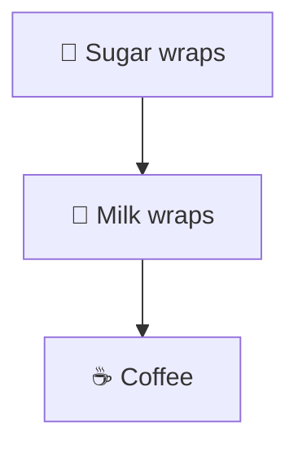
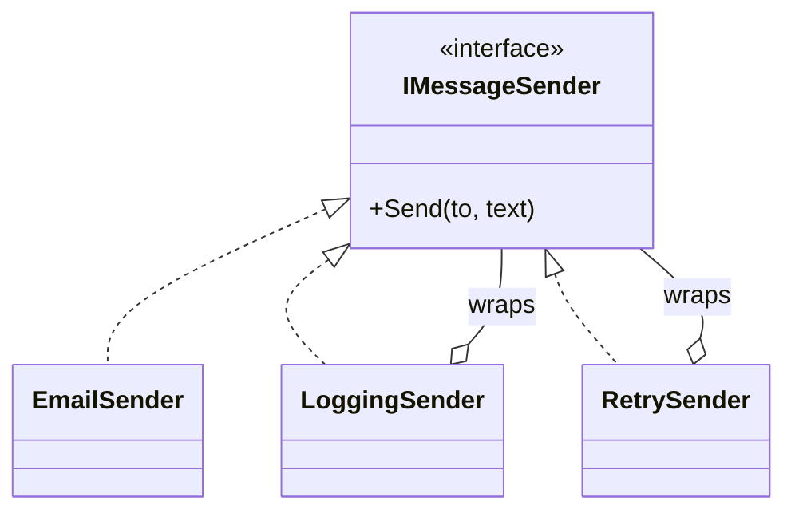

# Decorator

> [!REMEMBER]
> Wrap it to add, layer by layer. Coffee + milk + sugar: still a coffee, every time.



## The idea

A decorator **implements the same interface** as the object it wraps, **adds** something (logging, retry, caching),
then calls the wrapped object. Because it looks the same from outside, you can stack decorators in any order.

**Use it when:**

- You need combinations of extras and subclasses multiply (`LoggingRetryingSender`...).
- You want to add behaviour to an object at runtime, without touching its class.

## Structure



- **Component** (`IMessageSender`) and **concrete component** (`EmailSender`): the real work.
- **Decorators** (`LoggingSender`, `RetrySender`): same interface, hold the next one, add their part.

## See it

```csharp before title="Before: a subclass per combination" snippet="samples/Lld.Samples.Patterns/Structural/Decorator/Before/Senders.cs#LoggingEmailSender,RetryingLoggingEmailSender"
```
```csharp after title="After: wrappers you can stack" snippet="samples/Lld.Samples.Patterns/Structural/Decorator/After/Senders.cs#LoggingSender,RetrySender,Senders"
```

**What changed:** each extra is one class, and combinations are built, not inherited. Retry without logging, or
logging outside retry, needs no new class. The tests stack both around a sender that fails twice.

## Modern C#

```csharp snippet="samples/Lld.Samples.Patterns/Structural/Decorator/Modern/RetryHandler.cs#RetryHandler"
```

.NET has decorators built in for HTTP: a `DelegatingHandler` wraps the next handler, and `IHttpClientFactory` stacks
them. For your own services, the Scrutor library's `Decorate<T, TDecorator>()` wraps a DI registration.

## Seen in .NET

- `BufferedStream`, `GZipStream`, `CryptoStream`: each wraps another `Stream` and adds one thing.
- `DelegatingHandler` chains for `HttpClient`.
- ASP.NET Core middleware: each piece wraps the rest of the pipeline.

## Travels with

- [Composite](../composite/lesson.md): both wrap; decorators are often used inside composite trees.
- [Strategy](../strategy/lesson.md): a decorator changes the outside of an object, a strategy its inside.
- **Chain of Responsibility** (Behavioral): a chain of decorators that may stop early is a chain.

> [!OVERUSE]
> - The order of wrappers matters and nobody wrote it down (retry inside or outside the cache?).
> - Stack traces six wrappers deep for a one-line call.
> - A decorator that changes **what** the call means, not just what happens around it.

## In this app

```csharp snippet="src/Lld.App/Hosting/HttpHandlers.cs#TunnelHeadersHandler"
```

The app's `HttpClient` is wrapped by this handler (it adds the tunnel header) and by `ServerReachabilityHandler`
(it reports failures). Each does one job and passes the request on.

## Interview questions

### What is the Decorator pattern?

An object that wraps another object with the same interface and adds behaviour before or after delegating to it.
Decorators can be stacked to combine behaviours at runtime.

### Why not just subclass?

Subclassing fixes combinations at compile time and multiplies classes (n extras → up to 2ⁿ combinations).
Decorators are combined by composition, one class per extra.

### Decorator vs Proxy?

Same shape, different purpose: a decorator **adds** behaviour; a proxy **controls access** to the real object
(lazy, cached, remote, checked) and usually manages its lifetime.

### Decorator vs Adapter?

A decorator keeps the interface; an adapter changes it.

### Where does .NET use decorators?

`Stream` wrappers like `GZipStream` and `BufferedStream`, `DelegatingHandler` for `HttpClient`, and middleware in
ASP.NET Core.

## Go deeper

### Order matters

`new Logging(new Retry(sender))` logs once per send; `new Retry(new Logging(sender))` logs every attempt. Name the
stack in one place (a factory or the DI setup) so the order is a decision, not an accident.

### Decorating with DI

The built-in container has no `Decorate`; options are Scrutor (`services.Decorate<IMessageSender, RetrySender>()`)
or registering a factory lambda that builds the stack by hand.

### Transparent vs opaque

Callers should not need to know they hold a decorator. If code does `if (sender is RetrySender)`, the abstraction has
leaked.

### In a design interview

- Coffee shop pricing (the classic), notification senders, data sources with caching or encryption.
- Say what each layer adds and why order matters.

### Misconceptions

- "Python/TypeScript decorators are the same thing." Language decorators annotate functions; the GoF pattern wraps
  objects at runtime. Related idea, different mechanism.

> [!WORK]
> **From my work:** a retry, logging or caching layer you added without touching the original class. (Add your story here.)

### Related

- [Proxy](../proxy/lesson.md) · [Adapter](../adapter/lesson.md) · [Composite](../composite/lesson.md) ·
  [Composition over inheritance](../../oop-solid/composition-over-inheritance/lesson.md)
