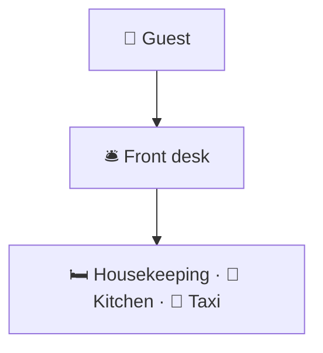
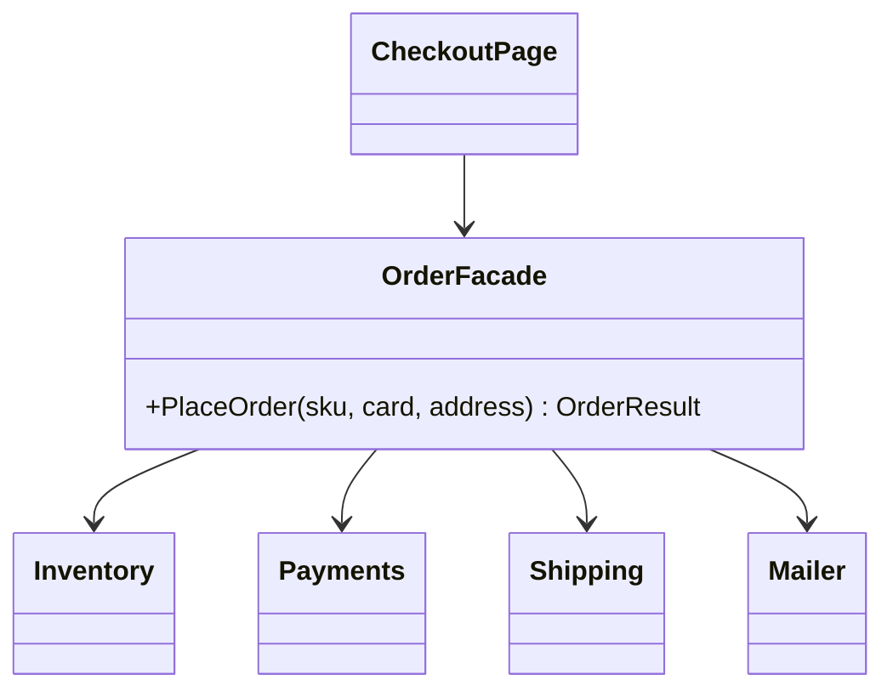

# Facade

> [!REMEMBER]
> One front desk for the whole hotel. Ask the desk; it talks to housekeeping, kitchen and taxi for you.



## The idea

A class with a few **simple methods** that hide a group of classes working together. The facade knows the order of
the steps and how to undo them; clients just call `PlaceOrder`.

**Use it when:**

- Clients repeat the same sequence of calls into several classes.
- You want one stable entry point to a subsystem that keeps changing inside.

## Structure



- **Facade** (`OrderFacade`): the simple entry point.
- **Subsystem classes:** do the work; they don't know the facade exists and stay usable on their own.
- **Clients:** talk to the facade only.

## See it

```csharp before title="Before: the page drives every class" snippet="samples/Lld.Samples.Patterns/Structural/Facade/Before/CheckoutPage.cs#CheckoutPage"
```
```csharp after title="After: one call to the facade" snippet="samples/Lld.Samples.Patterns/Structural/Facade/After/OrderFacade.cs#OrderFacade,CheckoutPage"
```

**What changed:** the steps and the "put the stock back" rule live in one place. The web page, the mobile app and the
admin tool all call `PlaceOrder`, so none of them can forget a step.

## Modern C#

```csharp snippet="samples/Lld.Samples.Patterns/Structural/Facade/Modern/OrderingRegistration.cs#OrderingRegistration"
```

Facades show up at start-up too: one `AddOrdering()` registers the whole subsystem. In web apps the facade is usually
an application service or use case called by a thin endpoint.

## Seen in .NET

- `File.ReadAllText`: one call over streams, encodings and buffers.
- `HttpClient`: hides handlers, connections and pooling behind `GetAsync`.
- `WebApplication.CreateBuilder` and `AddDbContext`, `AddAuthentication`: facades over many registrations.

## Travels with

- [Singleton](../singleton/lesson.md): one facade per subsystem is usually enough.
- [Abstract Factory](../abstract-factory/lesson.md): the facade can create its subsystem objects through one.
- [Adapter](../adapter/lesson.md): adapters for outside systems often sit under the facade.

> [!OVERUSE]
> - A "god facade" with 40 methods for unrelated jobs: split it by client or by use case.
> - Business rules move **into** the facade and the subsystem becomes empty data holders.
> - Clients that need fine control are forced through it: let them use the subsystem directly.

## In this app

```csharp snippet="src/Lld.Application/Auth/Sessions.cs#SessionManager.Start"
```

Sign-in, refresh and password change all call `SessionManager.Start`; it hides the token issuer, the refresh-token
codec and the repository behind one call.

## Interview questions

### What is the Facade pattern?

A class that offers a simple interface to a set of classes, hiding the steps and their order. It reduces what clients
need to know about the subsystem.

### Does a facade stop clients using the subsystem directly?

No. The subsystem classes stay public and usable; the facade is a convenience for the common case.

### Facade vs Adapter?

Adapter makes one existing class match an existing interface. Facade defines a new, simpler interface over many
classes.

### Facade vs Mediator?

A facade is one-way: clients call it, the subsystem doesn't know it. A mediator coordinates objects that talk **to
each other** through it.

### How does it help with coupling?

Clients depend on one class instead of five, so the subsystem can change inside without touching them (see
[Law of Demeter](../../oop-solid/law-of-demeter/lesson.md)).

## Go deeper

### Facades and layers

An application layer is often a set of facades: each use case (`PlaceOrder`, `CancelOrder`) is a small facade over
domain objects and repositories. Small, per-use-case facades avoid the "god facade".

### Facade over a third-party SDK

Big SDKs (cloud storage, payments) expose hundreds of options. A facade with the five calls your app uses keeps the
SDK out of your code and makes upgrades easier.

### In a design interview

- Library system: `LibraryFacade.Checkout(member, book)` over `Catalogue`, `Loans`, `Fines`, `Notifications`.
- Say what stays outside: "the admin screen still uses `Catalogue` directly".

### Misconceptions

- "A facade adds behaviour." It mostly orders existing calls; heavy logic belongs in the subsystem.

> [!WORK]
> **From my work:** a messy integration you hid behind one service. (Add your story here.)

### Related

- [Adapter](../adapter/lesson.md) · [Abstract Factory](../abstract-factory/lesson.md) ·
  [Law of Demeter](../../oop-solid/law-of-demeter/lesson.md)
