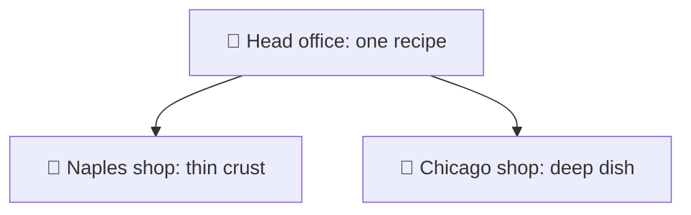
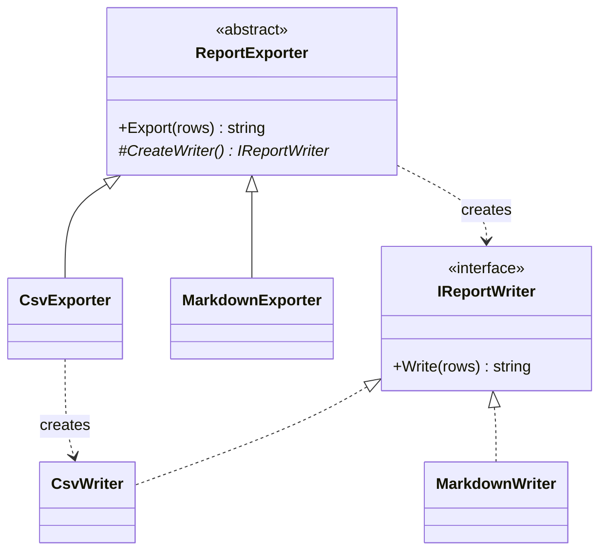

# Factory Method

> [!REMEMBER]
> Same recipe, each shop picks the dough. The base class says *when* to create; the subclass says *what*.



## The idea

The base class runs the steps and calls a method like `CreateWriter()` to get the object it needs. **Subclasses
override that method** to choose the concrete class.

**Use it when:**

- A `switch` on a type string creates objects inside code that should not change.
- The steps around the object stay the same; only **which class** varies.

## Structure



- **Creator** (`ReportExporter`): the fixed steps, plus the factory method.
- **Concrete creators** (`CsvExporter`): override the factory method.
- **Product** (`IReportWriter`) and **concrete products** (`CsvWriter`).

## See it

```csharp before title="Before: the exporter picks the class" snippet="samples/Lld.Samples.Patterns/Creational/FactoryMethod/Before/ReportExporter.cs#ReportExporter"
```
```csharp after title="After: a subclass picks the class" snippet="samples/Lld.Samples.Patterns/Creational/FactoryMethod/After/ReportExporter.cs#ReportExporter,CsvExporter,MarkdownExporter"
```

**What changed:** a new format is a new subclass; `Export` is never opened again (that's
[OCP](../../oop-solid/ocp/lesson.md)). The tests add an upper-case exporter without touching the others.

## Modern C#

```csharp snippet="samples/Lld.Samples.Patterns/Creational/FactoryMethod/Modern/ReportExporter.cs#ReportExporter"
```

A `Func<IReportWriter>` does the same job with no subclass. Use the classic form when the creator has other steps
subclasses also customise.

## Seen in .NET

- `DbProviderFactory.CreateConnection()`: each database provider overrides it.
- `IHttpClientFactory.CreateClient(name)` and `ILoggerFactory.CreateLogger(category)`.
- `Encoding.GetEncoding(name)` and many static `Create(...)` methods (a simpler "factory" idea).

## Travels with

- [Abstract Factory](../abstract-factory/lesson.md): each of its methods is often a factory method.
- [Template Method](../template-method/lesson.md): the factory method is one step of a template method.

> [!OVERUSE]
> - A creator subclass exists **only** to create one class: a delegate or `new` would do.
> - Parallel hierarchies explode: every new product needs a new creator too.
> - "Factory" classes that just call `new` with no choice to make.

## In this app

```csharp snippet="src/Lld.Infrastructure/Persistence/DesignTimeDbContextFactory.cs#DesignTimeDbContextFactory"
```

EF Core's tools call `CreateDbContext` when they need a context at design time; this class decides which one to make.

## Interview questions

### What is the Factory Method pattern?

A method in a base class that creates an object; subclasses override it to choose the concrete class. The rest of
the base class works with the product's interface only.

### Factory Method vs a simple factory?

A simple factory is one method with a `switch` that returns different classes. Factory Method uses inheritance: each
subclass overrides the creation step, so adding a type never edits existing code.

### How does it relate to the Open/Closed Principle?

New products arrive as new subclasses; the creator's code stays closed. That is OCP applied to object creation.

### How would you do it in modern C#?

Pass a `Func<T>` or a factory interface into the constructor, or register the choice in DI. Inheritance is no longer
needed just to pick a class.

### Where does .NET use it?

`DbProviderFactory.CreateConnection`, `IHttpClientFactory.CreateClient` and `ILoggerFactory.CreateLogger` all hand
back an abstract product and hide the concrete class.

## Go deeper

### Why it is called a "virtual constructor"

C# constructors can't be virtual: `new CsvWriter()` always makes a `CsvWriter`. A factory method is an ordinary virtual
method that returns a new object, so it can be overridden. That's the whole trick.

### Variations

- **Default product:** the factory method is `virtual`, not `abstract`, and returns a sensible default.
- **Parameterised:** `Create(string kind)`; this slides back towards a simple factory with a `switch`.
- **Static `Create` methods:** `TimeSpan.FromSeconds`, `Uri.TryCreate`: named constructors, not the GoF pattern, but the
  same goal of hiding `new`.

### In a design interview

- In a parking lot: `ParkingLot.CreateTicket()` overridden by `MallParkingLot` and `AirportParkingLot`.
- Say why: "the flow is the same; only the ticket type differs".

### Misconceptions

- "Any method that returns an object is a factory method." The GoF pattern is about **subclasses choosing**.
- "Factories everywhere." Only where the choice really varies.

> [!WORK]
> **From my work:** a `switch` on type you replaced with a factory. (Add your story here.)

### Related

- [Abstract Factory](../abstract-factory/lesson.md) · [Builder](../builder/lesson.md) ·
  [Open/Closed (OCP)](../../oop-solid/ocp/lesson.md)
