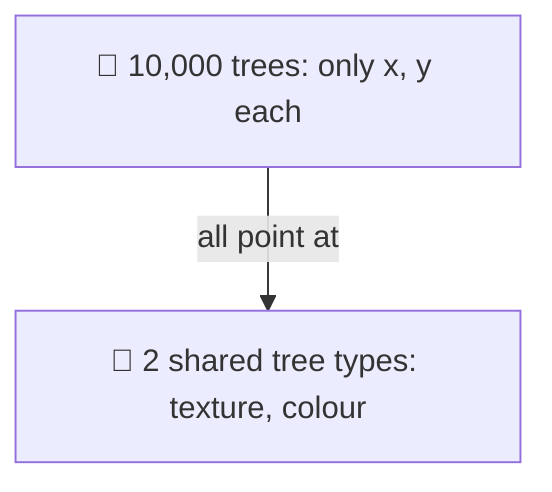
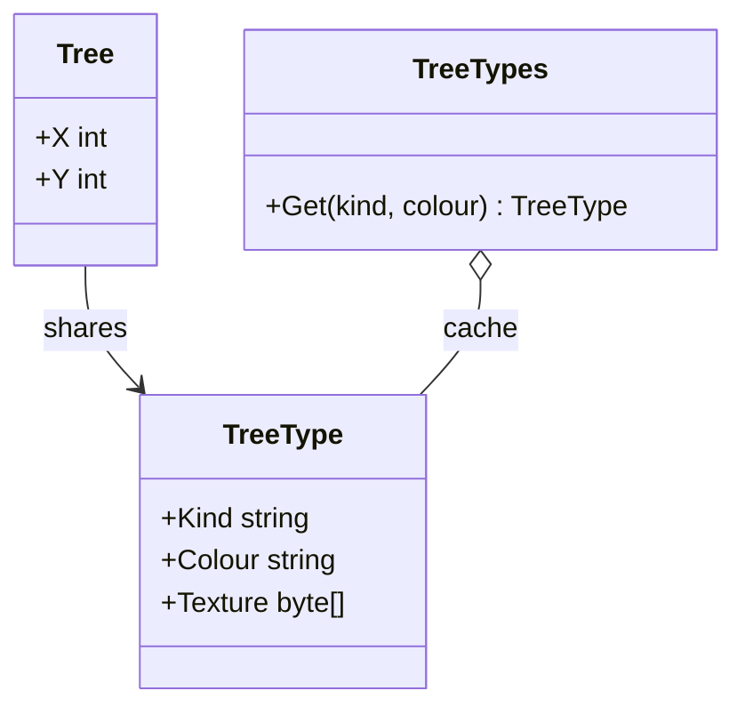

# Flyweight

> [!REMEMBER]
> Share the heavy part. A forest needs two tree designs, not ten thousand.



## The idea

Split an object's data in two. The **intrinsic** part (texture, colour, glyph shape) is the same for many objects,
so it lives in **one shared, immutable object**. The **extrinsic** part (position) stays in each object. A small
factory hands out the shared parts.

**Use it when:**

- You have **huge numbers** of similar objects and memory is a real problem (measured, not guessed).
- Most of each object's data repeats and never changes.

## Structure



- **Flyweight** (`TreeType`): shared, immutable, intrinsic state.
- **Flyweight factory** (`TreeTypes`): creates each one once, then reuses it.
- **Context** (`Tree`): extrinsic state plus a reference to its flyweight.

## See it

```csharp before title="Before: every tree carries its own texture" snippet="samples/Lld.Samples.Patterns/Structural/Flyweight/Before/Forest.cs#Tree"
```
```csharp after title="After: trees share a type" snippet="samples/Lld.Samples.Patterns/Structural/Flyweight/After/Forest.cs#TreeTypes,Tree"
```

**What changed:** 1,000 trees held 1,000 textures (4 MB); now they hold 2. The tests check that both forests have
the same trees in the same places.

## Modern C#

```csharp snippet="samples/Lld.Samples.Patterns/Structural/Flyweight/Modern/TreeKinds.cs#TreeKinds"
```

When every shared part is known up front, build them once into a `FrozenDictionary`. Use structs for the small
per-object part to save more.

## Seen in .NET

- `string.Intern`: one shared instance per distinct string.
- `ArrayPool<T>.Shared`: buffers reused instead of allocated.
- Boxed `bool`, small cached `Task` results (`Task.CompletedTask`): the runtime shares common instances.

## Travels with

- [Composite](../composite/lesson.md): the leaves of a big tree are often flyweights.
- [Factory Method](../factory-method/lesson.md): the flyweight factory decides "new or shared".

> [!OVERUSE]
> - Applied without measuring: the memory saved is tiny and the code harder to read.
> - Shared objects that are **mutable**: one change shows up in every user.
> - Extrinsic state passed around through long parameter lists.

## Interview questions

### What is the Flyweight pattern?

Sharing the common, unchanging part of many fine-grained objects in a few shared instances, while each object keeps
only its unique data, to save memory.

### What are intrinsic and extrinsic state?

Intrinsic state is shared and independent of context (a glyph's shape). Extrinsic state depends on context and is
stored or passed separately (where the glyph is drawn).

### Why must flyweights be immutable?

Many objects share each one; if it changed, every user would see the change.

### How does .NET use the idea?

String interning, `ArrayPool<T>`, cached boxed values and completed tasks.

### When is it not worth it?

When there are few objects, or the shared part is small. Measure memory first.

## Go deeper

### Text editors, the classic

A document with a million characters doesn't store a million font objects. Each character stores its position; the
glyph (shape, font, size) is a shared flyweight.

### Thread safety

The factory may be called from many threads: use `ConcurrentDictionary.GetOrAdd`, a lock, or a frozen, pre-built set.
The flyweights themselves are safe because they are immutable.

### In a design interview

- Game particles or map tiles, a chess engine's piece types, seat maps in a booking system.
- Give rough numbers: "10,000 objects × 4 KB = 40 MB; shared, under 10 KB".

### Misconceptions

- "Flyweight = caching." A cache saves time on repeated work; a flyweight saves memory by sharing state.

> [!WORK]
> **From my work:** a memory problem you solved by sharing objects. (Add your story here.)

### Related

- [Composite](../composite/lesson.md) · [Singleton](../singleton/lesson.md) · [Prototype](../prototype/lesson.md) ·
  [Value objects & immutability](../../oop-solid/value-objects-immutability/lesson.md)
