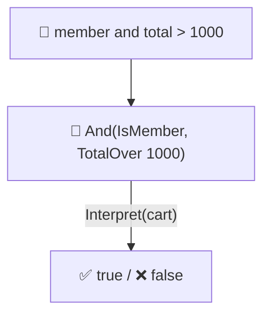
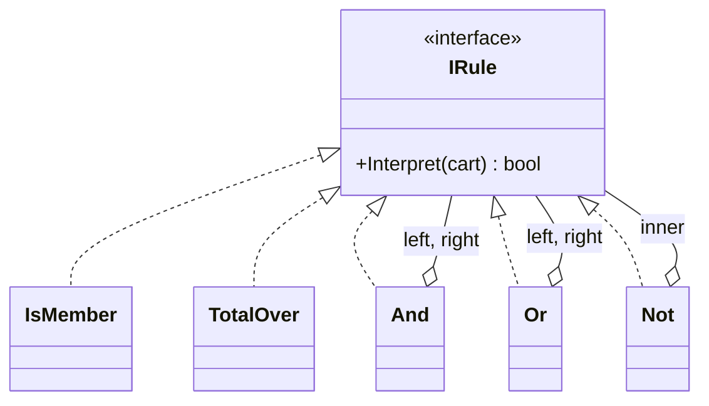

# Interpreter

> [!REMEMBER]
> Each word knows what it means. Sheet music: every note and rest knows how to be played; the song is the tree.



## The idea

For a **small language** (discount rules, search filters, formulas), make one class per grammar rule. Words (`member`,
`total>1000`) are **terminal** expressions; combinations (`and`, `or`, `not`) are **non-terminal** expressions that
hold others. A sentence becomes a **tree**; calling `Interpret(context)` on the root evaluates it.

**Use it when:**

- Business users write simple rules or filters, and the code picks strings apart with `if`s.
- The language is small and stable; performance isn't critical.

## Structure



- **Abstract expression** (`IRule`): `Interpret(context)`.
- **Terminal expressions** (`IsMember`, `TotalOver`): leaves.
- **Non-terminal expressions** (`And`, `Or`, `Not`): combine other expressions (a [Composite](../composite/lesson.md)).
- **Context** (`Cart`): what the sentence is evaluated against.

## See it

```csharp before title="Before: rules picked apart with ifs" snippet="samples/Lld.Samples.Patterns/Behavioral/Interpreter/Before/Discounts.cs#Discounts"
```
```csharp after title="After: one class per grammar rule" snippet="samples/Lld.Samples.Patterns/Behavioral/Interpreter/After/Rules.cs#IRule,TotalOver,And,Not"
```

**What changed:** `or` and `not` are two small classes, and every rule can be tested alone. In *Before*,
`"member or total>1000"` is quietly treated as "always true"; the tests catch it. A tiny parser
(`RuleParser`) turns text into the tree.

## Modern C#

```csharp snippet="samples/Lld.Samples.Patterns/Behavioral/Interpreter/Modern/RuleExpressions.cs#RuleExpressions"
```

.NET ships an interpreter: build the rule as a `System.Linq.Expressions` tree, then `Compile()` it into a fast
delegate, or give the same tree to EF Core, which translates it to SQL.

## Seen in .NET

- `System.Linq.Expressions`: LINQ queries become expression trees that providers interpret (EF Core → SQL).
- `Regex`: parses a pattern into a tree and runs it (interpreted, or compiled with `RegexOptions.Compiled`).
- MAUI data binding paths (`"Address.City"`): a tiny language read at runtime.

## Travels with

- [Composite](../composite/lesson.md): the syntax tree is a composite.
- [Visitor](../visitor/lesson.md): print, optimise or check the tree without adding methods to every node.
- [Flyweight](../flyweight/lesson.md): identical terminal expressions can be shared.

> [!OVERUSE]
> - A real language with precedence, errors and tooling: use a parser generator (ANTLR) or an existing engine.
> - Rules that change every week and would be better as data (a table) than as a language.
> - Hot paths: walking a tree per call is slow; compile it (expression trees) instead.

## Interview questions

### What is the Interpreter pattern?

It defines a class for each rule of a small grammar, represents sentences as trees of those classes, and evaluates a
sentence by calling `Interpret` on the root with a context.

### Terminal vs non-terminal expressions?

Terminal expressions are leaves (a variable, a number, `member`); non-terminal expressions combine others (`and`,
`or`, `not`).

### Who builds the tree?

A parser, which is not part of the pattern. Interpreter is about representing and evaluating; parsing text is a
separate job.

### When is it a bad fit?

Large or complex grammars, and code where speed matters: use a parser generator, a rules engine, or compiled
expression trees.

### How does .NET use the idea?

LINQ expression trees: a query is a tree of `Expression` nodes that EF Core translates to SQL or that you `Compile()`
into a delegate.

## Go deeper

### Interpreter and Specification

Business rules like "active customers in India with orders over ₹10,000" are often written as specifications: small
rule objects combined with `And` / `Or`. That's an interpreter for a business vocabulary (see the Enterprise module).

### Making it fast

Interpret the tree once to **build** a delegate (or an `Expression`), then call the delegate many times. Walking the
tree per call is fine for a few rules, slow for millions.

### In a design interview

- Discount or eligibility rules, search filters (`price<500 and brand:acme`), a calculator.
- Say how rules are stored (text, JSON) and how errors are reported.

### Misconceptions

- "Interpreter means writing a compiler." It's usually a few small classes for a tiny, stable language.

> [!WORK]
> **From my work:** a rules or filter language you built (or replaced). (Add your story here.)

### Related

- [Composite](../composite/lesson.md) · [Visitor](../visitor/lesson.md) · [Strategy](../strategy/lesson.md)
