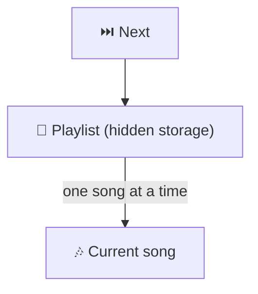
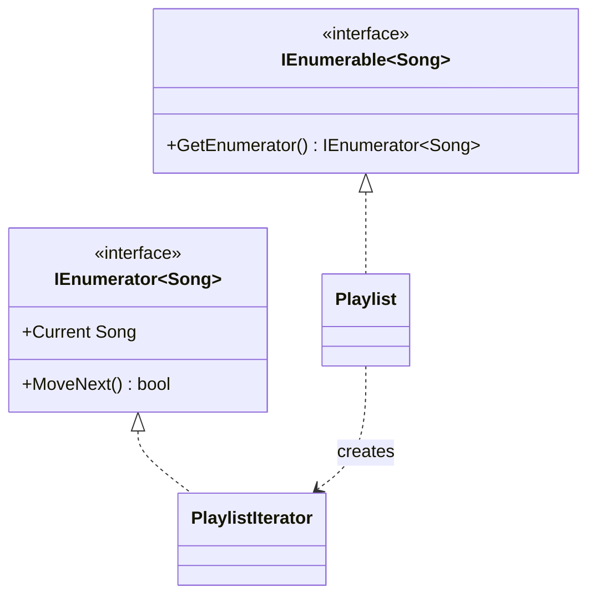

# Iterator

> [!REMEMBER]
> Next, next, next: no peeking inside. The Next button plays your playlist; it never shows you the hard drive.



## The idea

The collection hands out a separate **iterator** object that knows where you are and how to get the **next** item.
Callers loop with `foreach` and never see the collection's insides, so the storage can change, and there can be
several ways to walk the same items.

**Use it when:**

- A class exposes its inner `List` just so callers can loop over it.
- You need different traversals (unplayed only, backwards, page by page) without copying data.

## Structure



- **Aggregate** (`Playlist`, an `IEnumerable<T>`): creates iterators.
- **Iterator** (`PlaylistIterator`, an `IEnumerator<T>`): `Current` and `MoveNext()`.
- **Client:** `foreach` (or LINQ) drives the iterator.

## See it

```csharp before title="Before: the inner list is handed out" snippet="samples/Lld.Samples.Patterns/Behavioral/Iterator/Before/Playlist.cs#Playlist,Player"
```
```csharp after title="After: an iterator, written by hand" snippet="samples/Lld.Samples.Patterns/Behavioral/Iterator/After/Playlist.cs#Playlist,PlaylistIterator"
```

**What changed:** the songs are private; callers get `foreach` and LINQ, and can't clear the list (the test in
*Before* does). This is the classic form; nobody writes it by hand in C# today.

## Modern C#

```csharp snippet="samples/Lld.Samples.Patterns/Behavioral/Iterator/Modern/Playlist.cs#Playlist"
```

`yield return` makes the compiler generate the iterator class (a state machine). Each method is another way to walk
the same items, and nothing runs until the caller asks for the next one. `IAsyncEnumerable<T>` with `await foreach`
does the same for data that arrives over time.

## Seen in .NET

- `IEnumerable<T>` / `IEnumerator<T>` and `foreach`: the whole of LINQ is built on them.
- `yield return` and `IAsyncEnumerable<T>` (`await foreach`) for streams and paged APIs.
- EF Core queries are enumerated lazily; `Directory.EnumerateFiles` walks the disk one file at a time.

## Travels with

- [Composite](../composite/lesson.md): iterators walk composite trees.
- [Factory Method](../factory-method/lesson.md): `GetEnumerator()` is a factory method for iterators.

> [!OVERUSE]
> - Enumerating the same lazy query twice: two database round trips (the "multiple enumeration" warning).
> - Returning `IEnumerable<T>` from a method that has already built a list: say `IReadOnlyList<T>`.
> - Changing a collection while iterating over it (`InvalidOperationException`).

## In this app

```csharp snippet="src/Lld.Content.Authoring/Validation/Rules/ConceptRules.cs#InterviewQuestionsRule.Problems"
```

Each validation rule yields its problems one at a time with `yield return`; the validator chains every rule's
iterator with `SelectMany` and builds one sorted list at the end.

## Interview questions

### What is the Iterator pattern?

It provides a way to access the items of a collection one by one without exposing how the collection is stored.

### How does C# support it?

`IEnumerable<T>` / `IEnumerator<T>` define it, `foreach` uses it, and `yield return` lets the compiler write the
iterator for you.

### What is deferred execution?

A `yield` method or LINQ query does nothing until it is enumerated, and runs again each time it is enumerated.

### Why can multiple enumeration be a problem?

Each enumeration re-runs the work: a second database query, a second file read. Materialise once with `ToList()`
when you need the items more than once.

### `IEnumerable<T>` vs `IQueryable<T>`?

`IEnumerable<T>` runs in memory, item by item. `IQueryable<T>` builds an expression the provider (EF Core)
translates, for example to SQL, before running.

## Go deeper

### What the compiler generates

A `yield` method becomes a private class with a `state` field and `MoveNext()` that resumes where it left off. Async
methods use the same trick; see [State](../state/lesson.md).

### External vs internal iteration

External: the caller drives (`foreach`, `MoveNext`). Internal: you pass a function and the collection drives
(`list.ForEach(...)`). C# mostly uses external iteration; LINQ composes it.

### In a design interview

- A paginated API client that yields items across pages, a tree that can be walked depth-first or breadth-first.
- Mention laziness and when to materialise.

### Misconceptions

- "`IEnumerable<T>` is a collection." It's a way to walk items; there may be no collection behind it at all.

> [!WORK]
> **From my work:** a multiple-enumeration bug or a streaming API you wrote with `yield`. (Add your story here.)

### Related

- [Composite](../composite/lesson.md) · [Encapsulation](../../oop-solid/encapsulation/lesson.md)
