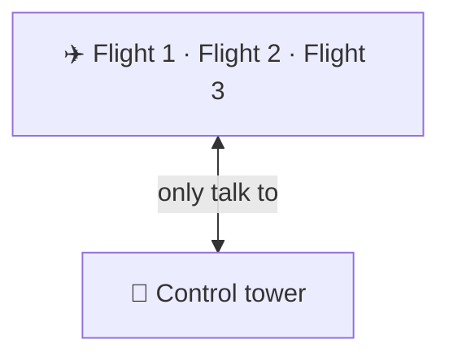
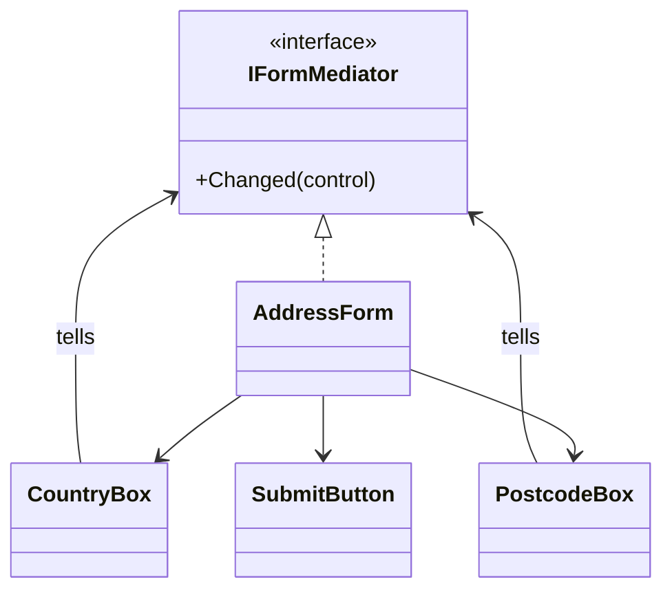

# Mediator

> [!REMEMBER]
> Everyone talks to the tower. Planes never call each other; the tower decides who lands.



## The idea

When many objects depend on each other (a web of calls), put **one mediator** in the middle. Each object (a
*colleague*) only tells the mediator "I changed"; the mediator holds **all the rules** that connect them and updates
the others.

**Use it when:**

- Objects hold references to many others just to keep them in sync (form controls, chat users, devices).
- The rules between objects are spread across all of them and hard to change.

## Structure



- **Mediator** (`IFormMediator`) and **concrete mediator** (`AddressForm`): know the colleagues and the rules.
- **Colleagues** (`CountryBox`, `PostcodeBox`): know only the mediator.

## See it

```csharp before title="Before: controls update each other" snippet="samples/Lld.Samples.Patterns/Behavioral/Mediator/Before/Controls.cs#PostcodeBox,CountryBox"
```
```csharp after title="After: controls tell the form; the form holds the rules" snippet="samples/Lld.Samples.Patterns/Behavioral/Mediator/After/AddressForm.cs#IFormMediator,CountryBox,AddressForm"
```

**What changed:** the postcode rule lives once, in the form. Controls know nothing about each other, so a "same as
billing" box is one new colleague plus one rule in the form.

## Modern C#

```csharp snippet="samples/Lld.Samples.Patterns/Behavioral/Mediator/Modern/Messenger.cs#Messenger"
```

MVVM apps use a messenger (CommunityToolkit's `WeakReferenceMessenger`): view models send messages instead of
holding each other. Note: the MediatR library is a request dispatcher (one handler per request), not the GoF
mediator.

## Seen in .NET

- `WeakReferenceMessenger` / `StrongReferenceMessenger` in CommunityToolkit.Mvvm (used with MAUI).
- A `Form` or page code-behind coordinating its controls is a mediator in WinForms and MAUI.
- Message brokers (Azure Service Bus, RabbitMQ) mediate between services.

## Travels with

- [Observer](../observer/lesson.md): colleagues often notify the mediator through events.
- [Facade](../facade/lesson.md): looks similar, but a facade is one-way.

> [!OVERUSE]
> - The mediator becomes a god object that knows everything about everyone.
> - Two objects that simply call each other once get a mediator anyway.
> - Hidden flows: you can't tell from a control what happens when it changes.

## Interview questions

### What is the Mediator pattern?

An object that encapsulates how a set of objects interact. Colleagues talk to the mediator instead of to each other,
which turns a many-to-many web into many-to-one.

### Mediator vs Observer?

Observer broadcasts one subject's changes to any listeners. A mediator coordinates two-way interactions between
specific colleagues and holds the rules between them; it often uses observer-style notifications inside.

### Mediator vs Facade?

A facade simplifies a subsystem for outside clients, one-way; the subsystem doesn't know it. A mediator sits among
colleagues that know it and talk through it.

### Is MediatR an implementation of Mediator?

Loosely: it decouples senders from handlers, but it dispatches each request to one handler rather than coordinating a
group of colleagues. In interviews, say it's an in-process request dispatcher.

### What is the main risk?

The mediator grows into a god object; split it per screen, per use case or per conversation.

## Go deeper

### Many-to-many to many-to-one

With n objects all talking to each other there are up to n × (n − 1) connections; with a mediator there are n. That
is the whole argument, and also the cost: one place now knows a lot.

### Chat rooms

A chat room is the classic mediator example: users send to the room, the room decides who receives (everyone,
direct messages, muted users).

### In a design interview

- Air traffic control, chat rooms, auction houses (bidders talk to the auctioneer), a booking form.
- Say what the mediator owns: the rules, not the colleagues' own behaviour.

### Misconceptions

- "Mediator = message bus." A bus is a general mediator for messages; the pattern is about owning interaction rules.

> [!WORK]
> **From my work:** a screen or service that coordinated others. (Add your story here.)

### Related

- [Observer](../observer/lesson.md) · [Facade](../facade/lesson.md) ·
  [Coupling & cohesion](../../oop-solid/coupling-cohesion/lesson.md)
