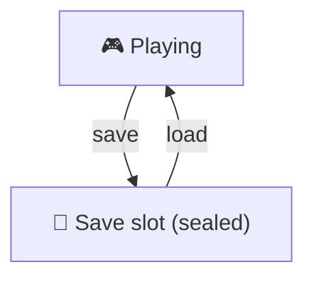
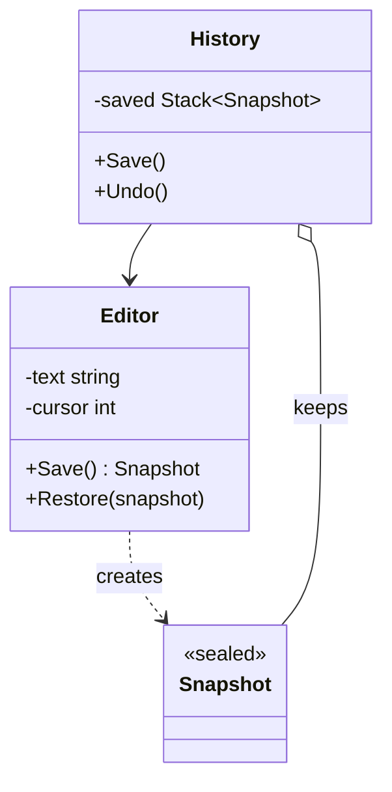

# Memento

> [!REMEMBER]
> Save the game, not the code. A save point brings everything back; you never see what's inside the file.



## The idea

The object (the *originator*) creates a **snapshot** of its own state and can **restore** from it. Someone else (the
*caretaker*) keeps the snapshots but **can't look inside**, so the object's fields stay private.

**Use it when:**

- You need undo, checkpoints or "cancel changes", and the object has private state.
- Code outside the class reads and writes its fields just to save and restore them.

## Structure



- **Originator** (`Editor`): makes and reads snapshots of itself.
- **Memento** (`Snapshot`): the saved state, opaque to everyone else.
- **Caretaker** (`History`): stores snapshots, never opens them.

## See it

```csharp before title="Before: the history reaches into the editor" snippet="samples/Lld.Samples.Patterns/Behavioral/Memento/Before/Editor.cs#Editor,History"
```
```csharp after title="After: the editor makes a sealed snapshot" snippet="samples/Lld.Samples.Patterns/Behavioral/Memento/After/Editor.cs#Editor.Save,Editor.Restore,Editor.Snapshot,History"
```

**What changed:** the editor's fields are private again, and a new field (a selection) is saved by changing only the
editor. The tests check that a snapshot exposes nothing.

## Modern C#

```csharp snippet="samples/Lld.Samples.Patterns/Behavioral/Memento/Modern/EditorState.cs#EditorState,Editor"
```

Make the state an immutable `record`: every change returns a new state, so the previous one already is a snapshot.
This is how Redux-style and MVU apps get undo for free.

## Seen in .NET

- Immutable collections (`ImmutableList<T>`): every old version stays valid, a natural snapshot.
- `DbContext` change tracking keeps original values so changes can be detected or reset.
- Serialisation (`System.Text.Json`) is often used to save and reload state across runs.

## Travels with

- [Command](../command/lesson.md): a command can keep a memento to undo itself.
- [Iterator](../iterator/lesson.md): an iterator can save its position as a memento.
- [Prototype](../prototype/lesson.md): a snapshot is often a clone.

> [!OVERUSE]
> - Snapshots of huge objects on every keystroke: store differences or cap the history.
> - Mementos that expose everything (public fields): that's the problem it was meant to fix.
> - Snapshots holding references to mutable objects that change later.

## Interview questions

### What is the Memento pattern?

It captures an object's internal state in a snapshot object so the object can be restored later, without breaking
encapsulation: only the originator can read the snapshot.

### What are originator, memento and caretaker?

The originator creates and restores snapshots of itself; the memento holds the state; the caretaker stores mementos
(for undo) without inspecting them.

### Memento vs Command for undo?

Command undoes by doing the reverse action; Memento undoes by restoring a saved state. Commands are cheaper when
reverse actions are easy; mementos are simpler when they aren't.

### How do you keep a memento opaque in C#?

Make its members `internal` or private with the originator as a nested type, so only the originator's code can read it.

### What about memory?

Snapshots of large state add up: limit the history, store only differences, or share immutable parts.

## Go deeper

### Immutable state makes it trivial

If the whole state is an immutable record, "save" is keeping a reference. Undo/redo becomes two stacks of states.

### Persisting snapshots

Saving a memento to disk turns it into a save file; then version it, because the originator's fields will change
over time.

### In a design interview

- Text editor undo, game checkpoints, a form wizard's "back", a drawing app's history.
- Mention memory limits and what exactly a snapshot contains.

### Misconceptions

- "Memento is just a copy." The point is who may read it: only the originator.

> [!WORK]
> **From my work:** an undo, draft or checkpoint feature you built. (Add your story here.)

### Related

- [Command](../command/lesson.md) · [Prototype](../prototype/lesson.md) ·
  [Encapsulation](../../oop-solid/encapsulation/lesson.md)
