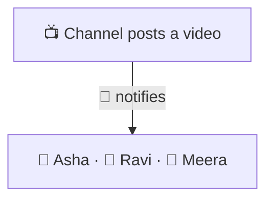
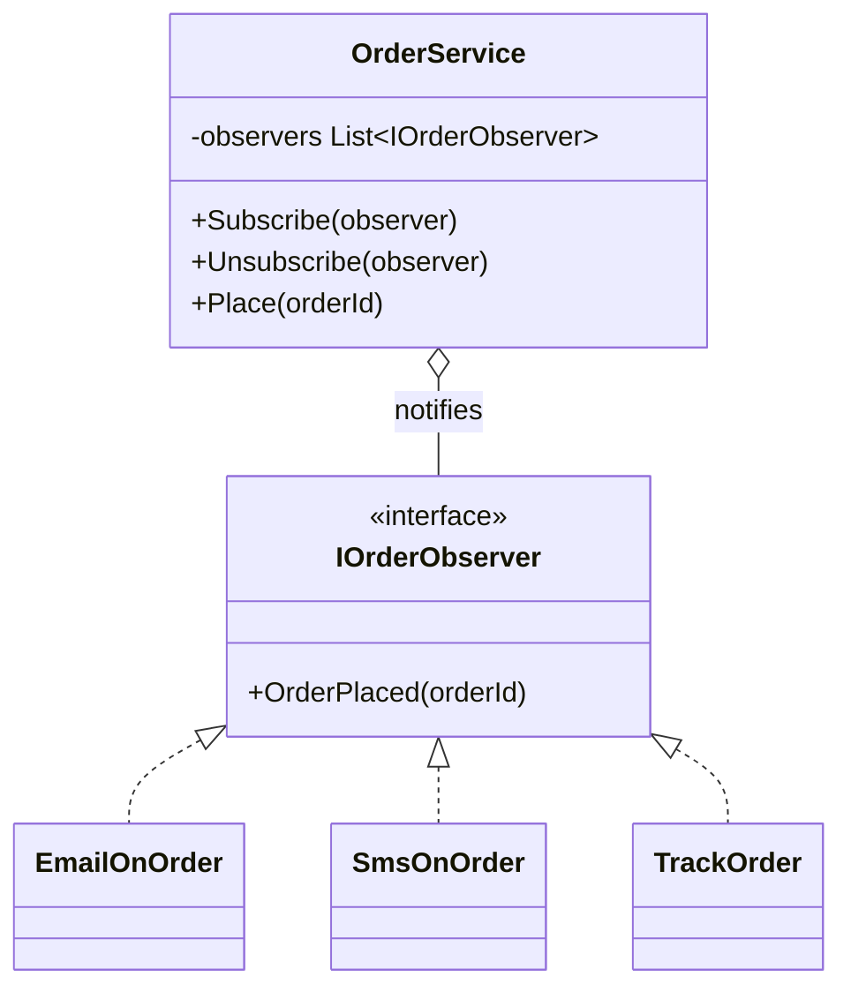

# Observer

> [!REMEMBER]
> Subscribe once, hear every change. The channel doesn't know its subscribers; it just rings the bell.



## The idea

The object where things happen (the **subject**) keeps a list of **observers** behind a small interface. When
something happens it tells each of them. Observers subscribe and unsubscribe themselves; the subject never names them.

**Use it when:**

- One change must trigger work in several other places (email, SMS, analytics, cache refresh).
- New reactions keep being added and you don't want to edit the code where the change happens.

## Structure



- **Subject** (`OrderService`): keeps observers and notifies them.
- **Observer** (`IOrderObserver`) and **concrete observers**: each reacts in its own way.

## See it

```csharp before title="Before: the order calls everyone by name" snippet="samples/Lld.Samples.Patterns/Behavioral/Observer/Before/OrderService.cs#OrderService"
```
```csharp after title="After: the order rings a bell; listeners subscribe" snippet="samples/Lld.Samples.Patterns/Behavioral/Observer/After/OrderService.cs#IOrderObserver,OrderService,EmailOnOrder"
```

**What changed:** loyalty points are a new observer that subscribes; the order code isn't touched. The tests add
and remove one without changing `OrderService`.

## Modern C#

```csharp snippet="samples/Lld.Samples.Patterns/Behavioral/Observer/Modern/OrderService.cs#OrderService"
```

C# has Observer built in: an `event` is the observer list, `+=` and `-=` subscribe and unsubscribe. For streams of
events use `IObservable<T>` (Reactive Extensions) or `System.Threading.Channels`; across services, a message broker.

## Seen in .NET

- `event EventHandler<T>` everywhere: button clicks, `FileSystemWatcher.Changed`.
- `INotifyPropertyChanged`: MAUI and WPF data binding observe your view models.
- `IObservable<T>` / `IObserver<T>` in the BCL, and `IChangeToken` for configuration reloads.

## Travels with

- [Singleton](../singleton/lesson.md): an app-wide event hub is often one shared object.
- [Mediator](../mediator/lesson.md): a mediator often uses observers to hear from its colleagues.

> [!OVERUSE]
> - Chains of events triggering events: nobody can tell what happens when an order is placed.
> - Forgotten unsubscribes: the subject keeps observers alive (a memory leak in long-lived apps).
> - Observers that depend on being called in a certain order.

## In this app

```csharp snippet="src/Lld.Application/Common/DomainEvents.cs#DomainEventDispatcher"
```

Use cases raise domain events (`UserCreated`, `LoginFailed`); the dispatcher hands each one to every
`IDomainEventObserver`. `AuditTrail` is one of them: it writes the audit log, and the use cases don't know it exists.

## Interview questions

### What is the Observer pattern?

A one-to-many dependency: when the subject changes, it notifies all registered observers through a common interface,
without knowing their concrete types.

### How do C# events relate to it?

An event is a built-in observer list: `+=` subscribes a handler, `-=` removes it, and raising the event notifies all
handlers.

### What is the "lapsed listener" problem?

The subject holds references to its observers; if an observer forgets to unsubscribe, it can never be garbage
collected. Unsubscribe in `Dispose`, or use weak events.

### Push vs pull?

Push sends the data with the notification (`OrderPlaced(orderId)`). Pull only says "something changed" and observers
ask the subject for what they need.

### Observer vs pub/sub?

In Observer the subject holds its observers directly. In publish/subscribe a broker sits in between, so publishers
and subscribers don't know each other at all (often across processes).

## Go deeper

### Synchronous by default

Plain observers run on the subject's thread, one after another: a slow or failing observer slows or breaks the
subject. Options: catch per observer, hand work to a queue, or publish asynchronously.

### Domain events

Many .NET apps collect domain events during a use case and dispatch them when the transaction commits, so observers
never see changes that were rolled back. This app does exactly that.

### In a design interview

- Stock price alerts, order notifications, cache invalidation, live scores.
- Say how observers subscribe and what happens if one fails.

### Misconceptions

- "Observer means async." It doesn't; async delivery is a separate decision.

> [!WORK]
> **From my work:** a notification or event flow you built (or untangled). (Add your story here.)

### Related

- [Command](../command/lesson.md) · [Strategy](../strategy/lesson.md) ·
  [Coupling & cohesion](../../oop-solid/coupling-cohesion/lesson.md)
