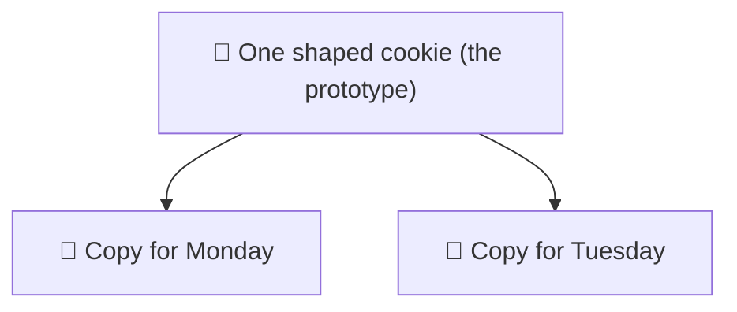
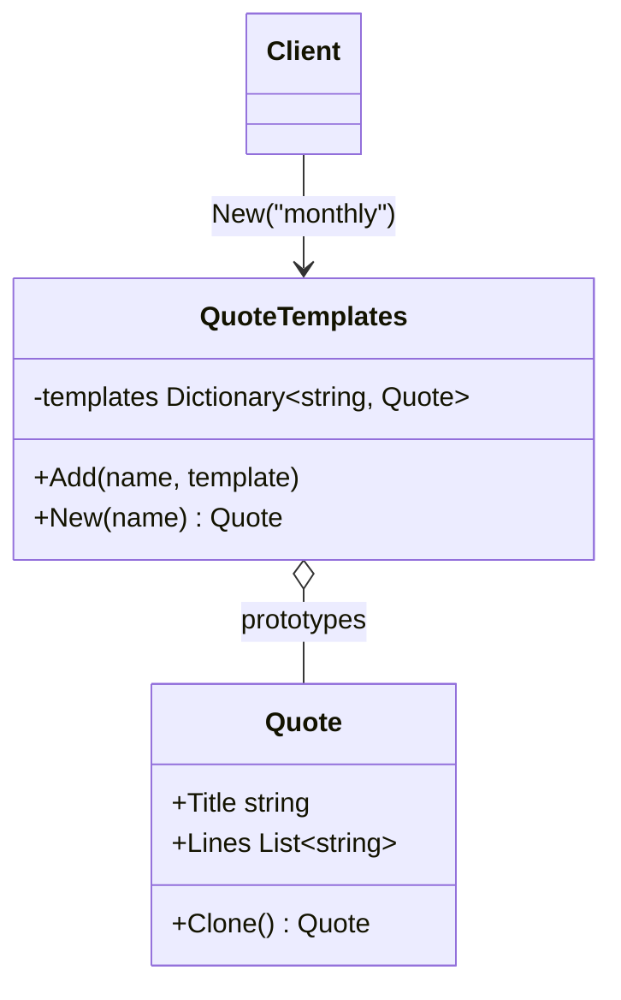

# Prototype

> [!REMEMBER]
> Copy the cookie, don't bake again. The object clones itself, so it knows what must be deep-copied.



## The idea

Keep **configured objects** as templates and create new ones by **cloning** them. The class offers `Clone()`, so
callers never copy fields by hand and never need to know the concrete class.

**Use it when:**

- Setting an object up is long or costly, and new ones differ only a little.
- Callers copy objects field by field, and sometimes forget a list.

## Structure



- **Prototype** (`Quote`): knows how to copy itself (`Clone`).
- **Registry** (optional, `QuoteTemplates`): named, ready-made prototypes.
- **Client:** asks for a copy, then changes only what differs.

## See it

```csharp before title="Before: copied by hand, list shared" snippet="samples/Lld.Samples.Patterns/Creational/Prototype/Before/Quote.cs#Quotes"
```
```csharp after title="After: the object clones itself" snippet="samples/Lld.Samples.Patterns/Creational/Prototype/After/Quote.cs#Quote,QuoteTemplates"
```

**What changed:** in *Before*, adding a line to March's quote also added it to the template (they share one list).
`Clone()` copies the list, so each quote is independent.

## Modern C#

```csharp snippet="samples/Lld.Samples.Patterns/Creational/Prototype/Modern/Quote.cs#Quote,Quotes"
```

A `record` copies itself with `with`. With immutable parts (`ImmutableList<T>`), sharing them is safe, so the shallow
copy `with` makes is enough.

## Seen in .NET

- `with` on records and structs; `object.MemberwiseClone()` (a shallow copy).
- `JsonNode.DeepClone()`, `XElement`'s copy constructor.
- `ICloneable`: exists, but avoid it in public APIs; it never says whether the copy is deep or shallow.

## Travels with

- [Abstract Factory](../abstract-factory/lesson.md): a factory can hand out clones of stored prototypes.
- [Memento](../memento/lesson.md): a snapshot of state is often a clone.
- [Composite](../composite/lesson.md): cloning a tree means cloning each child.

> [!OVERUSE]
> - Objects are cheap to create: just call the constructor.
> - Deep object graphs with cycles: cloning gets subtle; prefer immutable data.
> - `Clone()` returning `object` (`ICloneable`) and casts everywhere.

## In this app

```csharp snippet="src/Lld.Content.Authoring/Packing/ContentPacker.cs#ContentPacker.Pack"
```

The packer builds the pack without a version, then copies it `with { Version = ... }`: the same record, one field
changed, the original untouched.

## Interview questions

### What is the Prototype pattern?

Creating objects by copying an existing, configured instance. The object provides the copy method, so callers don't
depend on its concrete class or its internals.

### Shallow copy vs deep copy?

A shallow copy copies field values, so reference fields still point at the same objects. A deep copy also copies the
objects they point to. Shared mutable lists are the classic bug.

### Why is `ICloneable` discouraged?

It returns `object` and doesn't say whether the copy is deep or shallow, so callers can't rely on it. Write a typed
`Clone()` (or use records) and document the depth.

### How do records help?

`with` creates a copy with some properties changed. If the record's parts are immutable, a shallow copy is safe.

### When would you use a prototype registry?

When users start from named templates ("monthly quote", "default game level") and only tweak a few values.

## Go deeper

### Copy constructors

`new Quote(other)` is another way to copy. It's fine when the caller knows the concrete class; `Clone()` wins when it
doesn't (a list of `IShape` that must each copy themselves).

### Cloning a hierarchy

Make `Clone()` `abstract` (or `virtual`) on the base class and override it in each subclass, returning the right type
(C# allows covariant return types: `public override Circle Clone()`).

### In a design interview

- A game spawning many similar enemies, a document editor duplicating shapes, quote templates.
- Mention deep vs shallow before the interviewer asks.

### Misconceptions

- "Prototype = `MemberwiseClone`." That's only a shallow copy; the pattern is about the object owning its copy.

> [!WORK]
> **From my work:** a shared-reference bug from a hand-made copy. (Add your story here.)

### Related

- [Builder](../builder/lesson.md) · [Abstract Factory](../abstract-factory/lesson.md) ·
  [Value objects & immutability](../../oop-solid/value-objects-immutability/lesson.md)
