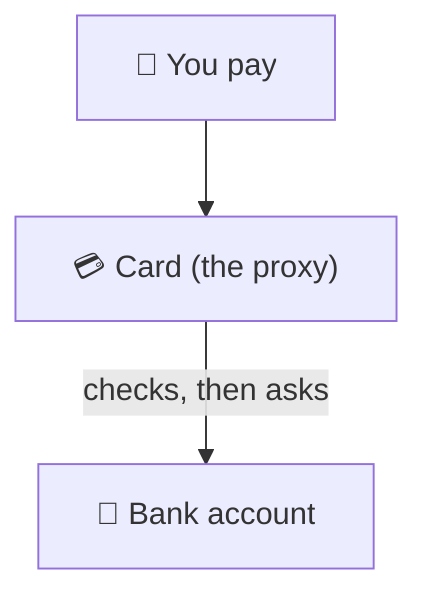
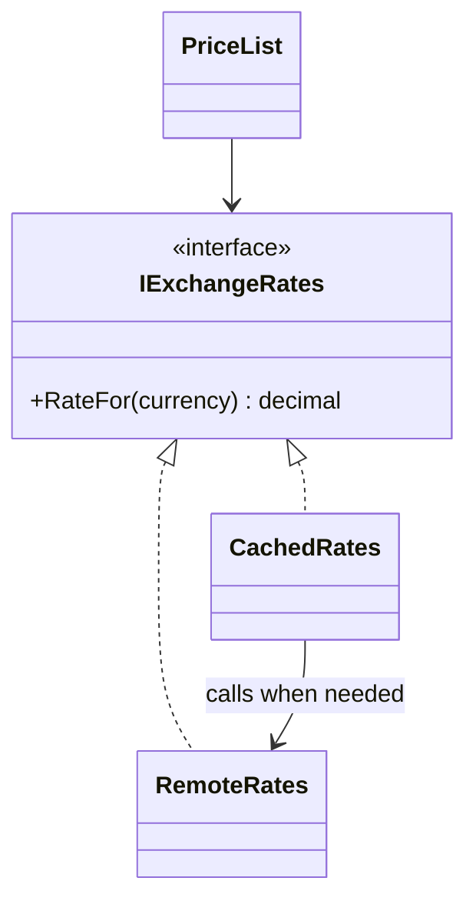

# Proxy

> [!REMEMBER]
> A stand-in that guards the real thing. Your bank card isn't the money; it decides when to reach it.



## The idea

A proxy has **the same interface** as the real object and sits in front of it. It decides **when and whether** to
call the real one: create it only when needed, answer from a cache, check permissions, or talk to it over the network.

**Use it when:**

- The real object is **costly** (slow service, big data) and calls can be saved or delayed.
- Access needs a **guard** (permissions, rate limits) or the real object is **far away** (another process).

## Structure



- **Subject** (`IExchangeRates`): the shared interface.
- **Real subject** (`RemoteRates`): does the real (costly) work.
- **Proxy** (`CachedRates`): same interface, controls when the real one is used.

## See it

```csharp before title="Before: every price asks the slow service" snippet="samples/Lld.Samples.Patterns/Structural/Proxy/Before/PriceList.cs#PriceList"
```
```csharp after title="After: a caching proxy stands in front" snippet="samples/Lld.Samples.Patterns/Structural/Proxy/After/CachedRates.cs#CachedRates,PriceList"
```

**What changed:** three prices made six remote calls; behind the proxy they make two (one per currency). The price
list didn't change: it still asks an `IExchangeRates`.

## Modern C#

```csharp snippet="samples/Lld.Samples.Patterns/Structural/Proxy/Modern/Report.cs#Report"
```

`Lazy<T>` is a ready-made virtual proxy. For caching proxies, `IMemoryCache` or `HybridCache` do the storing; the proxy
class just decides what to cache.

## Seen in .NET

- EF Core lazy-loading proxies: navigation properties load from the database on first access.
- gRPC and WCF client classes: local objects that forward calls to a remote service.
- `DispatchProxy`: builds a proxy for any interface at runtime (used for logging or remoting).

## Travels with

- [Decorator](../decorator/lesson.md): same shape; proxies often sit in a decorator-style stack.
- [Factory Method](../factory-method/lesson.md): a factory hands out the proxy so callers never `new` the real object.

> [!OVERUSE]
> - Remote calls hidden behind a local-looking interface: callers loop over it and make 1,000 network calls.
> - Lazy loading in a loop: the N+1 query problem.
> - Caching proxies with no expiry or size limit.

## Interview questions

### What is the Proxy pattern?

A placeholder object with the same interface as a real object that controls access to it, for example by creating
it lazily, caching results, checking permissions or forwarding calls to another process.

### Name the common kinds of proxy.

Virtual (lazy creation), caching, protection (access checks), remote (stands in for an object elsewhere) and smart
reference (counts references, logs access).

### Proxy vs Decorator?

Both wrap an object with the same interface. A decorator adds behaviour the client asks for; a proxy controls access
and often manages the real object's creation and lifetime.

### What is the danger of remote proxies?

They make network calls look like local method calls, so it is easy to call them in loops. Design remote interfaces
with coarse, batch-friendly methods.

### How does EF Core use proxies?

With lazy loading turned on, EF Core generates subclasses of your entities that load related data the first time a
navigation property is read.

## Go deeper

### Protection proxy

```text
SecureDocuments : IDocuments
  Read(id) → if user may read: inner.Read(id) else throw
```

The real `Documents` class stays free of permission checks, and the rule lives in one place.

### Where the proxy comes from

Clients must not create the real object themselves, or they can skip the proxy. Register only the proxy in DI (or
hand it out from a factory) so every caller goes through it.

### In a design interview

- Image gallery with thumbnails (load the full image only when opened), a rate-limited API client, a cached
  product catalogue.
- Say which kind of proxy and what it protects.

### Misconceptions

- "A proxy is just a cache." Caching is one kind; lazy creation, access checks and remoting are others.

> [!WORK]
> **From my work:** a slow dependency you put a cache or lazy proxy in front of. (Add your story here.)

### Related

- [Decorator](../decorator/lesson.md) · [Adapter](../adapter/lesson.md) · [Facade](../facade/lesson.md)
