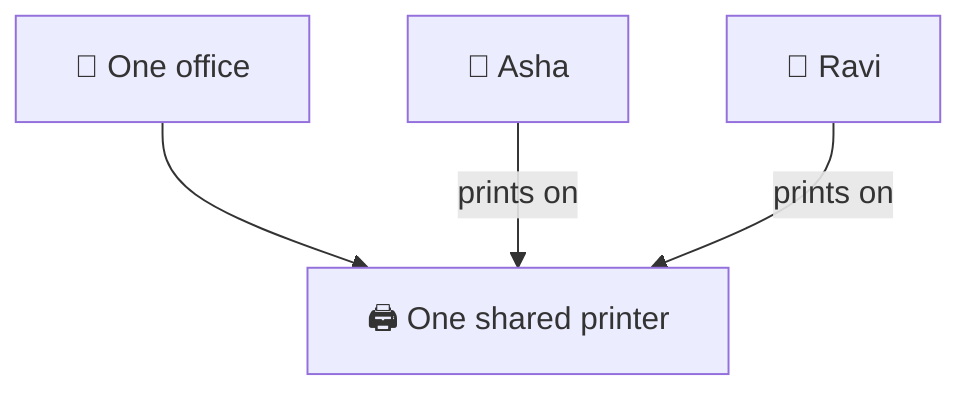
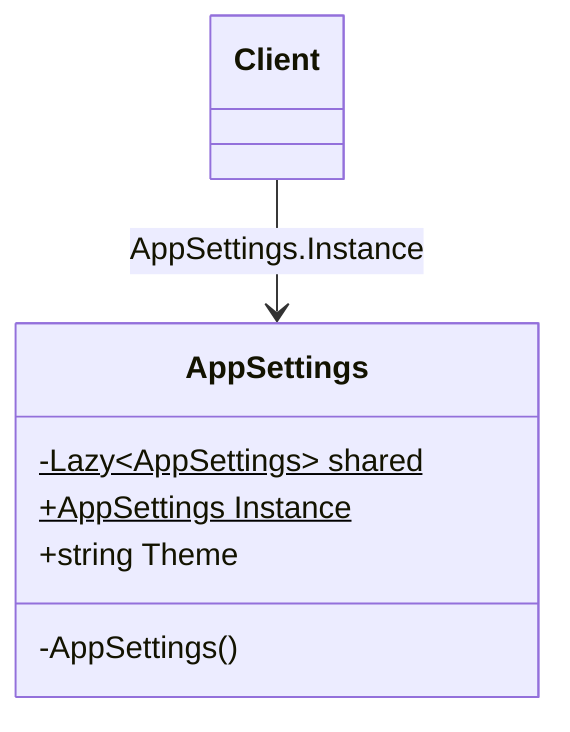

# Singleton

> [!REMEMBER]
> One for everyone, made once. In .NET: let the container keep it single.



## The idea

A class that has **exactly one instance**, and a single, well-known way to get it.

**Use it when:**

- Many parts of the app must share **one** thing: settings, a cache, a counter.
- Making it twice is **wrong** (two counters disagree) or **costly** (the file is read twice).

## Structure



- **Private constructor:** nobody else can `new` it.
- **Static `Instance`:** the one way in; the object is made the first time it is asked for.

## See it

```csharp before title="Before: every screen makes its own" snippet="samples/Lld.Samples.Patterns/Creational/Singleton/Before/AppSettings.cs#AppSettings"
```
```csharp after title="After: one instance, made once" snippet="samples/Lld.Samples.Patterns/Creational/Singleton/After/AppSettings.cs#AppSettings"
```

**What changed:** the file is read once, and a theme set on one screen is seen by all. `Lazy<T>` makes the first
call thread-safe; the sample tests ask from 16 threads at once and get one object.

## Modern C#

```csharp snippet="samples/Lld.Samples.Patterns/Creational/Singleton/Modern/AppSettings.cs#AppSettings,ThemePage,SettingsRegistration"
```

In .NET you rarely write `Instance`. Register the class with `AddSingleton` and ask for it in constructors: still one
object, but tests can pass their own.

## Seen in .NET

- `TimeProvider.System`, `ArrayPool<T>.Shared`, `EqualityComparer<T>.Default`: one shared instance each.
- `AddSingleton<T>()` in `Microsoft.Extensions.DependencyInjection`: the container keeps one per app.

## Travels with

- [Abstract Factory](../abstract-factory/lesson.md): the factory for the chosen family is usually one object.
- **Facade** (Structural): a front door to a subsystem is often one shared object too.

> [!OVERUSE]
> - Code reaches for `Thing.Instance` everywhere: the dependency is **hidden** from the constructor.
> - Tests leak into each other through the shared state.
> - It holds per-user or per-request data, which must never be shared.

## In this app

```csharp snippet="src/Lld.Application/Hosting/RequestBudget.cs#RequestBudgetMeter.Record"
```

The API has **one** request meter, registered with `AddSingleton<RequestBudgetMeter>()`. Every request calls
`Record` at the same time, so it counts with `Interlocked`: a singleton must be thread-safe.

## Interview questions

### What is the Singleton pattern?

A class with exactly one instance and one global way to reach it. The constructor is private, and a static property
creates the instance on first use.

### How do you make a Singleton thread-safe in C#?

Use `Lazy<T>` (thread-safe by default) or a `static readonly` field, which the runtime initialises once. Avoid
hand-written double-checked locking.

### Why is Singleton often called an anti-pattern?

The classic form is a global variable in disguise: callers hide the dependency, tests share state, and it can't be
swapped. The problem is the global access, not the "one instance".

### How is `AddSingleton` different from the classic pattern?

The container decides there is one instance; the class itself stays an ordinary class with a public constructor.
Dependencies are visible in constructors and tests can create their own.

### What is a captive dependency?

A singleton that holds a scoped service (like a `DbContext`). The scoped object then lives forever and is shared by
every request. .NET's scope validation reports it in Development.

## Go deeper

### Two ways to write the classic form

- `static readonly AppSettings Instance = new();`: simple and thread-safe; made when the class is first touched.
- `Lazy<AppSettings>`: made on the first `Instance` call; useful when creating it is slow.

### Singleton vs static class

| | Singleton | Static class |
|---|---|---|
| Implements an interface | ✅ | ❌ |
| Can be passed as a parameter | ✅ | ❌ |
| Lazy creation | ✅ | Partly (static constructor) |
| Swappable in tests | Only through DI | ❌ |

Use a static class for pure helpers with no state (`Math`). Use a singleton (through DI) for a shared object with state
or dependencies.

### DI lifetimes in one line each

- **Singleton:** one per app. Must be thread-safe, must not hold scoped services.
- **Scoped:** one per request (web) or per scope.
- **Transient:** a new one every time it is asked for.

### In a design interview

- Say **why** there must be one ("one meter, or the counts disagree").
- Then say **how**: "registered as a singleton in DI, thread-safe with `Interlocked`".

### Misconceptions

- "Singleton = static class." No: a singleton is an object, it can implement interfaces and be injected.
- "Singletons are always bad." Shared, stateless or thread-safe services are fine; global access is the smell.

> [!WORK]
> **From my work:** a singleton that made tests flaky, or a captive dependency you found. (Add your story here.)

### Related

- [Factory Method](../factory-method/lesson.md) · [Abstract Factory](../abstract-factory/lesson.md) ·
  [Dependency Inversion (DIP)](../../oop-solid/dip/lesson.md)
