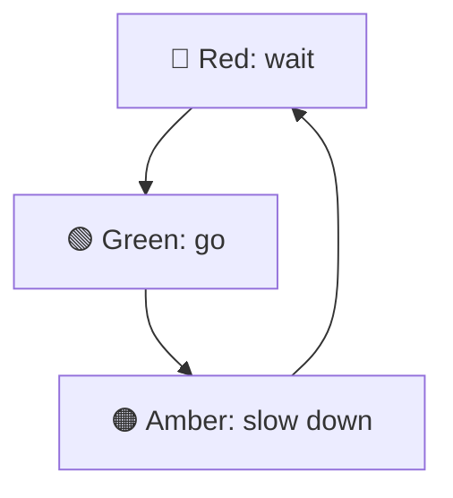
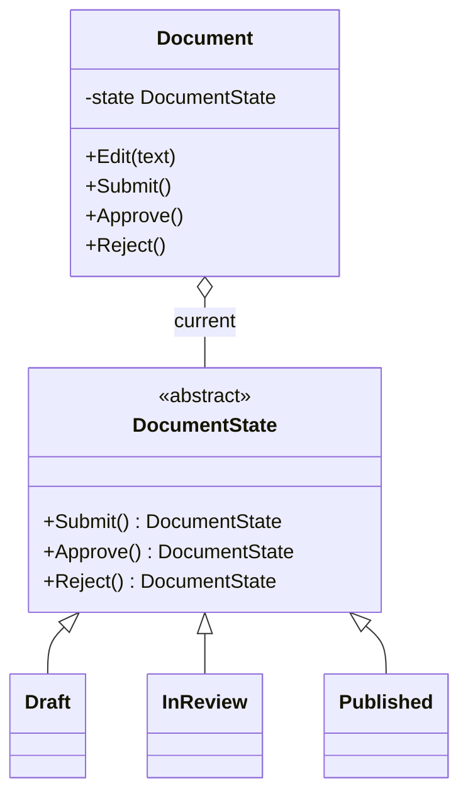

# State

> [!REMEMBER]
> Behaviour follows the state. The same "go" button does nothing at red and drives at green.



## The idea

Each state becomes a **class** that knows what every action does **in that state** and which state comes next. The
object (the *context*) holds its current state and hands every action to it. Changing state means swapping that one
object.

**Use it when:**

- Methods start with `switch (status)` and the same `switch` appears in many methods.
- Rules like "can't edit once published" are spread everywhere and easy to forget.

## Structure



- **Context** (`Document`): delegates each action to its current state.
- **State** (`DocumentState`): refuses every action by default.
- **Concrete states** (`Draft`, `InReview`, `Published`): allow their own moves and return the next state.

## See it

```csharp before title="Before: every method switches on the status" snippet="samples/Lld.Samples.Patterns/Behavioral/State/Before/Document.cs#Document"
```
```csharp after title="After: one class per state" snippet="samples/Lld.Samples.Patterns/Behavioral/State/After/Document.cs#DocumentState,InReview,Document"
```

**What changed:** each state's rules live together. "Archived" would be one new class that allows only what it
should; everything else is refused by default. The tests walk the same moves through every version.

## Modern C#

```csharp snippet="samples/Lld.Samples.Patterns/Behavioral/State/Modern/DocumentFlow.cs#DocumentFlow"
```

For a small machine, a transition table (`switch` on `(state, action)`) shows every legal move on one screen. Use
state classes when each state has lots of its own behaviour; the Stateless library sits in between.

## Seen in .NET

- The compiler turns every `async` method and `yield` iterator into a state machine class.
- `HttpClient` connections, `Task.Status`, `CommunicationState` in WCF: lifecycles with legal transitions.
- Workflow engines (Elsa, Durable Functions orchestrations).

## Travels with

- [Flyweight](../flyweight/lesson.md): stateless state objects can be shared by every context.
- [Singleton](../singleton/lesson.md): each state often exists once.

> [!OVERUSE]
> - Two states and one rule: an `if` is clearer than four classes.
> - States that reach into the context's private data everywhere: the logic is split, not separated.
> - Transitions scattered so nobody can draw the state diagram any more: write it down.

## In this app

```csharp snippet="src/Lld.Domain/Access/AccessRequestStates.cs#IAccessRequestState"
```

An access request is *Pending*, *Approved* or *Rejected*. `PendingState` allows merge, approve and reject;
`DecidedState` refuses all three with the same error. The states are shared single instances (flyweights).

## Interview questions

### What is the State pattern?

It lets an object change its behaviour when its internal state changes by delegating to a state object; each state is
its own class and decides which state comes next.

### State vs Strategy?

They look the same in code. With Strategy the client picks the algorithm and it rarely changes; with State the object
moves itself from state to state as things happen.

### Who decides the next state?

Either the states (each returns the next one, as here) or the context (a table of transitions). States deciding keeps
rules together; the context deciding keeps the whole map in one place.

### How do you persist a stateful object?

Store a simple status value (an enum or string) and rebuild the state object from it when loading, as
`AccessRequestStates.For(status)` does.

### When is a `switch` better?

When there are few states, little behaviour per state, and you want the whole transition table visible at once.

## Go deeper

### Draw it first

Write the state diagram before the code (Mermaid `stateDiagram-v2`): states, actions, arrows. Every arrow is a method
that returns a new state; everything else is refused.

### Shared states

If states have no fields, make one instance each and reuse them; if a state needs data (a retry count), it's an
object per context.

### In a design interview

- Vending machine, elevator, order lifecycle, traffic lights, ATM sessions.
- Say what happens on an illegal action: an error, an ignored press, or a logged event.

### Misconceptions

- "A status enum is the State pattern." The enum is the data; the pattern moves behaviour into state classes.

> [!WORK]
> **From my work:** a workflow with tangled `switch` statements you turned into states. (Add your story here.)

### Related

- [Strategy](../strategy/lesson.md) · [Polymorphism](../../oop-solid/polymorphism/lesson.md) ·
  [Iterator](../iterator/lesson.md)
