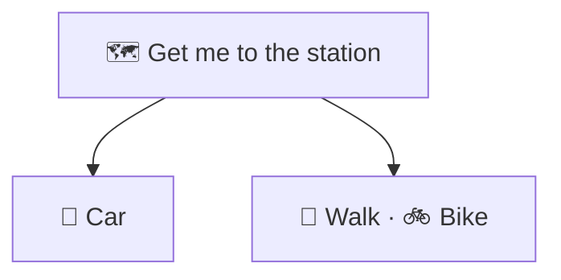
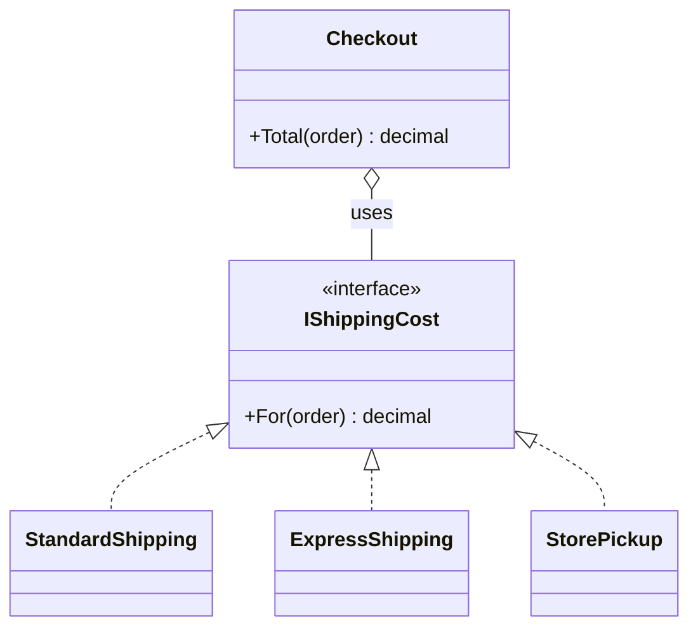

# Strategy

> [!REMEMBER]
> Swap how, keep what. Same trip, pick car, bike or walk.



## The idea

Each **way of doing one job** (an algorithm) becomes its own small class behind a shared interface. The class that
needs the job done (the *context*) is **given** one and just calls it. New ways are new classes.

**Use it when:**

- A `switch` or `if` chain picks between versions of the same calculation, and grows.
- You want to choose the behaviour at runtime, or test each version alone.

## Structure



- **Strategy** (`IShippingCost`): the one job.
- **Concrete strategies** (`ExpressShipping`, ...): one way each.
- **Context** (`Checkout`): holds a strategy and calls it; never asks which one it is.

## See it

```csharp before title="Before: every way in one switch" snippet="samples/Lld.Samples.Patterns/Behavioral/Strategy/Before/Checkout.cs#Checkout"
```
```csharp after title="After: one class per way, chosen from outside" snippet="samples/Lld.Samples.Patterns/Behavioral/Strategy/After/Shipping.cs#IShippingCost,ExpressShipping,Checkout"
```

**What changed:** same-day delivery is a new class; checkout is not opened again (that's
[OCP](../../oop-solid/ocp/lesson.md)). Each shipping rule is tested on its own.

## Modern C#

```csharp snippet="samples/Lld.Samples.Patterns/Behavioral/Strategy/Modern/Shipping.cs#ShippingCosts,Checkout"
```

A one-method strategy is just a `Func<T, TResult>`. Keep the interface when strategies need dependencies, several
methods or names in DI (keyed services: `[FromKeyedServices("express")]`).

## Seen in .NET

- `IComparer<T>` for `List<T>.Sort`, `IEqualityComparer<T>` for `Dictionary`, `StringComparer.OrdinalIgnoreCase`.
- LINQ: `Where(predicate)`, `OrderBy(keySelector)` take the strategy as a delegate.
- ASP.NET Core: `IPasswordHasher<T>`, authentication handlers per scheme.

## Travels with

- [Factory Method](../factory-method/lesson.md): a factory often picks the right strategy (from config or input).
- [Decorator](../decorator/lesson.md): a decorator changes the outside of an object, a strategy its inside.
- [Template Method](../template-method/lesson.md): the inheritance-based alternative for varying steps.

> [!OVERUSE]
> - An interface and three classes for a rule that has only ever had one version.
> - The context still `switch`es on which strategy it holds.
> - Strategies that need the context's private data passed in ten parameters.

## In this app

```csharp snippet="src/Lld.Application/Abstractions/Ports.cs#IPasswordPolicy"
```

`ChangePassword` and Identity's `PolicyPasswordValidator` both ask an `IPasswordPolicy`; `MinLengthPasswordPolicy` is
today's rule (12 to 128 characters, not your email). A stricter policy would be a new class, not an edit.

## Interview questions

### What is the Strategy pattern?

It defines a family of interchangeable algorithms, puts each in its own class behind one interface, and lets the
client choose which to use at runtime without changing the code that uses it.

### How does it relate to the Open/Closed Principle?

New behaviour is added as a new strategy class; the context stays closed for modification.

### Strategy vs State?

Both delegate to an interface. With Strategy the **caller** picks the algorithm; with State the **object** switches
its own state object as its situation changes.

### Strategy vs Template Method?

Strategy varies the whole algorithm by composition (pass an object). Template Method fixes the steps in a base class
and varies some of them by inheritance.

### How would you write it in modern C#?

Pass a `Func<T, TResult>` for one-method strategies, or register several implementations in DI and pick by key.

## Go deeper

### Choosing the strategy

- At start-up from configuration (DI).
- Per request, from a dictionary of named strategies.
- Never with a `switch` inside the context, or the pattern has moved the problem, not solved it.

### Stateless strategies are shareable

Strategies with no fields can be singletons (`StringComparer.Ordinal` is one). Strategies with state need care if
shared between threads.

### In a design interview

- Parking fees (hourly, flat, weekend), discounts, sorting, payment methods, route planning.
- Say who chooses: "the pricing service picks the fee strategy from the lot's configuration".

### Misconceptions

- "Strategy needs an interface." The idea is the swap; a delegate is a perfectly good strategy.

> [!WORK]
> **From my work:** a growing `switch` you replaced with strategies. (Add your story here.)

### Related

- [State](../state/lesson.md) · [Template Method](../template-method/lesson.md) · [Command](../command/lesson.md) ·
  [Open/Closed (OCP)](../../oop-solid/ocp/lesson.md)
