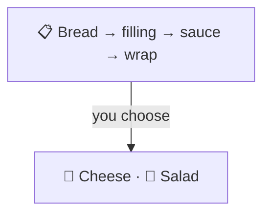
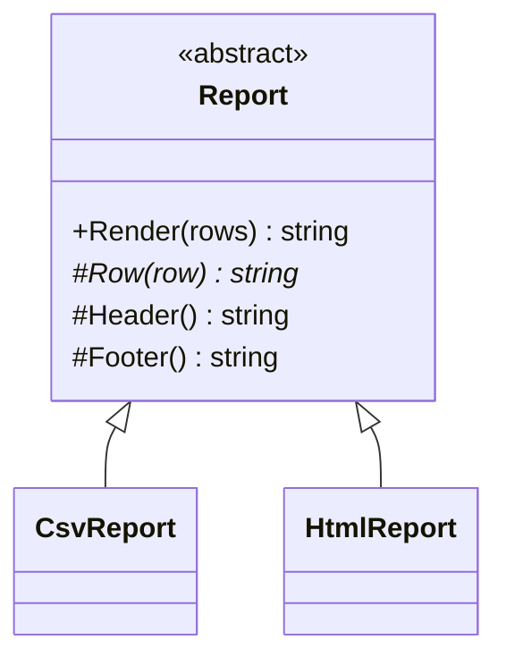

# Template Method

> [!REMEMBER]
> Fixed recipe, your own fillings. The sandwich steps never change; you choose what goes inside.



## The idea

A base class has one **non-virtual method** (the template method) that runs the steps in order. Some steps are
**abstract** (every subclass must write them) and some are **hooks** with a default (subclasses may change them).

**Use it when:**

- Several classes repeat the same steps with small differences, and fixes have to be copied.
- You write a framework: you own the flow, users plug in the parts.

## Structure



- **Abstract class** (`Report`): `Render` is the template method; `Row` is an abstract step; `Header` and `Footer`
  are hooks.
- **Concrete classes** (`CsvReport`, `HtmlReport`): fill in the steps.

## See it

```csharp before title="Before: the same steps, copied" snippet="samples/Lld.Samples.Patterns/Behavioral/TemplateMethod/Before/Reports.cs#CsvReport,HtmlReport"
```
```csharp after title="After: steps fixed once, parts filled in" snippet="samples/Lld.Samples.Patterns/Behavioral/TemplateMethod/After/Reports.cs#Report,HtmlReport"
```

**What changed:** skipping blanks and trimming rows live in one place. In *Before*, the HTML copy never got the trim
fix; the tests catch it.

## Modern C#

```csharp snippet="samples/Lld.Samples.Patterns/Behavioral/TemplateMethod/Modern/Reports.cs#ReportFormat,Reports"
```

Pass the varying steps as data (a record of delegates) instead of subclassing. That's Strategy doing Template
Method's job: easier to combine and test.

## Seen in .NET

- `BackgroundService`: you override `ExecuteAsync`; .NET runs start, stop and cancellation around it.
- `Stream`: `ReadAsync` and `CopyTo` are written once on top of the `Read` / `Write` you override.
- `DbContext.OnModelCreating`, `Controller.OnActionExecuting`: hooks inside a flow the framework owns.

## Travels with

- [Factory Method](../factory-method/lesson.md): a factory method is often one step of a template method.
- [Strategy](../strategy/lesson.md): the composition-based alternative.

> [!OVERUSE]
> - Deep hierarchies where each level overrides a few steps: hard to follow which code runs.
> - Subclasses that must call `base.Step()` in the right place, or things break (fragile base class).
> - A base class with ten hooks "just in case".

## In this app

```csharp snippet="src/Lld.Api/Hosting/RequestBudgetFlusher.cs#RequestBudgetFlusher.ExecuteAsync"
```

`RequestBudgetFlusher` is a `BackgroundService`: .NET's template starts it, runs this step until shutdown, and stops
it. The app only fills in "save the request counts every minute".

## Interview questions

### What is the Template Method pattern?

A method in a base class that defines the skeleton of an algorithm, calling steps that subclasses override. The order
of the steps is fixed; only their content varies.

### Why make the template method non-virtual?

So subclasses can't change the order or skip steps: they can only fill in the parts they are allowed to.

### What is a hook?

A virtual step with a default (often empty) implementation. Subclasses may override it but don't have to.

### Template Method vs Strategy?

Template Method varies parts of an algorithm through inheritance, fixed at compile time. Strategy swaps the whole
algorithm through composition, at runtime.

### What is the "Hollywood principle"?

"Don't call us, we'll call you": the base class calls the subclass's steps, not the other way round. Frameworks work
this way.

## Go deeper

### Sealing the template

C# methods are non-virtual by default, which already protects the template method. Mark concrete subclasses `sealed`
so nobody adds another layer of overrides.

### When inheritance is right here

Template Method is fine when the steps are stable and the subclasses really are kinds of the base. When you want to
mix and match parts, prefer composition ([Composition over inheritance](../../oop-solid/composition-over-inheritance/lesson.md)).

### In a design interview

- Data import (read, validate, transform, save) with one subclass per file format.
- Game turns (start, move, check win, end) per game type.

### Misconceptions

- "Any abstract class is a template method." The pattern is the fixed sequence calling overridable steps.

> [!WORK]
> **From my work:** duplicated workflows you merged into one base flow. (Add your story here.)

### Related

- [Strategy](../strategy/lesson.md) · [Factory Method](../factory-method/lesson.md) ·
  [Inheritance](../../oop-solid/inheritance/lesson.md)
