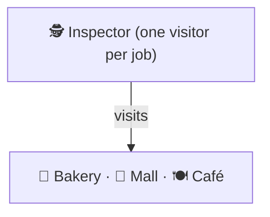
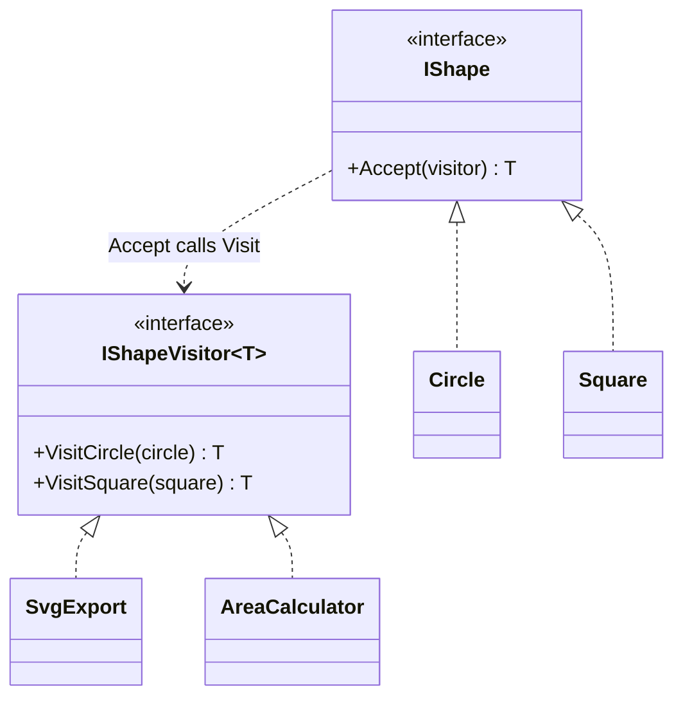

# Visitor

> [!REMEMBER]
> New jobs, same classes. The tax inspector visits every kind of shop; the shops don't learn tax law.



## The idea

When the **set of classes is fixed** but **new operations keep arriving** (export, print, check), put each operation
in a **visitor** with one method per class. Each class has one `Accept(visitor)` method that calls the right one:
**double dispatch**.

**Use it when:**

- Every new feature adds a method to every class of a stable hierarchy (shapes, syntax nodes, document parts).
- Those methods have nothing to do with what the classes are about.

## Structure



- **Visitor** (`IShapeVisitor<T>`): one method per element class; each operation is one implementation.
- **Elements** (`Circle`, `Square`): `Accept` calls the visitor method for their own type.

## See it

```csharp before title="Before: every operation lives in every shape" snippet="samples/Lld.Samples.Patterns/Behavioral/Visitor/Before/Shapes.cs#IShape,Circle"
```
```csharp after title="After: shapes accept; each operation is a visitor" snippet="samples/Lld.Samples.Patterns/Behavioral/Visitor/After/Shapes.cs#IShapeVisitor,IShape,Circle,SvgExport"
```

**What changed:** exporting to SVG is one class; shapes only have `Accept`. A new operation is a new visitor, no shape
is opened. The catch: a new **shape** means adding a method to every visitor.

## Modern C#

```csharp snippet="samples/Lld.Samples.Patterns/Behavioral/Visitor/Modern/Shapes.cs#Shape,Circle,Square,Exports.ToSvg"
```

With a closed set of records, an operation is one `switch` expression: no `Accept`, no interface. Most modern C#
code chooses this; the visitor still wins for big, public hierarchies (Roslyn) where type checks would be scattered.

## Seen in .NET

- Roslyn: `CSharpSyntaxWalker` and `CSharpSyntaxRewriter` visit every kind of syntax node.
- `System.Linq.Expressions.ExpressionVisitor`: walks and rewrites expression trees (EF Core is built on it).
- `System.Text.Json` converters choose code per type, a related idea.

## Travels with

- [Composite](../composite/lesson.md): visitors usually walk composite trees.
- [Iterator](../iterator/lesson.md): an iterator walks, a visitor does the work at each node.
- [Interpreter](../interpreter/lesson.md): a visitor can evaluate or print an interpreter's syntax tree.

> [!OVERUSE]
> - The hierarchy still changes often: every new class breaks every visitor.
> - Visitors that need private data of the elements, so everything becomes public.
> - A visitor for two classes and one operation: a `switch` is clearer.

## In this app

```csharp snippet="src/Lld.Content.Authoring/Snippets/CSharpSymbolFinder.cs#CSharpSymbolFinder.NameMatches"
```

The snippet finder walks Roslyn's syntax tree but picks the modern route: a `switch` on node types instead of a
`CSharpSyntaxWalker` visitor. It needs one small check over two node kinds, so a visitor would be overkill.

## Interview questions

### What is the Visitor pattern?

It lets you add new operations to a set of classes without changing them, by putting each operation in a visitor
with one method per class; each class's `Accept` calls the matching method (double dispatch).

### What is double dispatch?

Choosing the code to run based on two runtime types: the element's (through `Accept`) and the visitor's (through the
call to `VisitX`). C# methods dispatch on one type only, so the pattern does the second step.

### What is the trade-off?

New operations are easy (a new visitor); new element classes are hard (change every visitor). Use it when the classes
are stable and operations change.

### How does pattern matching change things?

A `switch` expression over sealed records gives the same "operation outside the classes" without `Accept`. The
compiler checks exhaustiveness for enums, though not for open class hierarchies.

### Where does .NET use visitors?

Roslyn syntax walkers and rewriters, and `ExpressionVisitor` for LINQ expression trees.

## Go deeper

### The expression problem

Classes make adding types easy and operations hard; visitors (and `switch`) make operations easy and types hard. No
design makes both easy; choose by which one changes more in your system.

### Visitors that return values

`IShapeVisitor<T>` returns a result (`string`, `double`), so visitors compose like functions. Older C# visitors
returned `void` and stored results in fields.

### In a design interview

- Exporting a document model to HTML, PDF and Markdown; tax rules over product types; compilers.
- Say why the classes are stable and the operations are not.

### Misconceptions

- "Visitor is for walking trees." Walking is the iterator's job; the visitor decides what to do at each node.

> [!WORK]
> **From my work:** operations you moved out of a class hierarchy (a visitor or a big `switch`). (Add your story here.)

### Related

- [Composite](../composite/lesson.md) · [Interpreter](../interpreter/lesson.md) ·
  [Polymorphism](../../oop-solid/polymorphism/lesson.md)
