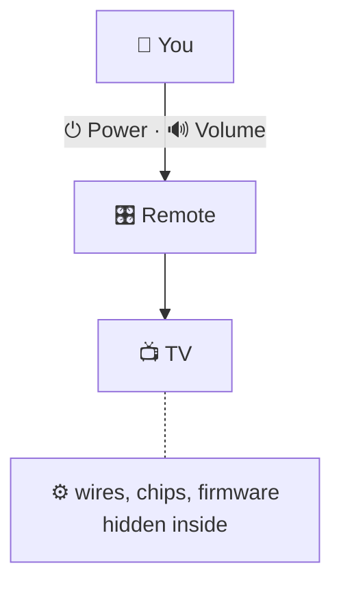

# Abstraction

> [!REMEMBER]
> Show the buttons. Hide the wires.



## The rule

- Give callers a few **buttons**, named in **their** words (`SaveAsync(name, content)`).
- Hide the **wires**: folders, streams, SQL, HTTP.
- Test: you can swap the wires completely and **callers don't change**.

Abstraction decides **what** callers see. Encapsulation makes sure they **can't get around it**.

## See it

```csharp before title="Before: the file system with an interface in front" snippet="samples/Lld.Samples.OopSolid/Abstraction/Before/SalesReport.cs#IFileStorage"
```
```csharp after title="After: named documents, in the caller's words" snippet="samples/Lld.Samples.OopSolid/Abstraction/After/DocumentStore.cs#IDocumentStore"
```

**What changed:** `IFileStorage` shows the wires (`RootFolder`, `FileStream`), so a cloud store can't fit it.
`IDocumentStore` shows only buttons: a folder, a blob store or a dictionary can all sit behind it.

## Smell it

- An interface that mentions `FileStream`, folders, `SqlConnection`, `IQueryable`.
- "How" names: `SaveToSqlServer`, `SendViaSmtp`.
- A method you can't describe without "and".

## In this app

```csharp snippet="src/Lld.Content.Authoring/Files/IContentFiles.cs#IContentFiles"
```

The content pipeline reads files through this. Disk or memory, Windows or Linux: the pipeline can't tell.

## Interview questions

### What is abstraction?

Showing what something does, in the caller's terms, and hiding how. Good test: the implementation can change
completely and callers don't notice.

### How is it different from encapsulation?

Abstraction chooses what callers see. Encapsulation stops them going around it. You want both.

### What is a leaky abstraction?

One that makes callers know the implementation, e.g. an interface exposing `FileStream` or `IQueryable`. Design it
from the caller's side to stop the leak.

### When should you add an interface?

When there are (or soon will be) several implementations, or a test needs a fake. Not for every class.

### What does "one level of abstraction per method" mean?

A method reads as steps at one level ("total it, format it, save it"); each step's detail lives in its own smaller
method below.

## Go deeper

### One level of abstraction per method

```csharp before title="Before: business steps, CSV and paths mixed" snippet="samples/Lld.Samples.OopSolid/Abstraction/Before/SalesReport.cs#SalesReport"
```
```csharp after title="After: the method reads as the business steps" snippet="samples/Lld.Samples.OopSolid/Abstraction/After/SalesReport.cs#SalesReport"
```

- The public method tells the story; private methods hold the detail (the **stepdown rule**).
- Private methods are abstractions too, and they are free. Not every step needs an interface.

### Two stores, one promise

```csharp snippet="samples/Lld.Samples.OopSolid/Abstraction/After/DocumentStore.cs#FolderDocumentStore,InMemoryDocumentStore"
```

The sample tests run **the same test against both stores**. One set of expectations, any implementation.

### C# traps

```csharp snippet="samples/Lld.Samples.OopSolid/Abstraction/Language/LeakyQueries.cs#CustomerDirectory"
```

- `IEnumerable<T>` can be a query that **runs again every time** you loop. Return `IReadOnlyList<T>` for results.
- `IQueryable<T>` from a repository leaks SQL: code that works on a list can fail on the database.
- If any implementation does I/O, make the interface `async` with a `CancellationToken` from day one.

> [!APP]
> More abstractions in this app: `ITokenIssuer` hides JWT details, `TimeProvider` lets tests move time, and the
> web app's `DataSource` hides whether lessons come from the device or the dev API.

### When not to

- **The wrong abstraction costs more than duplication.** Wait for the 2nd or 3rd real case.
- **One implementation, no test fake?** Skip the interface.
- **Don't wrap your framework "in case we switch".** Abstract your own decisions instead.

### In a design interview

1. Start from the use case: "when an order ships, notify the customer".
2. Write the key interface in domain words: `INotificationChannel.SendAsync(recipient, message)`.
3. Name 2 implementations (email, SMS), mention a 3rd (push).
4. Go down a level only when asked.

### Misconceptions

- "Abstraction = interfaces." Private methods and small classes are abstractions too.
- "More layers = more abstraction." Pass-through layers hide nothing.

> [!WORK]
> **From my work:** an abstraction that leaked, or one that let you swap an implementation painlessly. (Add your
> story here.)

### Related

- [Encapsulation](../encapsulation/lesson.md) · [Polymorphism](../polymorphism/lesson.md) ·
  [Inheritance](../inheritance/lesson.md)
