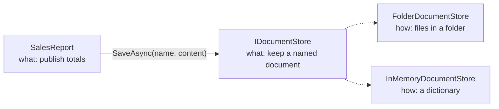

# Abstraction

## The idea

**Abstraction is choosing what to show.** Every model of the world leaves things out; abstraction is doing that on
purpose, for a reader. A map of the underground leaves out the streets, the distances and the curves of the tunnels
because a passenger needs only stations, lines and changes. A good class does the same: it offers the few operations
its callers need, named in *their* language, and keeps everything else out of sight.

In code, abstraction shows up in two places that people often treat as different topics:

1. **Types.** An interface or a class's public surface is an abstraction. `IDocumentStore` with `SaveAsync(name,
   content)` lets a report keep a file without knowing whether it lands on a disk, in a blob container or in memory.
2. **Methods.** A method body is an abstraction too. `PublishAsync` reading "work out the totals, turn them into CSV,
   save the document" is at one level; the details of each step live one level down. Mixing levels in one method is
   the most common abstraction failure in real code.

Abstraction and encapsulation travel together but answer different questions. **Abstraction decides *what* callers
see; encapsulation guarantees *they can't get around it*.** A class can expose a beautiful abstraction and still leak
its list through a getter (good abstraction, poor encapsulation), or carefully protect a confusing set of methods
nobody can use well (the opposite).



The report depends on the *what* (the interface). The *how* (two implementations) can grow, change or be swapped
in tests without the report noticing.

> [!INTERVIEW]
> A crisp answer: "Abstraction is exposing what something does in the caller's terms and hiding how it does it. The
> test of a good abstraction is that an implementation can change completely without the caller changing." Then show
> a leaky one and fix it; interviewers remember the example, not the definition.

## The problem it solves

Without abstraction, every piece of code knows about every detail it touches, so **every detail change spreads**.

If the report writes files itself, moving reports to cloud storage means editing the report. If ten features write
files, it means editing ten features, each of which also needs to learn about credentials, retries and container
names. If they all depend on `IDocumentStore`, it means writing one new class.

Abstraction also manages **cognitive load**. Human working memory holds a handful of things at once. A method that
mixes business steps with string escaping and file paths forces a reader to hold all of it; a method that reads as
three named steps can be understood in seconds, and each step can be read on its own when needed. Good abstraction
is how large programs stay readable: you read at the level you care about and drill down only where you must.

Finally, abstraction is what makes **tests cheap**. A report that depends on `IDocumentStore` can be tested with an
in-memory store: no temporary folders, no clean-up, no flaky disk. The abstraction is the seam the test plugs into.

## How a violation looks

> [!SMELL]
> **One method, several levels of detail.** A business step (`Publish the monthly report`) next to a `StringBuilder`,
> next to `Path.Combine`. You can't say what the method does in one sentence without saying "and".

> [!SMELL]
> **A leaky interface.** The interface mentions its implementation's concepts: `RootFolder`, `FileStream`,
> `SqlConnection`, `HttpResponseMessage`, `IQueryable`. Any other implementation must fake them or throw.

> [!SMELL]
> **Names that say how, not what.** `SaveToSqlServer`, `SendViaSmtp`, `GetFromCache`. The caller wanted "save",
> "send", "get"; the name ties them to a choice they shouldn't care about.

> [!SMELL]
> **Flag arguments.** `Export(data, useCloud: true, compress: false)` is several abstractions squeezed into one
> method. Each flag is a decision the caller had to learn about.

> [!SMELL]
> **The caller supplies the details.** If calling a method requires passing a folder path, a connection string or a
> retry count, those details have escaped into every caller.

## Worked example: one level of abstraction per method

The monthly sales report, as it often starts:

```csharp before title="Before: business step, totals, CSV and paths in one method" snippet="samples/Lld.Samples.OopSolid/Abstraction/Before/SalesReport.cs#SalesReport"
```
```csharp after title="After: the method reads as the business step" snippet="samples/Lld.Samples.OopSolid/Abstraction/After/SalesReport.cs#SalesReport"
```

The *Before* method works and is tested. Its problem is that **you have to read every line to know what it does**,
and every reason to change (a new column, a new escaping rule, a new place to keep reports) is a change to this one
method.

The *After* version applies two rules:

- **The stepdown rule.** The public method tells the story at the business level; each private method it calls
  explains one step, one level lower. You can stop reading at `PublishAsync` and know what happens. If you need the
  CSV format, you read `ToCsv` and nothing else.
- **Details belong where they are decided.** The file name is a reporting decision, so it stays (`DocumentName`). The
  folder is a deployment decision, so it moved out of the report altogether: the report asks an `IDocumentStore` to
  keep a document and doesn't know where it goes.

Notice what the *After* version did **not** do: it didn't create an `ICsvFormatter`, an `ITotalsCalculator` and a
`IFileNameStrategy`. Private methods are abstractions too, and they are free. An interface is worth it when there are,
or will soon be, several ways to do the thing, or when a test needs to replace it. Storage meets that bar; CSV
formatting for one report doesn't.

> [!TIP]
> Read a method aloud as a list of steps. If one step takes a paragraph to say and the others take a phrase, that
> step is at a lower level: give it a name.

## Worked example: a leaky abstraction and a clean one

An abstraction leaks when callers must know about the implementation to use it correctly. This storage interface
looks like an abstraction, but every member is a file-system concept:

```csharp before title="Before: the file system with an interface in front" snippet="samples/Lld.Samples.OopSolid/Abstraction/Before/SalesReport.cs#IFileStorage"
```
```csharp after title="After: named documents, in the caller's terms" snippet="samples/Lld.Samples.OopSolid/Abstraction/After/DocumentStore.cs#IDocumentStore"
```

Try to implement `IFileStorage` on top of cloud blob storage: there is no `RootFolder`, no `FileStream`, no full path.
You would invent fake values or throw, and every caller written against the folder-shaped interface would break in
subtle ways. The interface was extracted *from one implementation*, so it describes that implementation.

`IDocumentStore` was designed *from the caller's side*: what does a report need? To keep a document under a name and
to get it back. Both implementations below keep that promise, and so could a blob store or a database table:

```csharp snippet="samples/Lld.Samples.OopSolid/Abstraction/After/DocumentStore.cs#FolderDocumentStore,InMemoryDocumentStore"
```

The sample tests run **the same test against both stores**: save twice, load the latest, get `null` for an unknown
name. That is the practical meaning of a good abstraction: one set of expectations, any implementation. (When you
reach Liskov Substitution later in this module, this kind of shared "contract test" is the main tool.)

> [!PITFALL]
> Extracting an interface from an existing class with your IDE ("Extract Interface") copies the class's shape,
> including its leaks. Design the interface by writing the *caller* first, then implement it.

Joel Spolsky's *Law of Leaky Abstractions* says all non-trivial abstractions leak to some degree. A network call
behind `SaveAsync` can be slow or fail in ways a dictionary never does. Good abstractions don't pretend otherwise:
`IDocumentStore` is `async` and takes a `CancellationToken` because *some* implementation will need them. Design for
the hardest realistic implementation, not the easiest one.

## In this app

The content pipeline that builds this very lesson reads files through an abstraction designed from the pipeline's
point of view:

```csharp snippet="src/Lld.Content.Authoring/Files/IContentFiles.cs#IContentFiles"
```

Look at what it promises: **repository-relative paths with forward slashes**, whatever the operating system. The
pipeline never sees `C:\` or `Path.DirectorySeparatorChar`; [`PhysicalContentFiles`](../../../src/Lld.Content.Authoring/Files/PhysicalContentFiles.cs)
translates at the edge, and [`InMemoryContentFiles`](../../../src/Lld.Content.Authoring/Files/InMemoryContentFiles.cs)
lets more than two hundred tests run without touching a disk. The same packed output comes from a Windows checkout
and a Linux CI runner because the abstraction made the difference invisible.

The pipeline's entry point is also a small lesson in levels of abstraction:

```csharp snippet="src/Lld.Content.Authoring/ContentPipeline.cs#ContentPipeline.Build"
```

Read, validate, pack: the business steps are visible at a glance; each lives in its own class one level down.

Two more abstractions worth a look:

- **`ITokenIssuer`** in the application layer says "issue an access token for this user at this time". Whether that
  is a JWT, which signing key and which claims are infrastructure details in
  [`JwtTokenIssuer`](../../../src/Lld.Infrastructure/Security/Security.cs).
- **`DataSource`** in the React app ([`types.ts`](../../../web/src/data/types.ts)) is the same idea on the front end:
  the reader asks for a lesson; whether it comes from the device's SQLite through the native bridge or from the
  development API over HTTP is decided once at startup.

> [!APP]
> The app also uses .NET's own `TimeProvider` instead of `DateTimeOffset.UtcNow`. "What time is it?" is an
> abstraction too: production asks the system clock, tests use a fake clock and can move time forward to expire a
> token without waiting an hour.

## C# and .NET specifics

**Interfaces are the usual unit of abstraction**, but a class's public members are an abstraction as well. Not every
abstraction needs an interface; the next lesson compares interfaces with abstract classes in detail.

**`IEnumerable<T>` hides *when* work happens.** It promises "a sequence", and a deferred LINQ query is a perfectly
valid sequence that runs again every time it is enumerated:

```csharp snippet="samples/Lld.Samples.OopSolid/Abstraction/Language/LeakyQueries.cs#CustomerDirectory"
```

A caller that counts the result and then loops over it runs the filter twice, or queries the database twice. When
the caller needs a finished collection, say so in the type: `IReadOnlyList<T>`.

**`IQueryable<T>` is the famous leak.** Returning it from a repository looks flexible, but the caller's lambdas are
translated to SQL, so code that works against a list in a unit test can fail or become slow against the real
database. Return results, not queries, from your abstractions.

**`Stream` is the textbook good abstraction.** Files, network sockets, memory, compression and encryption all
implement it, and code written against `Stream` works with all of them. Notice how small it is: read, write, seek
(optional, with `CanSeek` to ask). Small abstractions are easier to implement honestly.

**Async and cancellation are part of the contract.** If any realistic implementation does I/O, make the abstraction
`async` and accept a `CancellationToken` from the start. Adding them later changes every caller.

**`TimeProvider`, `ILogger<T>`, `IOptions<T>`, `IHttpClientFactory`.** Much of modern .NET is built from small
abstractions over things that are awkward to test or configure. Prefer them over statics such as
`DateTime.Now` and `Console.WriteLine` in code you want to test.

## Trade-offs and when not to

- **The wrong abstraction is worse than none.** Sandi Metz puts it as "duplication is far cheaper than the wrong
  abstraction". An abstraction invented after one example usually fits that example and fights the second. Wait for
  the second or third real case before extracting a shared interface.
- **Every layer costs.** Each interface is another file to open and another hop when debugging. An interface with one
  implementation, no test that substitutes it and no planned second one is ceremony, not design.
- **Don't abstract the framework you already chose.** Wrapping all of ASP.NET Core or EF Core "in case we switch"
  rarely pays off: you will switch rarely, and your wrapper will leak anyway. Abstract the *decisions* your
  application makes (where documents go, how tokens are issued), not the tools.
- **Abstraction is not vagueness.** `IManager.Process(object input)` hides everything, including what it does. A good
  abstraction is precise about *what* and silent about *how*.

> [!WORK]
> **From my work:** an abstraction that leaked in production (a "repository" returning `IQueryable`, an SDK wrapper
> that exposed vendor types), or one that let you swap an implementation painlessly. (Add your story here.)

## Using it in a design interview

Abstraction is the skill interviewers watch most closely in the first ten minutes of an LLD round, before any code:
**what level do you start at, and do you stay there?**

Take "design a notification system". Weak answers start with tables, queues and SMTP. Strong answers start with the
caller's vocabulary and work down:

1. **Start from the use case.** "When an order ships, the customer is notified on the channels they chose." The nouns
   are your first abstractions: `Notification`, `Recipient`, `Channel`.
2. **Write the key interface in domain terms.** `INotificationChannel { Task SendAsync(Recipient to, Message message,
   CancellationToken ct); }`. No `SmtpClient`, no phone-number formats, no HTTP. Then say which implementations you
   expect: e-mail, SMS, push, and later perhaps WhatsApp.
3. **Ask what the hardest implementation needs.** SMS has length limits; push needs a device token; e-mail has
   attachments. Decide which of those belong in `Message` (a title and a body, perhaps a link) and which stay inside
   one channel (HTML templates are an e-mail detail).
4. **Name the next level down only when asked.** "Inside the e-mail channel there is a template renderer and an SMTP
   or provider client." Going down a level is a choice you make visibly, not a place you wander into.
5. **Point out the seam for tests and for change.** "The order service depends on `INotificationChannel`, so tests use
   an in-memory channel, and adding WhatsApp is one class."

Interviewers also probe abstraction with change requests: "now some notifications must be sent at the recipient's
local 9am". A good abstraction absorbs that in one place (a scheduler in front of the channels); a leaky one turns
it into edits across every sender.

## Common misconceptions

**"Abstraction means interfaces."** Interfaces are one tool. A well-named private method, a class with a small public
surface or a `record` that groups related values are all abstractions. Many good abstractions never get an interface
because nothing needs to substitute them.

**"More layers means more abstraction."** Layers that pass calls straight through (`Controller → Service → Manager →
Repository`, each with the same method) add indirection without hiding anything. An abstraction earns its place by
hiding a decision.

**"Abstract classes are how you do abstraction."** `abstract` is a C# keyword for a class that can't be instantiated.
It can be a useful abstraction, or a dumping ground for shared code. The keyword doesn't make the design abstract.

**"A good abstraction never leaks."** All of them leak somewhere: performance, failure modes, ordering. The goal is
that the leaks are rare, documented and visible in the signature (async, cancellation, a result type), not that they
are impossible.

**"Abstract early to stay flexible."** Flexibility you guess at usually points the wrong way. Abstractions extracted
from two or three real cases fit far better than ones designed for imagined futures.

## Related

- [Encapsulation](../encapsulation/lesson.md): abstraction chooses what is visible; encapsulation enforces it.
- [Polymorphism](../polymorphism/lesson.md): one abstraction, many implementations chosen at runtime.
- [Inheritance](../inheritance/lesson.md): one way (not the only one) to share an abstraction's implementation.
- Later in this module: *Interfaces vs abstract classes*, *Interface Segregation* (small abstractions) and
  *Dependency Inversion* (who owns the abstraction).

## Interview questions

### What is abstraction, and how is it different from encapsulation?

Abstraction is exposing what something does in terms its callers care about and hiding how it does it.
Encapsulation is protecting an object's data and invariants so callers can't bypass its methods. Abstraction decides
the shape of the public surface; encapsulation makes sure that surface is the only way in. Each is weaker without the
other.

### What makes an abstraction "leaky"? Give an example.

Callers have to know about the implementation to use it correctly. An interface that exposes `FileStream`, a root
folder or `IQueryable<T>` leaks: other implementations can't keep those promises, and callers start depending on
file-system or SQL behaviour. Fix it by designing the interface from the caller's needs, in domain terms, and by
returning results instead of implementation types.

### What does "one level of abstraction per method" mean?

Each method's statements should be at the same level of detail. A method that publishes a report should call "work
out totals", "format as CSV" and "save" rather than mixing those calls with loops over dictionaries and string
escaping. The public method then reads as a summary, and each detail lives in one smaller method below it (the
stepdown rule).

### When should you introduce an interface?

When there are, or will soon be, several implementations; when a test needs to substitute the dependency; or when the
dependency is a decision you want to keep out of the caller (storage, time, the network). Not for every class: an
interface with one implementation and no test seam adds indirection without benefit.

### Why can returning IEnumerable from a method cause bugs?

It may be a deferred query that runs every time it is enumerated. A caller that calls `Count()` and then loops pays
twice, and if the source is a database or changes between enumerations, the two passes can disagree. Return
`IReadOnlyList<T>` when you hand back a finished result, or materialise with `ToList()` at the boundary.

### How does abstraction help testing?

Code that depends on an abstraction can be given a fake or in-memory implementation in tests: no disk, network or
real clock. That makes tests fast and deterministic. The same abstraction lets a contract test run against every
implementation, proving they behave the same.

### Is it worth abstracting EF Core or ASP.NET Core "in case we switch"?

Usually not. Frameworks are rarely replaced, wrappers tend to leak their concepts anyway, and you lose the
framework's features. Abstract the decisions your application owns, such as where documents are stored or how
tokens are issued, and let the framework be the implementation detail behind them.
