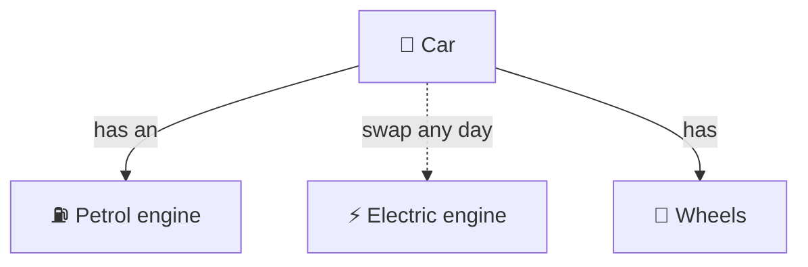

# Composition over inheritance

> [!REMEMBER]
> Build with LEGO bricks, not family trees.



## The rule

- **Inheritance** = "is a". Fixed when you compile.
- **Composition** = "has a". Plug parts in, swap them at runtime.
- Need **combinations** (timestamped *and* upper-case *and* to a file)? Compose. Subclasses explode.

## See it

```csharp before title="Before: one subclass per combination" snippet="samples/Lld.Samples.OopSolid/CompositionOverInheritance/Before/Loggers.cs#Logger,TimestampedLogger,UpperCaseLogger,TimestampedUpperCaseLogger"
```
```csharp after title="After: small bricks you can stack in any order" snippet="samples/Lld.Samples.OopSolid/CompositionOverInheritance/After/Loggers.cs#ILog,MemoryLog,Timestamped,UpperCase"
```

**What changed:** each feature is one small class that **has** an `ILog` and passes the line on. Stack them:
`new Timestamped(new UpperCase(memory), clock)`. Three features, three classes, any combination.

## Smell it

- Class names that list features: `TimestampedUpperCaseFileLogger`.
- Inheriting a big class to use one method.
- "I need behaviour from two base classes."

## In this app

```csharp snippet="src/Lld.Content.Authoring/ContentPipeline.cs#ContentPipeline"
```

The pipeline **has** a reader, a validator and a packer. Tests swap the files (`InMemoryContentFiles`) without
subclassing anything.

## Interview questions

### What does "composition over inheritance" mean?

Prefer building behaviour from objects a class has (and delegates to) over inheriting it. It is looser, and parts
can be swapped or combined at runtime.

### Why does inheritance cause a "class explosion"?

Each combination of features needs its own subclass: three optional features means up to seven classes. With
composition, it's three small classes stacked as needed.

### What pattern is this, in the logging example?

Decorator: each wrapper has the same interface as what it wraps, adds one thing, and passes the call on.

### When is inheritance still fine?

A true, stable is-a, a base designed for extension, or a framework that asks for it.

### How does composition help testing?

Parts come in through the constructor, so a test passes fakes. No need to subclass to change behaviour.

## Go deeper

### Delegation, step by step

1. Find the varying behaviour (where to write, what to add).
2. Put it behind a small interface (`ILog`).
3. The class **receives** an implementation in its constructor and calls it.
4. Combine implementations by wrapping one in another.

### Strategy vs Decorator

| | Strategy | Decorator |
|---|---|---|
| Idea | Pick **one** way to do a step | **Wrap** to add behaviour |
| Shape | `Checkout(IFeePolicy policy)` | `new Cached(new Retry(service))` |
| Combine? | One at a time | Stack many |

### C# notes

- Primary constructors keep composition short: `sealed class Timestamped(ILog inner, TimeProvider clock)`.
- Dependency injection (`services.AddSingleton<ILog, …>`) wires the bricks in one place.
- Libraries like Scrutor add `Decorate<TService, TDecorator>()` for decorators in DI.

### When not to

- One simple variation that will never combine? A small subclass or a parameter is fine.
- Too many tiny wrappers make a stack hard to follow: name them clearly, keep stacks short.

### In a design interview

- When you hear "it can also…", "sometimes it should…", "combine…", reach for **has-a**.
- Draw the interface once and its decorators beside it, not a tree under it.

### Misconceptions

- "Composition means no inheritance at all." No: prefer it, don't ban inheritance.
- "Composition is slower." One extra call per layer: negligible.

> [!WORK]
> **From my work:** a base class you replaced with composition. (Add your story here.)

### Related

- [Inheritance](../inheritance/lesson.md) · [Polymorphism](../polymorphism/lesson.md) ·
  [Interfaces vs abstract classes](../interfaces-vs-abstract-classes/lesson.md)
