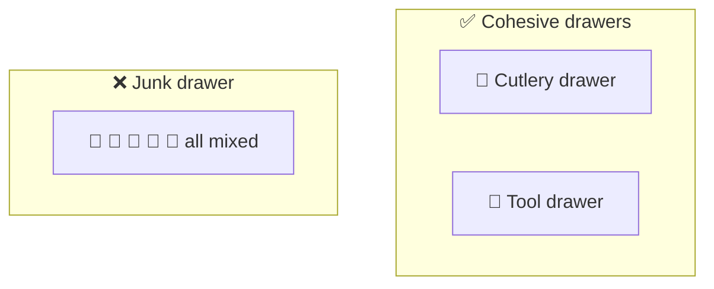
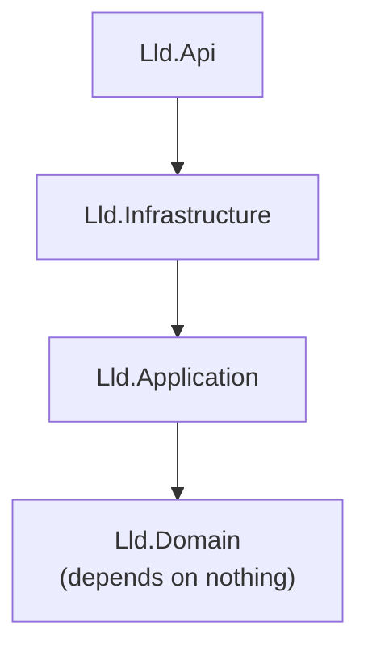

# Coupling & cohesion

> [!REMEMBER]
> Tight inside, loose outside. Like a tidy drawer with one handle.



## The rule

- **Cohesion** = how much the things **inside** a class belong together. Want: **high**.
- **Coupling** = how much a class **knows about others**. Want: **low**.
- Change one thing → touch **one** place.

## See it

```csharp before title="Before: a junk drawer that knows everything" snippet="samples/Lld.Samples.OopSolid/CouplingCohesion/Before/OrderHelpers.cs#OrderHelpers"
```
```csharp after title="After: pricing with the order, a receipt that needs only what it prints" snippet="samples/Lld.Samples.OopSolid/CouplingCohesion/After/Receipts.cs#Order,ReceiptData,ReceiptFormatter"
```

**What changed:** the total moved next to the lines it adds up (cohesion). The receipt now depends on one small record,
not on the whole order, customer and address (coupling).

## Smell it

- `Helpers`, `Utils`, `Manager` classes with unrelated methods.
- `a.B.C.D` chains reaching deep into other objects.
- One change makes you edit many files ("shotgun surgery").

## In this app



The domain knows nothing about the database or the web. Each project is one cohesive layer, linked one way only.

## Interview questions

### What are coupling and cohesion?

Cohesion: how strongly a module's parts belong together (want high). Coupling: how much a module depends on others'
details (want low).

### Why do they matter?

High cohesion and low coupling mean a change stays in one place, and parts can be tested and replaced alone.

### How do you reduce coupling?

Depend on small interfaces or records, not whole object graphs; pass in what a class needs; keep dependencies pointing
one way.

### Give a sign of low cohesion.

A `Utils` class or a class whose methods each use different fields: it is really several classes.

### How do SRP and cohesion relate?

SRP is cohesion applied to change: a class should change for one reason, so everything in it belongs together.

## Go deeper

### Kinds of coupling, from bad to fine

| Kind | Example | Verdict |
|---|---|---|
| Content | Reaching into private state (reflection) | Avoid |
| Shared global | A static mutable setting everyone reads | Avoid |
| Control | Passing a flag that changes what a method does | Usually avoid |
| Stamp | Passing a whole `Order` when only the total is used | Reduce |
| Data | Passing just the values needed | ✅ Good |

### Measure it quickly

- **Fan-out:** how many types does this class use? High = coupled.
- **LCOM (cohesion):** do most methods use most fields? If methods split into groups, split the class.

### Connascence, in one line

Two parts are connascent when changing one forces a change in the other. Prefer the weak kinds (agreeing on a
**name**) over strong ones (agreeing on **order** of arguments, or on magic values).

> [!APP]
> `Lld.Content` (pack model, used by the phone app) and `Lld.Content.Authoring` (Markdown, YAML and Roslyn, build time
> only) are split so the app never ships the authoring libraries. Cohesion by **who uses it**.

### In a design interview

- Group classes into packages by **what changes together**.
- Draw dependency arrows **one way**; point out there are no cycles.
- Name the small "seams" between packages (interfaces, records).

### Misconceptions

- "Zero coupling is the goal." Some coupling is the point of a program: keep it small and visible.
- "More, smaller classes is always more cohesive." Splitting things that change together *lowers* cohesion.

> [!WORK]
> **From my work:** a change that touched twenty files, and what would have kept it to one. (Add your story here.)

### Related

- [Law of Demeter](../law-of-demeter/lesson.md) · [Encapsulation](../encapsulation/lesson.md) ·
  [Abstraction](../abstraction/lesson.md)
