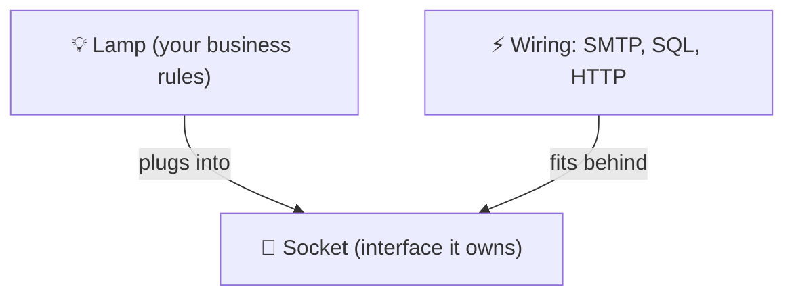

# Dependency Inversion (DIP)

> [!REMEMBER]
> Depend on the socket, not the wiring behind the wall.



## The rule

- **High-level** code (business rules) must not depend on **low-level** details (SMTP, SQL).
- Both depend on an **interface**, and the **high-level** side **owns** it.
- So the arrow flips: the mail sender depends on checkout's interface, not checkout on the mail sender.

## See it

```csharp before title="Before: checkout builds its own mail server" snippet="samples/Lld.Samples.OopSolid/Dip/Before/Checkout.cs#SmtpMailer,CheckoutService"
```
```csharp after title="After: checkout owns a socket; mail plugs in" snippet="samples/Lld.Samples.OopSolid/Dip/After/Checkout.cs#ICustomerNotifier,CheckoutService,EmailNotifier"
```

**What changed:** checkout no longer says `new SmtpMailer(...)`. It asks for an `ICustomerNotifier` it defines.
Tests pass a fake; production passes email; SMS is one new class.

## Smell it

- `new SqlConnection` / `new HttpClient` / `new SmtpClient` inside business code.
- Business code you can't test without a database or network.
- `using Infrastructure…` in your domain project.

## In this app

```csharp snippet="src/Lld.Application/Abstractions/Ports.cs#IAccessRequestRepository"
```

The application layer **owns** this interface; EF Core implements it in
[Infrastructure](../../../src/Lld.Infrastructure/Persistence/Repositories.cs). The domain never references EF Core.

## Interview questions

### What is the Dependency Inversion Principle?

High-level modules shouldn't depend on low-level modules; both should depend on abstractions, and the abstractions
are owned by the high-level side.

### Is DIP the same as dependency injection?

No. DI is passing dependencies in (often with a container). DIP is about which way dependencies point and who owns
the interface. You can use DI and still violate DIP.

### What is "inverted" in Dependency Inversion?

The direction of the source-code dependency: instead of policy → detail, the detail depends on an interface the
policy owns.

### How does DIP help testing?

Business code depends only on interfaces, so tests pass fakes: no database, mail server or network needed.

### What are ports and adapters?

The same idea at architecture level: the core defines ports (interfaces); adapters (SQL, HTTP, SMTP) implement them
at the edges.

## Go deeper

### Who owns the interface?

The **client** owns it, and names it in its own words: `ICustomerNotifier` ("tell the customer"), not `ISmtpMailer`.
If the interface lives next to the SMTP code and mirrors it, the dependency hasn't really been inverted.

### The composition root

One place at startup decides which implementation plugs into each socket:

- In ASP.NET Core: `builder.Services.AddScoped<ICustomerNotifier, EmailNotifier>()`.
- In this app: [`DependencyInjection.cs`](../../../src/Lld.Infrastructure/DependencyInjection.cs) in Infrastructure
  wires every port to its adapter.

### DIP vs DI vs IoC

| Term | What it is |
|---|---|
| **DIP** | A design rule: depend on abstractions you own |
| **DI** | A technique: receive dependencies (constructor) instead of creating them |
| **IoC container** | A tool that does DI for you (`Microsoft.Extensions.DependencyInjection`) |

> [!APP]
> The React app does the same: pages depend on a `DataSource` interface; the native bridge and the HTTP API are two
> adapters chosen once at startup ([source](../../../web/src/data/types.ts)).

### In a design interview

- Put interfaces in the **core** of your diagram and implementations at the **edges**.
- Draw arrows from SQL/SMTP **into** the core's interfaces, and say "dependencies point inwards".

### Misconceptions

- "Every class needs an interface." Only the ones that are details (I/O, time, external services) or need fakes.
- "Using a DI container means I follow DIP." Only if the interfaces belong to the high-level code.

> [!WORK]
> **From my work:** business code you couldn't test until you inverted a dependency. (Add your story here.)

### Related

- [Abstraction](../abstraction/lesson.md) · [Interface Segregation](../isp/lesson.md) ·
  [Coupling & cohesion](../coupling-cohesion/lesson.md)
