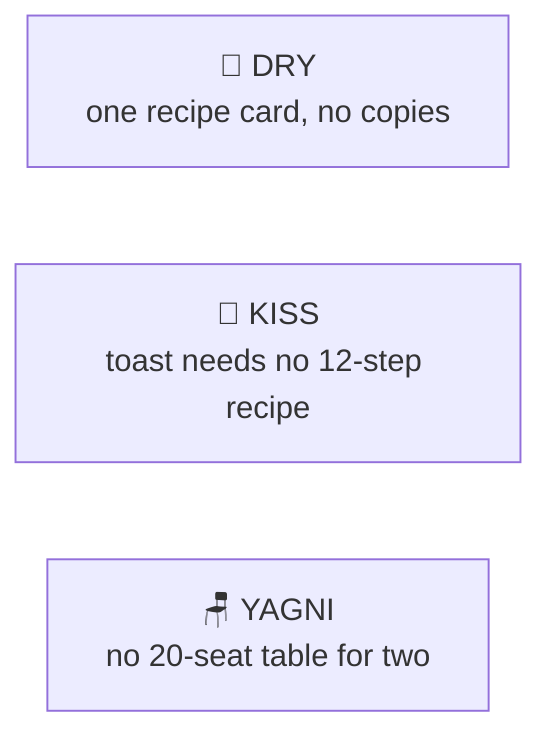

# DRY, KISS & YAGNI

> [!REMEMBER]
> Say it once. Keep it simple. Build only what's asked.



## The rule

- **DRY** (Don't Repeat Yourself): every **rule** lives in **one** place.
- **KISS** (Keep It Simple): pick the **simplest** design that works today.
- **YAGNI** (You Aren't Gonna Need It): don't build for a future nobody asked for.

## See it

```csharp before title="Before: one rule, three copies (already different)" snippet="samples/Lld.Samples.OopSolid/DryKissYagni/Before/Shipping.cs#Cart,Invoice,OrderEmail"
```
```csharp after title="After: the rule once; everyone asks it" snippet="samples/Lld.Samples.OopSolid/DryKissYagni/After/Shipping.cs#ShippingPolicy,Cart,Invoice,OrderEmail"
```

**What changed:** at exactly ₹500 the cart said "free" but the e-mail said "₹49": one copy used `>` instead of `>=`.
Now the rule lives in `ShippingPolicy`; change it once, everyone agrees.

## Smell it

- **DRY:** the same rule (not just similar lines) in several places.
- **KISS:** factories, registries or engines for one case.
- **YAGNI:** `NotImplementedException` "for later"; options nobody uses.

## In this app

```csharp snippet="src/Lld.App.Data/Schema/V2LessonTerms.cs#V2LessonTerms"
```

**KISS:** a phone schema change is one SQL line, not an EF Core migration (EF Core cost 1–5 s per launch on Android).

## Interview questions

### What does DRY really mean?

Every piece of **knowledge** has one source of truth. It's about rules and decisions, not about any two lines that
look alike.

### When is duplication OK?

When two pieces look the same but change for different reasons. Merging them couples two things that will drift
apart.

### What is KISS?

Choose the simplest design that meets today's needs. Simple code is easier to read, test and change.

### What is YAGNI?

Don't build features or extension points until they are needed. Speculative code costs time now and gets in the way
later.

### How do these fit with OCP?

They balance it: add extension points where change has really happened (often after the second or third case), not
everywhere "just in case".

## Go deeper

### KISS: one rule, one method

```csharp before title="Before: an engine for one rule" snippet="samples/Lld.Samples.OopSolid/DryKissYagni/Before/Overbuilt.cs#DiscountEngine"
```
```csharp after title="After: one method" snippet="samples/Lld.Samples.OopSolid/DryKissYagni/After/Simple.cs#MemberDiscount"
```

- Add the engine on the day the second rule arrives. Refactoring a simple method into a strategy takes minutes.

### YAGNI: build what was asked

```csharp snippet="samples/Lld.Samples.OopSolid/DryKissYagni/Before/Overbuilt.cs#IReportExporter,PdfExporter"
```

- Two of the three exporters only throw. They still have to compile, be read and be maintained.

### The rule of three

1. First time: just write it.
2. Second time: notice the copy, but you may duplicate.
3. Third time: extract it. Now you know what really varies.

### DRY's opposite failure: the wrong abstraction

Merging code that only **looks** alike creates a shared function full of `if (caller == …)` flags. When that happens,
copy it back out (Sandi Metz: "duplication is far cheaper than the wrong abstraction").

> [!APP]
> **DRY across languages:** the C# packer and the React app must make the same heading anchors. One shared test file,
> [`slugs.json`](../../../tests/fixtures/content/slugs.json), is checked by both, so they can't drift apart.
> **YAGNI:** images in lessons aren't supported yet; a validation rule says so until a lesson really needs one.

### In a design interview

- Say what you **won't** build: "no plug-in system yet; one fee policy until a second one exists".
- Mention where you'd add extension points **later** and what would trigger it.

### Misconceptions

- "DRY means no repeated lines." It means no repeated **knowledge**.
- "KISS means no patterns." Use a pattern when it makes the code simpler, not to look clever.
- "YAGNI means no design." It means no **speculative** design; clean code is always needed.

> [!WORK]
> **From my work:** a premature abstraction you removed, or a copied rule that drifted. (Add your story here.)

### Related

- [Open/Closed](../ocp/lesson.md) · [Abstraction](../abstraction/lesson.md) ·
  [Coupling & cohesion](../coupling-cohesion/lesson.md)
