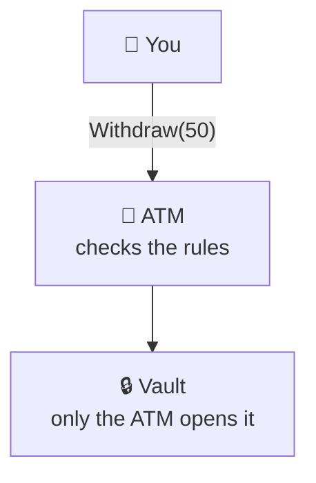

# Encapsulation

> [!REMEMBER]
> Don't touch my data. Ask me to do it.



## The rule

- An object **owns its data and its rules**.
- Callers **ask** it to act (`Withdraw`). They never **set** its data (`Balance = …`).
- So every rule lives in **one place**: inside the object.

The rules that must always be true are called **invariants**: "the balance is never negative", "a submitted order
can't change". Encapsulation keeps them true, whoever calls.

## See it

```csharp before title="Before: anyone can change the balance" snippet="samples/Lld.Samples.OopSolid/Encapsulation/Before/BankAccount.cs#BankAccount,AccountService"
```
```csharp after title="After: the account keeps its own rules" snippet="samples/Lld.Samples.OopSolid/Encapsulation/After/BankAccount.cs#BankAccount"
```

**What changed:** setters became `Deposit` and `Withdraw`. One private method, `Record`, is the *only* place the
balance changes, so the balance and its history can never disagree.

## Smell it

- `{ get; set; }` on data that has rules.
- Rules in an `…Service`, data in a "bag" class.
- A `List<T>` handed out to callers.

## In this app

```csharp snippet="src/Lld.Domain/Access/AccessRequest.cs#AccessRequest.Approve,AccessRequest.ApplyDecision"
```

`AccessRequest` has only `private set`. The admin console can't write `Status = Approved`; it must call `Approve`.

## Interview questions

### What is encapsulation, beyond "private fields"?

An object protects its **invariants**: its data changes only through methods that keep its rules true. Private
fields are the tool; one place per rule is the goal.

### What is an invariant? Give an example.

A rule that is always true for an object, e.g. "an account's balance is never negative". The constructor makes it
true; every public method keeps it true.

### Is a class with getters and setters encapsulated?

No. A public setter is a public field with extra typing. Replace setters with actions like `Withdraw` or `Submit`.

### What is an anaemic domain model?

Classes with data but no behaviour, plus services holding all the rules. Nothing stops other code from changing
the data without those rules.

### How do you expose a collection safely in C#?

Keep a private `List<T>`; expose `AsReadOnly()` (a wrapper that can't be cast back), and add methods like `AddLine`
for allowed changes.

## Go deeper

### A second example: an order over time

```csharp before title="Before: a public list, a stored total" snippet="samples/Lld.Samples.OopSolid/Encapsulation/Before/Order.cs#Order"
```
```csharp after title="After: the order decides what is allowed now" snippet="samples/Lld.Samples.OopSolid/Encapsulation/After/Order.cs#Order"
```

- **Rules about time:** lines can be added only while the order is a draft (`EnsureDraft`).
- **Compute, don't store:** `Total` is worked out from the lines, so it can't go stale.
- **Name methods after the business:** `Submit`, not `SetStatus`.

### C# traps

```csharp snippet="samples/Lld.Samples.OopSolid/Encapsulation/Language/Traps.cs#LeakyTeam,Team"
```

- `IReadOnlyList<T>` over your list can be **cast back** to `List<T>`. `AsReadOnly()` can't.

```csharp snippet="samples/Lld.Samples.OopSolid/Encapsulation/Language/Traps.cs#LeakyPercentage,Percentage"
```

- `with` copies a record **without running the constructor**. Check values in the `init` accessor (C# 14 `field`).
- EF Core can use `private set` and private constructors: an ORM doesn't force public setters.

> [!APP]
> An honest leak in this app: `AggregateRoot.DomainEvents` returns its list as `IReadOnlyCollection`
> ([source](../../../src/Lld.Domain/Common/AggregateRoot.cs)). Fine here: the only reader is our own unit of work.

### When not to

- **DTOs, requests, options:** plain data crossing a boundary. No rules, nothing to protect.
- **Reading is fine:** "Tell, don't ask" is about *decisions*, not about showing a balance.
- **Too many rules in one class?** Split it: value objects like `EmailAddress` take some.

### In a design interview

1. Name each entity's **invariants** out loud ("a spot holds one car").
2. Give each rule an **owner**: `ParkingSpot.Park(car)`, never `spot.Car = car`.
3. Draw **methods**, not setters, on the class diagram.
4. Thread safety is easier: only `Park` changes a spot, so only `Park` needs a lock.

### Misconceptions

- "Encapsulation = getters and setters." No: it's about *who may change what*.
- "It's a security feature." No: reflection can read private fields. It's a design tool.
- "Immutable means encapsulated." Not quite: an immutable `Percentage` of 150 is still wrong.

> [!WORK]
> **From my work:** an anaemic model that caused a bug, or a rule you moved into the object. (Add your story here.)

### Related

- [Abstraction](../abstraction/lesson.md): what callers see. Encapsulation makes sure they can't get around it.
- [Polymorphism](../polymorphism/lesson.md): the State pattern behind `AccessRequest`.
- [Auth case study](../../case-studies/auth/lesson.md): every idea here, on real code.
