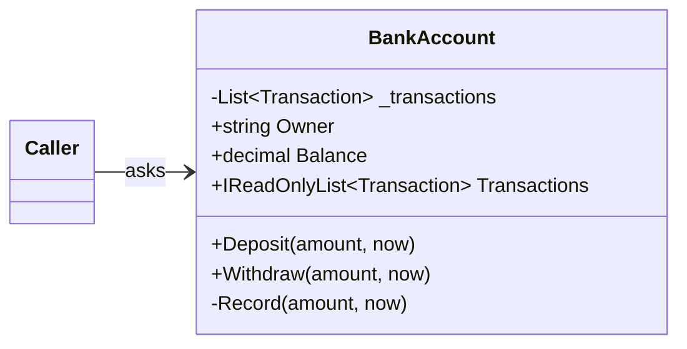

# Encapsulation

## The idea

**Encapsulation means an object owns its data and the rules about that data, and nothing outside the object can
break those rules.** Callers don't set a balance; they deposit and withdraw. They don't add to an order's list of
lines; they ask the order to add a line, and the order decides whether that is allowed right now.

Most developers first meet encapsulation as "make fields private and add getters and setters". That is the
mechanism, and on its own it achieves almost nothing: a private field with a public setter is a public field with
extra typing. The point is not hiding fields. The point is that **every rule that must always hold has exactly one
place that enforces it**, and that place is the object the rule is about.

Those always-true rules have a name you will use in every design interview: **invariants**. "The balance is never
negative." "The balance equals the sum of the transactions." "A submitted order has at least one line and can't
change." An encapsulated object makes its invariants true when it is created and keeps them true after every public
method, no matter who calls it or in what order.



The diagram shows the shape you are aiming for: data marked private (`-`), a small public surface of *behaviour*
(`+Deposit`, `+Withdraw`), and read access to state where callers genuinely need it. The caller's arrow points at
behaviour, never at the fields.

> [!INTERVIEW]
> When asked "what is encapsulation?", don't stop at "private fields". Say: "An object protects its invariants. State
> changes only through methods that keep those rules true, so the rules live in one place." Then give one invariant
> from a real system.

## The problem it solves

Software changes. The question every design answers, whether it means to or not, is: **when a rule changes, how many
places do I have to find and fix?**

Imagine the bank adds a rule: withdrawals above 10,000 need a second approval. If the balance is a public property
that any code can change, the honest answer is "every place that subtracts from the balance", and you find those by
searching the whole codebase for `.Balance -=` and `.Balance =` and hoping nobody wrote `account.Balance += -amount`.
If the account encapsulates its balance, the answer is "one method: `Withdraw`".

Encapsulation pays for itself in four ways:

1. **Correctness.** Invalid states become impossible to reach instead of merely discouraged. A test can prove the
   rule once, for every caller that will ever exist.
2. **Change.** Rules live next to the data they protect, so a new rule is a change in one class. This is the root of
   the Single Responsibility and Open/Closed principles you will meet later in this module.
3. **Reasoning.** When you read `account.Withdraw(50, now)`, you don't need to know how the account stores its
   history. When you debug a wrong balance, there is one method to put a breakpoint in.
4. **Freedom to change the inside.** Because callers depend only on behaviour, the account can switch from storing a
   balance to computing it from transactions, or start caching, without touching a single caller.

That fourth point is called **information hiding**, and it is older than object-oriented programming: David Parnas
argued in 1972 that modules should be split around *decisions that are likely to change*, each hidden behind an
interface. Encapsulation is how classes do that.

## How a violation looks

Violations rarely look dramatic. They look like convenient, ordinary code. These are the smells to train your eye on.

> [!SMELL]
> **Public setters on state that has rules.** `public decimal Balance { get; set; }` says "any value, any time, from
> anywhere". If that isn't true for the business, the type is lying.

> [!SMELL]
> **The rules live in a "service" next to a data bag.** `AccountService.Withdraw(account, amount)` checks and
> mutates `account`. Every other place that touches `account` must repeat or remember those checks. This is the
> *anaemic domain model*: objects with data and no behaviour, plus procedures that operate on them.

> [!SMELL]
> **Mutable collections handed out.** `public List<OrderLine> Lines { get; }` has no setter, so it *looks* safe, but
> anyone can call `order.Lines.Add(...)` or `order.Lines.Clear()` on the real list.

> [!SMELL]
> **Ask, then act.** Code that asks an object for its data, makes a decision, then pushes new data back
> (`if (account.Balance >= amount) account.Balance -= amount;`) is doing the object's job for it. The rule
> "Tell, don't ask" says: tell the object what you want and let it decide.

> [!SMELL]
> **Stored values that could be worked out.** An `Order.Total` property with a setter will, sooner or later, disagree
> with the lines it is supposed to total.

Notice that none of these is a compiler error, and all of them pass a quick code review. That is why encapsulation is
a design skill rather than a syntax rule.

## Worked example: a bank account

Here is the account as many codebases start: a class with public properties, and the rules in a separate static
"service". It compiles, it works for the first feature, and its tests pass.

```csharp before title="Before: data in one place, rules somewhere else" snippet="samples/Lld.Samples.OopSolid/Encapsulation/Before/BankAccount.cs#BankAccount,AccountService"
```
```csharp after title="After: the account keeps its own rules" snippet="samples/Lld.Samples.OopSolid/Encapsulation/After/BankAccount.cs#BankAccount"
```

Read the *Before* version as a reviewer looking for ways to break it:

- `Balance` can be set to anything, including a negative number, by any code in the program.
- `Transactions` is a public list with a setter: someone can replace the whole history, or add to it without
  changing the balance.
- The withdraw rules (positive amount, enough money, record the transaction) exist only in `AccountService`. Nothing
  forces anyone to use it.

And people won't. Months later, someone writes a refund feature. They find `Balance`, they add to it, they ship:

```csharp snippet="samples/Lld.Samples.OopSolid/Encapsulation/Before/BankAccount.cs#RefundHandler"
```

The balance and the history now disagree, and no test caught it, because the test for `AccountService` still passes.
The bug isn't in the refund code alone; it is in a design that *allowed* the refund code to exist.

Now read the *After* version the same way. What changed:

- **The constructor establishes the invariants.** An account must have an owner; it starts with a zero balance and
  an empty history, which trivially agree.
- **State is read-only from outside.** `Balance` has a `private set`. `Transactions` returns a read-only view of a
  private list.
- **Behaviour replaces setters.** `Deposit` and `Withdraw` express what the business does. Each validates its input
  and then calls one private method, `Record`, which is *the only place* the balance changes. Because the balance and
  the history change together in one method, they can't drift apart.
- **Failures leave nothing half done.** `Withdraw` checks everything before it changes anything. If it throws, the
  account is exactly as it was.

The refund feature now has to be written as `account.Deposit(amount, now)`, or as a new `Refund` method on the
account if refunds have rules of their own. Either way, it can't forget the history.

> [!TIP]
> A useful test when designing a class: list its invariants in a comment first, then check that every public method
> keeps each one true. If a property's setter could break one, the setter shouldn't be public.

The samples behind this lesson have tests that prove these claims. One of them shows the *Before* design accepting a
balance of -500 and a refund that leaves the history behind; another shows that the *After* account refuses an
overdraft and is unchanged afterwards. "Leaves nothing half done" is worth testing explicitly, because it is the
invariant people forget.

## Worked example: an order that changes over time

Invariants are often about *time*: what is allowed depends on what has already happened. An order is a classic
example. While it is a draft you can add lines; once it is submitted it is a promise to a customer and must not
change.

```csharp before title="Before: getters, setters and a public list" snippet="samples/Lld.Samples.OopSolid/Encapsulation/Before/Order.cs#Order"
```
```csharp after title="After: the order decides what is allowed now" snippet="samples/Lld.Samples.OopSolid/Encapsulation/After/Order.cs#Order"
```

Three things are worth noticing in the *After* version.

**The lifecycle is enforced, not documented.** `AddLine` and `Submit` both call `EnsureDraft` first. There is no way
to add a line to a submitted order, because there is no way to reach the list. In the *Before* version the only thing
stopping it is a comment in somebody's head.

**The total is computed, not stored.** `Total => _lines.Sum(...)` can never be stale. A stored total needs every path
that changes lines to remember to update it; a computed one has nothing to remember. When a value can be derived
cheaply, derive it. (When it can't, for example a total over millions of rows, store it, but update it in the same
method that changes what it summarises, exactly as `Record` does for the balance.)

**Validation lives at the edge of the object.** `AddLine` rejects an empty product name, a zero quantity and a
negative price before anything changes. The rest of the class can then trust its own data. This is sometimes called
*making illegal states unrepresentable*: rather than checking for bad data everywhere it is used, you make sure bad
data can't get in.

> [!PITFALL]
> Encapsulation is not "add a method for every field". `SetStatus(OrderStatus status)` is a setter with a longer
> name. Methods should be named after **what happens in the business**: `Submit`, `Cancel`, `Ship`. Each one
> knows which transitions are legal.

The order has a tiny state machine hidden inside it (Draft → Submitted). When a lifecycle grows (Draft, Submitted,
Paid, Shipped, Cancelled, each allowing different things), the checks inside each method get tangled. That is the
point where the State pattern earns its keep: one small class per status, each answering "what may happen now?". You
will see a real one in the next section.

## In this app

LLD Guide's own sign-in system, the [Auth case study](../../case-studies/auth/lesson.md), is built on encapsulated
domain objects. Here is how an access request gets approved:

```csharp snippet="src/Lld.Domain/Access/AccessRequest.cs#AccessRequest.Approve,AccessRequest.ApplyDecision"
```

`AccessRequest` has only `private set` properties ([source](../../../src/Lld.Domain/Access/AccessRequest.cs)). The
admin console can't write `request.Status = Approved`; it can only call `Approve`. `Approve` doesn't decide by itself
either: it asks the object for the current status (`State`), which is one of two small classes, and only the pending
one calls `ApplyDecision`. `ApplyDecision` is `internal`, so only code inside the domain assembly (the state objects)
can reach it. The rule "a decision is final" is enforced by the *type system*, not by a check someone might forget.

`ApplyDecision` also shows the "change together" idea from the bank account: status, decision time, update time and
the domain event that tells the rest of the system are all set in one method, so they can't disagree.

The refresh token follows the same pattern. Rotating a token is one operation that revokes the old token and creates
its successor in the same family:

```csharp snippet="src/Lld.Domain/Sessions/RefreshToken.cs#RefreshToken.Rotate"
```

The interesting part is what you *can't* do: there is no public way to un-revoke a token, change its family or
extend its expiry. A stolen token can't be "fixed" by a bug elsewhere, because nothing elsewhere can touch it.

> [!APP]
> The app also has an honest leak. Every aggregate inherits this base class:
>
> ```csharp snippet="src/Lld.Domain/Common/AggregateRoot.cs#AggregateRoot"
> ```
>
> `DomainEvents` returns the private list typed as `IReadOnlyCollection<IDomainEvent>`. That stops accidental
> changes, but a caller can cast it back to `List<IDomainEvent>` and add or remove events. The next section shows the
> one-word fix and why this codebase can live without it: the only reader is the unit of work in the same solution.

## C# and .NET specifics

C# gives you more encapsulation tools than most languages, and a few traps that look safe but aren't.

**Accessors.** Use `{ get; private set; }` for state that changes only through methods, `{ get; }` for state fixed at
construction, and `{ get; init; }` for values set once by an object initializer. A `readonly` field can only be
assigned in the constructor. Prefer the narrowest one that works.

**Read-only collections, properly.** `IReadOnlyList<T>` is an *interface*, not a wrapper. Returning your private
`List<T>` as `IReadOnlyList<T>` only hides the methods; the object is still the real list:

```csharp snippet="samples/Lld.Samples.OopSolid/Encapsulation/Language/Traps.cs#LeakyTeam,Team"
```

`AsReadOnly()` returns a `ReadOnlyCollection<T>` that wraps the list. It costs one small allocation, reflects later
changes, and throws `NotSupportedException` if anyone tries to change it through `ICollection<T>`. When the data
crosses a trust boundary, return a wrapper or a copy (`[.. _lines]`). Inside one team's codebase, the interface alone
is often an acceptable trade-off, as in `AggregateRoot` above. Know which one you chose and why.

**Records and `with`.** Records are great for values, but `with` creates a copy *without running your constructor*.
A check written only in the constructor is skipped:

```csharp snippet="samples/Lld.Samples.OopSolid/Encapsulation/Language/Traps.cs#LeakyPercentage,Percentage"
```

C# 14's `field` keyword lets an `init` accessor validate and store into the compiler-generated backing field, so the
check runs for constructors, object initializers and `with` alike. Before C# 14 you needed an explicit private field
for the same thing.

**Primary constructors capture, they don't encapsulate.** In `class Account(decimal balance)`, `balance` is a mutable
captured parameter visible to every member. It is fine for injected services; for domain state with rules, assign it
to a property and validate it.

**`internal` is an encapsulation boundary.** Assemblies are modules. `AccessRequest.ApplyDecision` is `internal` so
the state objects in the same assembly can call it while the application layer can't. Use
`InternalsVisibleTo` for test projects sparingly: tests that need internals often mean the public behaviour is hard
to observe.

**ORMs need a way in.** EF Core can map private setters and private fields (backing fields), and can call a private
parameterless constructor. That is why `AccessRequest` has `// Required by EF Core.` on one: persistence gets in
through a door the rest of the code can't use. You don't have to give up encapsulation to use an ORM.

**Exceptions vs results.** Both are valid ways for a method to refuse. The samples throw; the app's domain returns a
`Result` (an error is an expected outcome there, like "this request was already approved"). What matters for
encapsulation is that the object refuses and stays valid, not the mechanism.

## Trade-offs and when not to

Encapsulation is about protecting **rules**. Where there are no rules, there is nothing to protect, and ceremony only
costs you.

- **Data transfer objects should be plain.** A request body, an API response or a message on a queue is data crossing
  a boundary. `public sealed record LoginRequest(string Email, string Password);` is correct; adding behaviour to it
  would be strange. Validate it at the edge, then turn it into domain objects that do have rules.
- **Configuration and options classes** (`JwtOptions`, `BackupOptions` in this app) are bound by the framework from
  settings files and need public setters. Validate them on startup instead.
- **Don't wrap everything in methods.** A getter for a value callers legitimately need (`Balance`, `Status`) is fine.
  "Tell, don't ask" is about not making *decisions* on another object's data; it doesn't forbid reading it. Reports,
  screens and serialisation all need to ask.
- **Don't encapsulate what isn't stable yet.** In a spike or a script, a record with public properties is the right
  tool. Add behaviour when rules appear; they will tell you where it belongs.
- **Encapsulation doesn't mean one giant class.** If an object has to protect too many rules, it is probably several
  objects. A `Customer` that validates email addresses, addresses, passwords and loyalty points should hand some of
  that to value objects such as `EmailAddress`.

> [!WORK]
> **From my work:** a place in your own projects where an anaemic model caused a bug, or where moving a rule into the
> object fixed a class of bugs for good. (Add your story here.)

## Using it in a design interview

In a low-level design round (a parking lot, a library, an elevator), encapsulation is where you show you think in
*rules*, not just in boxes and arrows. A reliable way to do it:

1. **Name the entities, then say their invariants out loud.** "A parking spot holds at most one vehicle. A ticket is
   either open or paid, never both. A paid ticket has an exit time after its entry time." Interviewers rarely hear
   candidates do this, and it immediately raises the level of the conversation.
2. **Give each invariant an owner.** The rule "a spot holds one vehicle" belongs to `ParkingSpot`, so the spot gets
   `Park(vehicle)` and `Leave()`, and nothing else can set its vehicle. `ParkingLot` asks spots to park; it never
   assigns `spot.Vehicle` itself.
3. **Draw methods, not setters, on the class diagram.** `ParkingSpot { -Vehicle? occupant; +Park(v); +Leave(); +IsFree }`
   tells the interviewer more than a list of properties.
4. **Show where state changes together.** "Paying a ticket sets the exit time, the amount and the status in one
   method, so a ticket can't be half paid."
5. **Mention concurrency when it fits.** Encapsulation is what makes thread safety tractable: if only `Park` changes
   a spot, then `Park` is the one place that needs a lock (or a compare-and-swap) to stop two cars taking the same
   spot. With public setters, every caller would need to lock.

When the interviewer pushes ("what if we need a reserved spot?"), the answer is usually a change inside one class
(`Park` checks the reservation), which is exactly the point.

## Common misconceptions

**"Encapsulation means getters and setters."** Generated accessors for every field are the most common
misunderstanding of the idea. They hide *where* a value is stored but not *who may change it or how*, which is what
matters.

**"Encapsulation is a security feature."** It is a design tool. Reflection, serializers and debuggers can read and
write private members. Encapsulation protects the program from its own mistakes, not from an attacker; security
needs real boundaries (processes, permissions, validation at trust boundaries).

**"Immutable objects don't need encapsulation."** Immutability removes the "changed later" problem but not the
"created invalid" one. An immutable `Percentage` of 150 is still wrong; it still needs a constructor (or `init`
accessors) that refuses bad values.

**"Private fields make testing hard, so make them public."** If a test needs to read private state, the object is
probably missing a behaviour or a query the business also needs (`IsOverdrawn`, `Total`). Test through the public
surface; it is what callers rely on.

**"Every class needs encapsulation."** Only classes with rules do. A DTO, a configuration object or a test builder can
be a plain bag of data, and making it one is a deliberate, correct choice.

## Related

- [Abstraction](../abstraction/lesson.md): encapsulation hides *how*; abstraction decides *what* callers see.
- [Polymorphism](../polymorphism/lesson.md): the State pattern behind `AccessRequest` is polymorphism keeping each
  state's rules encapsulated in its own class.
- Later in this module: *Value objects & immutability* (`EmailAddress`), *Law of Demeter* (Tell, don't ask, from the
  caller's side) and *SRP* (one reason to change).
- The [Auth case study](../../case-studies/auth/lesson.md) uses every idea in this lesson on real code.

## Interview questions

### What is encapsulation, beyond "private fields"?

An object protects its own invariants: the rules that must always be true about its data. Its state changes only
through methods that keep those rules true, so each rule is enforced in one place. Private fields are the mechanism;
the goal is that no caller, current or future, can put the object in an invalid state. A good answer names an
invariant, for example "an account's balance equals the sum of its transactions and is never negative".

### What is an invariant? Give an example.

A condition that holds for an object from the moment it is created and after every public method returns. For an
order: "a submitted order has at least one line and can no longer change". The constructor establishes invariants;
methods may break them briefly inside their own body, but must restore them before returning, including when they
fail.

### Is a class with private fields and public getters and setters encapsulated?

Not in any useful sense. A public setter lets any caller set any value at any time, which is exactly what a public
field does. It is encapsulated only if the setter enforces the rules for that value, and usually the better design
is to replace setters with business operations (`Withdraw`, `Submit`) that change related state together.

### What is an anaemic domain model, and why is it a problem?

Objects that hold data with no behaviour, plus services that contain all the rules and change the objects'
properties. The rules aren't attached to the data, so nothing stops other code from changing the data without
them, and every new feature has to remember to call the right service. It is a reasonable choice for simple CRUD;
it becomes a problem as soon as the data has rules.

### How do you expose a collection without breaking encapsulation in C#?

Keep a private `List<T>` and expose either an interface such as `IReadOnlyList<T>` (hides mutation methods, but the
caller can cast back to the list) or a wrapper from `AsReadOnly()` (can't be changed). Return a copy when the
caller must not see later changes. Add methods such as `AddLine` for the changes that are allowed, so the object can
enforce its rules.

### What does "Tell, don't ask" mean, and when is asking fine?

Instead of asking an object for its data, deciding, and writing the result back, tell the object what you want and
let it decide: `account.Withdraw(50)` instead of checking and setting `Balance`. Asking is fine when you only read:
displaying a balance, building a report or serialising a response. The smell is making *decisions* about an object
outside it.

### How do C# records interact with encapsulation?

Records give value equality and immutability by default, which suits value objects. But `with` copies the record
without running the constructor, so validation that lives only in the constructor can be bypassed. Put the checks in
the `init` accessors (C# 14's `field` keyword makes this short) or keep the constructor private and expose a factory.

### Does using an ORM like EF Core force you to make everything public?

No. EF Core can set private setters and private backing fields and can use a private parameterless constructor, so
the domain keeps its public surface small and persistence comes in through a door the rest of the code can't use.
