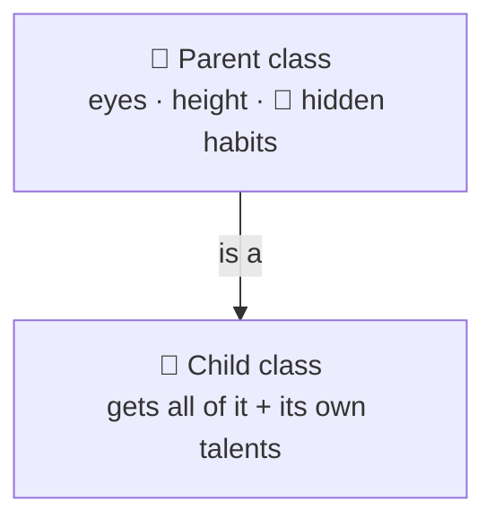

# Inheritance

> [!REMEMBER]
> A child inherits everything, even the bugs. Only inherit from a parent built for it.



## The rule

- A subclass **is a** kind of its base, and gets **all** its code.
- That makes it depend on how the base works **inside**. Change the parent, break the child.
- So: inherit only from bases **designed for it**. Seal everything else.

## See it

A playlist counts songs added. Add 3 songs… it says **6**.

```csharp before title="Before: everything virtual, so 3 songs count as 6" snippet="samples/Lld.Samples.OopSolid/Inheritance/Before/Playlist.cs#Playlist,CountingPlaylist"
```
```csharp after title="After: one hook, called once per song" snippet="samples/Lld.Samples.OopSolid/Inheritance/After/Playlist.cs#Playlist,CountingPlaylist"
```

**What changed:** the base's `AddSongs` secretly calls `Add`, so the subclass counted twice. The fix gives the
subclass **one documented hook** (`OnAdded`) and makes the public methods non-virtual. This bug has a name: the
**fragile base class**.

## Smell it

- Inheriting just to reuse code (`Stack : List<T>`).
- An override that throws `NotSupportedException`.
- Deep trees: `Entity → Audited → SoftDeleted → Order`.

## In this app

```csharp snippet="src/Lld.Infrastructure/Persistence/LldDbContext.cs#AppUser"
```

`AppUser : IdentityUser` extends a base the framework **designed** for it. Almost everything else here is `sealed`.

## Interview questions

### What does inheritance give you?

Two things at once: subtyping (use the child where the parent is expected) and the parent's code. Interfaces give
the first without the second.

### What is the fragile base class problem?

A harmless-looking change inside a base class breaks subclasses that depended on how it worked inside. Fix: design
the base for extension, or seal it.

### When is inheritance the right tool?

A real, stable is-a; a base built for extension (Template Method); or a framework that asks for it (`DbContext`,
`ControllerBase`).

### What is the Template Method pattern?

The base owns the algorithm in a non-virtual method and leaves one or two steps abstract for subclasses to fill in.

### Why seal classes by default?

It says "not built for inheritance", prevents fragile-base bugs, and keeps you free to change the class. Unsealing
later is easy; sealing later breaks subclasses.

## Go deeper

### Template Method: inheritance done right

```csharp before title="Before: the algorithm copied per format (and drifting)" snippet="samples/Lld.Samples.OopSolid/Inheritance/Before/Importers.cs#CsvContactImporter,JsonLinesContactImporter"
```
```csharp after title="After: the base owns the algorithm; subclasses read one line" snippet="samples/Lld.Samples.OopSolid/Inheritance/After/Importers.cs#ContactImporter,CsvContactImporter,JsonLinesContactImporter"
```

- `Import` is **not virtual**: subclasses fill in a step, they can't change the algorithm.
- `Normalise` is **private**: every format follows the same rules.
- If subclasses differ only in **data** (a separator, a URL), use a constructor parameter instead.

### C# traps

```csharp snippet="samples/Lld.Samples.OopSolid/Inheritance/Language/Traps.cs#Greeter,LoudGreeter"
```

- `new` **hides**, it doesn't override: the variable's type decides which method runs.

```csharp snippet="samples/Lld.Samples.OopSolid/Inheritance/Language/Traps.cs#Widget,Label"
```

- Never call a virtual method from a constructor: the subclass isn't ready yet (`label ''`).

```csharp snippet="samples/Lld.Samples.OopSolid/Inheritance/Language/Traps.cs#StringExtensions"
```

- C# 14 **extension members** add helpers without subclassing.

> [!APP]
> The domain's one base class, `AggregateRoot`, has nothing to override: it only shares the event list and a
> `protected Raise`. Nothing for a subclass to break ([source](../../../src/Lld.Domain/Common/AggregateRoot.cs)).

### In a design interview

- The parking-lot trap: `Car`, `Truck`, `Motorcycle` subclasses. Ask what differs. Usually just **size**, which is
  **data**: one `Vehicle` with a `VehicleSize`.
- Say it out loud: "I'm not subclassing; they differ in data, not behaviour."
- Fees that really differ? An `IFeePolicy` interface usually beats a base class.

### Misconceptions

- "Inheritance is the main way to reuse code." It is the most *coupled* way.
- "Is-a in English means inheritance." A square is a rectangle in maths, not in a mutable class (see LSP later).
- "`protected` is private enough." It is a contract with every subclass, forever.

> [!WORK]
> **From my work:** a deep or fragile hierarchy you untangled. (Add your story here.)

### Related

- [Polymorphism](../polymorphism/lesson.md) · [Abstraction](../abstraction/lesson.md) ·
  [Encapsulation](../encapsulation/lesson.md)
