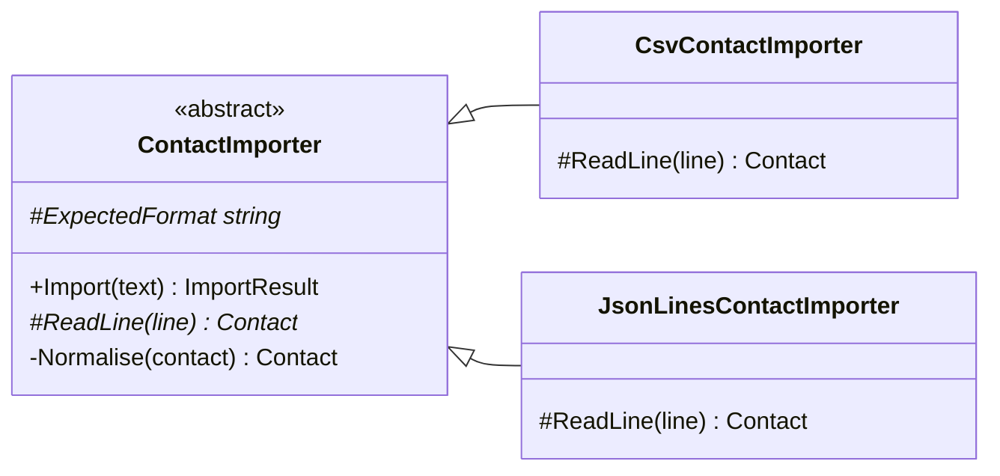

# Inheritance

## The idea

**Inheritance lets one class be defined as a specialised kind of another.** The subclass gets the base class's
members and its *type*: wherever a `Playlist` is expected, a `CountingPlaylist` can be used. It can add members,
and it can replace (override) the behaviour of members the base class marked as replaceable.

That one keyword, `: BaseClass`, actually gives you two different things, and most inheritance trouble comes from
wanting one and getting both:

1. **Subtyping (interface inheritance).** The subclass *is a* base: it promises to behave like one, so code written
   for the base works with it. This is what makes polymorphism possible.
2. **Implementation reuse.** The subclass gets the base class's fields and method bodies for free, including its
   private decisions about how things are done.

Interfaces give you the first without the second. Inheritance gives you both, glued together. That glue is the
tightest coupling in object-oriented code: the subclass depends not only on what the base class promises, but on how
it happens to be written today.



A healthy inheritance relationship looks like this: a base class that owns an algorithm and its rules (`Import`,
`Normalise`), and leaves a small, deliberate set of steps abstract (`#` is protected, `*` is abstract). The
subclasses fill in those steps and nothing else.

> [!INTERVIEW]
> Expect "inheritance vs composition" in almost every LLD interview. Say what inheritance gives you (subtyping and
> code reuse at once), why that coupling is risky (the fragile base class), and when it is still the right tool: a
> true *is-a* relationship, a base class designed for extension, and a stable hierarchy.

## The problem it solves

Inheritance solves two real problems.

**Sharing an algorithm whose steps vary.** Importing contacts from CSV and from JSON lines is the same process: split
into lines, read each line, check it, normalise it, collect errors. Only "read one line" differs. Without some way
to share the algorithm you copy it, and copies drift: someone fixes a bug in one and not the other.

**Treating a family of types uniformly.** A UI framework can draw any `Control`, a test runner can run any test
class, ASP.NET Core can serve any `ControllerBase`. The base class defines what all members of the family can do and
provides the plumbing; each subclass adds its own part. Frameworks are where inheritance shines, because their base
classes are designed, documented and versioned specifically to be inherited from.

The rest of this lesson is about telling those good uses apart from the ones that hurt.

## How a violation looks

> [!SMELL]
> **Inheriting to reuse code, not because it *is a* base.** `class Stack : List<T>` gets `Push` cheaply, plus
> `Insert`, `RemoveAt` and `Sort`, which break the stack. A stack *has* a list; it isn't one.

> [!SMELL]
> **Subclasses that disable inherited behaviour.** An override that throws `NotSupportedException` or does nothing
> says the subclass can't keep the base class's promise. Callers holding the base type will be surprised. (This is
> the Liskov Substitution Principle, later in this module.)

> [!SMELL]
> **Deep hierarchies.** Four or five levels (`Entity → AuditedEntity → SoftDeletableEntity → TenantEntity → Order`)
> mean understanding one class requires reading five, and a change at the top ripples through all of them.

> [!SMELL]
> **Overriding to work around the base class.** Calling `base.Method()` and then undoing part of what it did, or
> copying the base method's body into an override to change one line: the base wasn't designed for this extension.

> [!SMELL]
> **`protected` fields and "everything virtual".** They expose the base class's internals to every subclass forever.
> Each one is a decision the base can never change again without breaking someone.

## Worked example: the fragile base class

The danger of implementation reuse has a name: the **fragile base class problem**. A base class can't tell which of
its implementation details subclasses depend on, so any change to it, even a harmless-looking one, can break them.

Here is a playlist written with no particular thought for subclasses. Every method is `virtual`, "to be flexible",
and `AddSongs` happens to call `Add` for each song. A subclass wants to count how many songs were added, so it
overrides both entry points:

```csharp before title="Before: everything virtual; the subclass depends on hidden details" snippet="samples/Lld.Samples.OopSolid/Inheritance/Before/Playlist.cs#Playlist,CountingPlaylist"
```
```csharp after title="After: a base designed for extension, with one hook" snippet="samples/Lld.Samples.OopSolid/Inheritance/After/Playlist.cs#Playlist,CountingPlaylist"
```

In the *Before* design, adding three songs with `AddSongs` reports six. `CountingPlaylist.AddSongs` counts three,
then calls `base.AddSongs`, which calls `Add` for each song, and `Add` is overridden, so each song is counted again.
The sample's test pins this down.

Nobody wrote a bug, exactly. The subclass author couldn't see that the base calls `Add` internally. Worse, the fix
depends on the base class's *current* implementation: if the subclass stops counting in `AddSongs`, it works today and
breaks the day the base class author "optimises" `AddSongs` to add the songs in bulk without calling `Add`. The
subclass is coupled to code it can't see and doesn't control.

The *After* design changes the base class, because that is where the problem is:

- **The public methods aren't virtual.** Subclasses can't intercept `Add` or `AddSongs`, so the base is free to
  change how they work.
- **One documented extension point.** `OnAdded` is `protected virtual`, does nothing by default, and promises to be
  called *exactly once per song, however it was added*. That promise is the contract between base and subclass, and
  it is the only thing the subclass depends on.
- **The subclass is `sealed`.** Nobody inherits from the counting playlist, so it can't become someone else's
  fragile base.

This is sometimes called the **non-virtual interface** pattern: public methods are non-virtual and enforce the rules;
protected virtual hooks are the only customisation points.

> [!TIP]
> "Design for inheritance or prohibit it" (Joshua Bloch, *Effective Java*). If you haven't designed and documented
> the extension points of a class, seal it. Unsealing later is a compatible change; sealing later breaks every
> subclass.

## Worked example: Template Method, inheritance at its best

The same contact import, written twice:

```csharp before title="Before: the algorithm copied for each format" snippet="samples/Lld.Samples.OopSolid/Inheritance/Before/Importers.cs#CsvContactImporter,JsonLinesContactImporter"
```
```csharp after title="After: the base owns the algorithm; subclasses read one line" snippet="samples/Lld.Samples.OopSolid/Inheritance/After/Importers.cs#ContactImporter,CsvContactImporter,JsonLinesContactImporter"
```

The *Before* version has two copies of the same process, and they have already drifted: the CSV importer lower-cases
e-mail addresses and trims names, the JSON one doesn't. The same contact imported from two files comes out
differently. Copy-paste is the most common source of "we fixed that bug last month, why is it back?".

The *After* version uses the **Template Method** pattern: `ContactImporter.Import` is the algorithm, written once,
and it calls an abstract step, `ReadLine`, that each format supplies. Notice the details that make this safe:

- `Import` is **not virtual**. Subclasses can't change the algorithm, only the step they were given.
- `Normalise` is **private**. Every format gets the same rules, and subclasses can't skip them.
- The abstract members are **few and small**: one line in, one contact (or `null`) out, plus a description of the
  format for error messages. The smaller the hook, the less a subclass can get wrong.
- Both subclasses are **sealed**.

The test imports the same contact from both formats and gets equal results, with the same error messages for bad
lines. Adding a third format (XML, fixed-width) is one small class.

> [!PITFALL]
> If the only difference between subclasses is data (a separator character, a URL, a number), you don't need
> subclasses at all: pass it to the constructor. Inheritance is for differences in *behaviour*. And if the varying
> behaviour needs to change at runtime or be combined, composition (a later lesson) is the better tool.

## In this app

LLD Guide's own code uses inheritance in exactly three kinds of places, and seals everything else.

**One domain base class.** Every aggregate (an object that records domain events) inherits this:

```csharp snippet="src/Lld.Domain/Common/AggregateRoot.cs#AggregateRoot"
```

It is a textbook small base class: it owns one piece of state (the event list) and one rule (events are recorded
through `Raise`, which is `protected` so only the aggregate itself can raise them). There is nothing to override, so
there is nothing for a subclass to break. `AccessRequest : AggregateRoot` is a genuine *is-a*: an access request is an
aggregate root.

**Framework extension points.** ASP.NET Core Identity is designed to be extended by inheritance:

```csharp snippet="src/Lld.Infrastructure/Persistence/LldDbContext.cs#AppUser"
```

`AppUser : IdentityUser` adds the three fields this app needs, and `LldDbContext : IdentityDbContext<AppUser>` adds the
app's tables to Identity's. The framework documents these base classes as extension points and keeps them stable
across versions. Notice that `AppUser` has public setters: it is a persistence model owned by the framework, not a
domain object with rules, and the application layer never hands it out (it maps to `UserAccount`).

**Test bases.** A few test fixtures inherit from xUnit and ASP.NET Core testing base classes, such as
`WebApplicationFactory<Program>`, again because those frameworks are built for it.

**Everything else is `sealed`.** Search the repository for `sealed class`: use cases, rules, repositories and
endpoints are all sealed. The .NET analyzers even require it for internal types (CA1852). It documents intent ("not
designed for inheritance"), prevents fragile-base problems, and lets the JIT call methods directly instead of
through a virtual table.

> [!APP]
> The validation rules that check this lesson (`IContentRule`) share behaviour through an **interface** and small
> helper classes, not a base class. More than twenty rules, zero inheritance: each is independent, and a new rule can't
> break an existing one.

## C# and .NET specifics

**The keywords.** `virtual` lets a member be overridden; `override` replaces it; `abstract` requires it;
`sealed override` stops further overriding; `base.Member()` calls the base version. `protected` is visible to
subclasses, `private protected` to subclasses in the same assembly.

**`new` hides, it doesn't override.** A method marked `new` is a *different* method that happens to have the same
name, and which one runs depends on the type of the variable, not the object:

```csharp snippet="samples/Lld.Samples.OopSolid/Inheritance/Language/Traps.cs#Greeter,LoudGreeter"
```

`new LoudGreeter("Asha").Greet()` says `HELLO, ASHA`; the same object in a `Greeter` variable says `Hello, Asha`.
Hiding is almost always a mistake or a workaround; the compiler warns when you hide without saying `new`.

**Never call a virtual method from a constructor.** The base constructor runs first, so an override that uses the
subclass's fields sees them before they are set:

```csharp snippet="samples/Lld.Samples.OopSolid/Inheritance/Language/Traps.cs#Widget,Label"
```

`new Label("Save").Description` is `label ''`: `_text` was still `null` when `Widget`'s constructor called
`Describe`. The analyzer rule CA2214 flags this; the sample suppresses it deliberately to show the trap.

**Seal by default.** `sealed` classes can't be inherited, which removes a whole category of design questions, and the
JIT can devirtualise calls on them. Records can be sealed too, and usually should be: record equality and `with`
interact with inheritance in surprising ways (a derived record is never equal to a base record with the same values).

**Default interface methods** (C# 8) let an interface ship a method body. They are useful for evolving a public
interface without breaking implementers, not as a replacement for base classes: they can't hold state.

**Extension members** (C# 14) add methods and properties to a type you don't own, without inheriting from it:

```csharp snippet="samples/Lld.Samples.OopSolid/Inheritance/Language/Traps.cs#StringExtensions"
```

Before reaching for a subclass "to add a helper method", check whether an extension member does the job. It
doesn't couple you to anything but the type's public surface.

**Single inheritance of classes.** A C# class has exactly one base class but can implement many interfaces. That
limit is a good nudge: spend your one base class carefully.

## Trade-offs and when not to

Use inheritance when **all** of these hold:

- It is a genuine *is-a* relationship that will stay true: a `CsvContactImporter` is a `ContactImporter` in every
  context, forever.
- The base class is **designed for extension**: few, documented hooks, non-virtual public methods, its own rules
  private.
- The hierarchy is **shallow** (usually one level below an abstract base) and **stable**.
- Or a framework asks you to: controllers, `DbContext`, Identity users, test fixtures, UI controls.

Prefer something else when:

- You only want to **reuse code**: extract a class and use it (composition), or a static helper, or an extension
  member.
- The variation is **data**: pass it as a constructor parameter.
- The behaviour must **change at runtime** or **combine** (logged *and* cached *and* retried): composition and the
  Decorator pattern handle combinations that would need a subclass for every mix.
- You need to **substitute behaviour in tests**: an interface is easier to fake than a base class.

> [!WORK]
> **From my work:** a deep or fragile hierarchy you had to untangle, or a base class that worked well because it was
> designed for extension. (Add your story here.)

## Using it in a design interview

Inheritance is the place where interviewers most often set a trap, because the "obvious" class diagram uses it too
much. The parking lot is the classic case:

1. **The bait.** "There are cars, motorcycles and trucks." Many candidates draw `Vehicle` with `Car`, `Motorcycle` and
   `Truck` subclasses, then `ParkingSpot` with `CompactSpot`, `LargeSpot` and `MotorcycleSpot` subclasses.
2. **Ask what actually differs.** Does a truck *behave* differently, or is it just bigger? In most versions of the
   problem the only difference is size. Size is **data**: `VehicleSize { Small, Medium, Large }` on one `Vehicle`
   record, and one `ParkingSpot` with a `SpotSize`. The rule "a vehicle fits a spot of its size or larger" lives in
   one method, not in a matrix of subclasses.
3. **Say it out loud.** "I'm not subclassing vehicles because they differ in data, not behaviour. If electric
   vehicles needed charging behaviour, I'd model that as a capability, not a subclass." That one sentence shows the
   interviewer exactly the judgement they are testing for.
4. **Use inheritance where behaviour really varies.** Fee calculation might genuinely differ (hourly, flat, weekend).
   Even then, an `IFeePolicy` interface with small implementations usually beats a base class, because policies change
   at runtime and get combined. If there is a shared algorithm with one varying step (for example, a receipt layout),
   that is your Template Method.
5. **Mention sealing.** "Everything else is sealed; nothing here was designed for extension." It costs one sentence and
   signals experience.

The same reasoning applies to `Employee → Manager → Director` (roles change at runtime, so a role is data or a
separate object), `Account → SavingsAccount` (often a policy, not a subtype) and `Shape → Square` (the Liskov trap you
will meet later).

## Common misconceptions

**"Inheritance is the main way to reuse code."** It is the most coupled way. Most reuse in modern C# comes from
composition (a class used by another), generics, extension members and small helper classes.

**"is-a in English means inheritance in code."** "A square is a rectangle" is true in geometry and false in a mutable
object model, where setting a square's width must also change its height. The test is behavioural: can the subclass
keep *every* promise the base class makes?

**"Abstract base classes are more object-oriented than interfaces."** Neither is more OO. Interfaces describe what a
type can do; abstract classes also share state and code. Choose by need, as the next lesson discusses.

**"Protected members are private enough."** A `protected` member is part of your class's contract with every
subclass, including ones in other assemblies. Changing it is a breaking change, just as for a public member.

**"Sealing is premature optimisation."** It is mostly about design: it states that the class wasn't built for
extension and keeps you free to change it. The performance benefit is a bonus.

## Related

- [Polymorphism](../polymorphism/lesson.md): inheritance is one way to get subtype polymorphism; interfaces are the
  other.
- [Abstraction](../abstraction/lesson.md): an abstract base class is an abstraction with a partial implementation.
- [Encapsulation](../encapsulation/lesson.md): `protected` members are part of a class's public contract, for
  subclasses.
- Later in this module: *Interfaces vs abstract classes*, *Composition over inheritance* and *Liskov Substitution*.

## Interview questions

### What are the two things inheritance gives you, and why does it matter?

Subtyping (the subclass can be used wherever the base is expected) and implementation reuse (it gets the base's
code). Interfaces give subtyping without reuse. Getting both at once couples the subclass to the base class's
implementation details, which is why inheritance is the tightest coupling in OOP and needs care.

### What is the fragile base class problem?

A change to a base class's implementation breaks subclasses that depended on details they couldn't see, such as one
virtual method calling another. Classic example: a subclass overrides `Add` and `AddAll` to count items, and the base
`AddAll` calls `Add`, so items are counted twice; "fixing" it ties the subclass to the base's current code. The cure
is to design the base for extension (non-virtual public methods, documented hooks) or to seal it.

### What is the Template Method pattern?

A base class defines an algorithm in a non-virtual method and calls abstract or virtual "steps" that subclasses
implement. The algorithm and its rules are written once; subclasses supply only what varies. It is the canonical good
use of inheritance, for example one import process with a `ReadLine` step per file format.

### When would you use inheritance instead of composition?

When there is a genuine, stable is-a relationship, the base class is designed for extension, the hierarchy is shallow,
or a framework requires it (controllers, `DbContext`, UI controls). For reusing code, varying behaviour at runtime or
combining behaviours, composition is more flexible and less coupled.

### Why seal classes by default?

It states that a class wasn't designed for inheritance, prevents fragile-base and substitution bugs, keeps the
freedom to change the class's implementation, and lets the JIT devirtualise calls. Unsealing later is a compatible
change; sealing later breaks subclasses.

### What is the difference between override and new in C#?

`override` replaces a virtual member, so the subclass's version runs whatever the variable's type. `new` hides it
with an unrelated member of the same name, so the version that runs depends on the static type of the variable. Hiding
is rarely what you want and is a common source of confusing bugs.

### Why shouldn't a constructor call a virtual method?

Base constructors run before subclass constructors. An override called from the base constructor runs on an object
whose subclass fields haven't been initialised yet, so it sees nulls and defaults. Analyzer rule CA2214 catches it.
