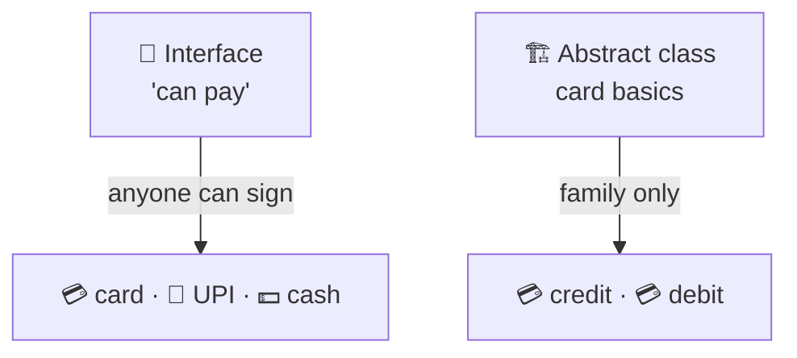

# Interfaces vs abstract classes

> [!REMEMBER]
> Interface = a job ad: "can pay". Abstract class = a half-built house: shared walls, finish the rest.



## The rule

- **Interface** = the **contract**. Anything can sign it, however different.
- **Abstract class** = **shared code** for one close family.
- Best of both: callers depend on the **interface**; a family may share an **abstract base** behind it.

## See it

```csharp before title="Before: an abstract class as the contract" snippet="samples/Lld.Samples.OopSolid/InterfacesVsAbstractClasses/Before/Payments.cs#PaymentMethod,UpiWallet"
```
```csharp after title="After: interface for the contract, abstract class for the card family" snippet="samples/Lld.Samples.OopSolid/InterfacesVsAbstractClasses/After/Payments.cs#IPaymentMethod,CardPayment,UpiWallet"
```

**What changed:** a UPI wallet had to fake a card number to fit the base class. Now it just implements
`IPaymentMethod`; only cards share `CardPayment`.

## Smell it

- A subclass fills base fields with fake values ("0000…").
- An abstract class with **only** abstract members (that's an interface).
- A class can't take a second base it needs (C# allows only one).

## In this app

```csharp snippet="src/Lld.App.Data/Schema/ISchemaMigration.cs#ISchemaMigration"
```

A schema step is a **capability** (interface). `AggregateRoot` shares **state**, so it is an abstract class.

## Interview questions

### When do you choose an interface over an abstract class?

When you describe a capability many unrelated types can have, or need a test fake. A class can implement many
interfaces but extend only one class.

### When is an abstract class the better fit?

When a close family shares state or code, or you want a Template Method: the base owns the algorithm, subclasses fill
in steps.

### Can you use both together?

Yes, and it's often best: callers depend on the interface; an optional abstract base shares code for one family.

### What are default interface methods for?

To add a member to a published interface without breaking existing implementers. They can't hold state.

### What are static abstract interface members?

They let an interface require static members or operators (e.g. `T.Zero`, `+`), so generic code can call them.

## Go deeper

### Growing an interface safely

```csharp snippet="samples/Lld.Samples.OopSolid/InterfacesVsAbstractClasses/Language/Evolving.cs#IGreeter,PoliteGreeter"
```

- `GreetAll` was added later; `PoliteGreeter` didn't change and still compiles.

### Static abstract members

```csharp snippet="samples/Lld.Samples.OopSolid/InterfacesVsAbstractClasses/Language/Evolving.cs#IHasZero,Points,Totals"
```

- The interface demands a static `Zero`; generic `Sum<T>` can now start from `T.Zero`.

### Quick comparison

| | Interface | Abstract class |
|---|---|---|
| Holds state (fields) | No | Yes |
| How many per class | Many | One |
| Constructors | No | Yes |
| Best for | Contracts, capabilities, test fakes | Shared code in one family |
| Changing it later | Default methods help | Add virtual members freely |

### In a design interview

- Draw the **interface** on the boundary (`IPaymentMethod`, `IFeePolicy`).
- Add an abstract class only when two implementations share real code.
- Say why: "one base class per type in C#, so I keep it for real code sharing".

### Misconceptions

- "Abstract classes are more OO." Neither is; they solve different problems.
- "Default interface methods make interfaces abstract classes." They still can't hold state.

> [!WORK]
> **From my work:** a breaking change to a shared interface, or a base class that should have been an interface.
> (Add your story here.)

### Related

- [Abstraction](../abstraction/lesson.md) · [Inheritance](../inheritance/lesson.md) ·
  [Composition over inheritance](../composition-over-inheritance/lesson.md)
