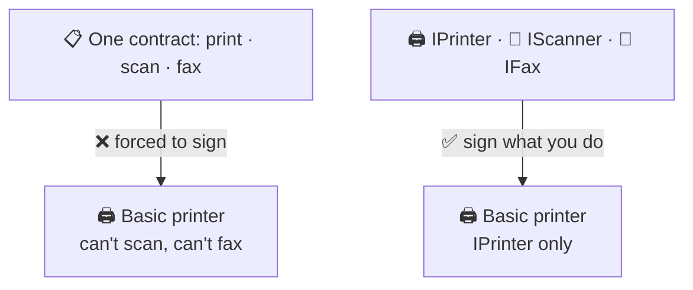

# Interface Segregation (ISP)

> [!REMEMBER]
> Don't make me sign for things I don't use.



## The rule

- Split fat interfaces into small **role** interfaces.
- Classes implement only the roles they really play.
- Callers ask only for the role they need (`IPrinter`, not `IOfficeMachine`).

## See it

```csharp before title="Before: one fat interface; a printer that throws" snippet="samples/Lld.Samples.OopSolid/Isp/Before/Machines.cs#IOfficeMachine,BasicPrinter"
```
```csharp after title="After: one interface per role" snippet="samples/Lld.Samples.OopSolid/Isp/After/Machines.cs#IPrinter,IScanner,IFax,BasicPrinter"
```

**What changed:** the basic printer no longer pretends to scan. Asking it to scan is now a **compile error**, not a
runtime crash.

## Smell it

- Methods that throw `NotSupportedException` or do nothing.
- Interfaces with 10+ members that every caller uses a little of.
- Test fakes that must stub methods the test never calls.

## In this app

```csharp snippet="src/Lld.Application/Abstractions/Ports.cs#IAuditLog,IUnitOfWork"
```

Ports are small: a use case that only needs to commit takes `IUnitOfWork`, not a big "data access" interface.

## Interview questions

### What is the Interface Segregation Principle?

No client should be forced to depend on methods it doesn't use. Prefer several small, role-focused interfaces over
one large one.

### How do you spot an ISP violation?

Implementations that throw `NotSupportedException` or leave methods empty, and callers that use only a few members
of a big interface.

### How does ISP relate to LSP?

A fat interface tempts implementations to throw for methods they can't support, which breaks LSP. Splitting it lets
each class keep every promise it makes.

### Doesn't ISP lead to too many interfaces?

It can. Split by real roles clients need, not one interface per method.

### Give a .NET example of good segregation.

`IReadOnlyList<T>` vs `IList<T>`: a caller that only reads asks for `IReadOnlyList<T>`, so any list or array works.

## Go deeper

### Role interfaces, from the client's side

Name interfaces after **what the client needs**, not after the class: `IPrinter` (what reception needs), not
`IOfficeMachineV2`. One class can play many roles: `AllInOne : IPrinter, IScanner, IFax`.

```csharp snippet="samples/Lld.Samples.OopSolid/Isp/After/Machines.cs#AllInOne,Reception"
```

### How to split a fat interface

1. List the callers.
2. Note which members each caller uses.
3. Make one interface per group; the old class implements all of them.
4. Change each caller to ask for its small interface.

### In tests

Small interfaces mean small fakes. Faking `IUnitOfWork` is one method; faking a 20-member repository is a chore.

> [!APP]
> The device database exposes content through `IContentCatalog` (read) and loads it through `ContentPackLoader`
> (write): the reader never sees the methods that replace content.

### In a design interview

- Draw interfaces next to their **clients**: "the kiosk needs `ITicketPrinter`, the admin needs `IReports`".
- If an implementation would throw for a method, say "that's an ISP smell; I'd split the interface".

### Misconceptions

- "ISP means one method per interface." No, one **role** per interface.
- "Big classes violate ISP." A class may play many roles; ISP is about what clients are forced to depend on.

> [!WORK]
> **From my work:** a fat repository or service interface you split. (Add your story here.)

### Related

- [Liskov Substitution](../lsp/lesson.md) · [Dependency Inversion](../dip/lesson.md) ·
  [Interfaces vs abstract classes](../interfaces-vs-abstract-classes/lesson.md)
