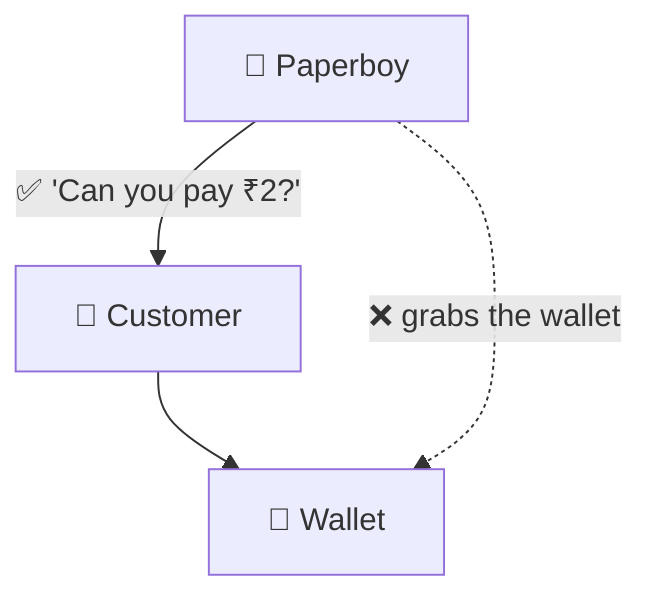

# Law of Demeter

> [!REMEMBER]
> Don't reach into your friend's pocket. Ask your friend.



## The rule

- A method talks only to: **itself**, its **fields**, its **parameters**, and objects it **creates**.
- Not to strangers it reaches **through** them: `customer.Wallet.Cash -= 2` ❌.
- Ask the friend instead: `customer.TryPay(2)` ✅.

## See it

```csharp before title="Before: the paperboy takes the wallet" snippet="samples/Lld.Samples.OopSolid/LawOfDemeter/Before/Paperboy.cs#Paperboy"
```
```csharp after title="After: the paperboy asks; the customer decides" snippet="samples/Lld.Samples.OopSolid/LawOfDemeter/After/Paperboy.cs#Customer,Paperboy"
```

**What changed:** the paperboy no longer knows wallets exist. He can't take money that isn't there, and the customer
can switch to a card without the paperboy changing.

## Smell it

- "Train wrecks": `order.Customer.Address.City.Name`.
- Mocks returning mocks returning mocks in tests.
- A change to a class you never call directly breaks your code.

## In this app

```csharp snippet="src/Lld.Content.Authoring/Validation/ContentContext.cs#ContentContext.AnchorsOf"
```

Link rules ask the context "what anchors does this file have?" instead of digging through each Markdown syntax tree.

## Interview questions

### What is the Law of Demeter?

A method should only talk to its direct collaborators (itself, fields, parameters, objects it creates), not to objects
it reaches through them. "Only one dot", loosely.

### Why does it matter?

Reaching through objects couples you to their insides. When the inner structure changes, your code breaks.

### How do you fix a train wreck?

Move the behaviour to the object that owns the data ("tell, don't ask"), or add a method on the direct friend that
answers the question.

### Is every chain of dots a violation?

No. Fluent APIs and LINQ return new objects for you to use (`list.Where().Select()`), and DTOs are plain data. The rule
is about reaching into other objects' **internals**.

### How does it relate to encapsulation?

It is encapsulation seen from the caller's side: don't depend on how a friend is built inside.

## Go deeper

### Not violations

- **LINQ and builders:** `query.Where(...).OrderBy(...)` each call returns something meant for you.
- **DTOs and records:** `response.Customer.Name` on plain data with no behaviour is fine.
- **Value objects:** `order.Total.Currency` reads a value, not a stranger's internals.

### The trade-off

Fixing every chain can add many tiny "wrapper" methods (`GetCustomerCityName()`). If you need lots of them, the
behaviour probably belongs on the inner object: move it, don't wrap it.

### In tests

Deep mock chains (`mock.Setup(x => x.A.B.C)`) are a Demeter smell made visible. When a test needs them, the code is
reaching too far.

### In a design interview

- When an interviewer asks "how does the lot know the spot is free?", answer "it asks the spot" (`spot.IsFree`), not
  "it checks `spot.Vehicle == null`".
- Keep arrows on your diagram to **direct** collaborators.

### Misconceptions

- "Count the dots." It's about **who** you talk to, not punctuation.
- "Never return objects from methods." Returning values or new objects is fine.

> [!WORK]
> **From my work:** a train wreck you found in code review, and how you fixed it. (Add your story here.)

### Related

- [Encapsulation](../encapsulation/lesson.md) · [Coupling & cohesion](../coupling-cohesion/lesson.md)
