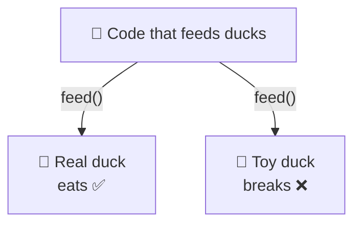

# Liskov Substitution (LSP)

> [!REMEMBER]
> If it looks like a duck but needs batteries, it's the wrong duck.



## The rule

- Anywhere the base type works, **every subtype must work too**.
- A subtype may do **more**, never **less** or **different** than the base promised.
- Test: swap the subtype in. If a caller is surprised, it's a violation.

## See it

```csharp before title="Before: a square that breaks rectangle code" snippet="samples/Lld.Samples.OopSolid/Lsp/Before/Shapes.cs#Rectangle,Square,Resizer"
```
```csharp after title="After: siblings that each keep their own promise" snippet="samples/Lld.Samples.OopSolid/Lsp/After/Shapes.cs#IShape,Rectangle,Square"
```

**What changed:** `StretchToTenByFive` expects 50, but a `Square` returns 25: setting the height changed the width.
Now `Square` isn't a `Rectangle`; both just promise an `Area`, and both keep it.

## Smell it

- An override that throws `NotSupportedException`.
- `if (x is Square)` checks in code that takes a `Rectangle`.
- An override that ignores what the base method promised.

## In this app

```csharp snippet="tests/Lld.Content.Tests/ContentCatalogContract.cs#ContentCatalogContract.CreateCatalogAsync"
```

One test suite, `ContentCatalogContract`, runs against **both** catalogs (in-memory and SQLite). If either breaks a
promise, the build fails.

## Interview questions

### What is the Liskov Substitution Principle?

Objects of a subtype must be usable wherever the base type is expected, without callers noticing. The subtype keeps
every promise of the base.

### Why is Square : Rectangle a violation?

Rectangle promises you can set width and height independently. A mutable square can't keep that promise, so code
written for rectangles gets wrong answers.

### What rules does a subtype have to follow?

Accept at least what the base accepts (no stronger preconditions), deliver at least what it promises (no weaker
postconditions), and keep its invariants.

### How do you catch LSP violations?

Contract tests: one shared test class that every implementation must pass. Also watch for `NotSupportedException`
and type checks in callers.

### How does LSP relate to OCP?

OCP relies on substituting new implementations. If they don't keep the contract, adding one breaks callers, so you
can't extend safely.

## Go deeper

### The contract, in three lines

| Rule | Meaning | Example violation |
|---|---|---|
| Preconditions | Can't demand **more** | Base accepts any amount; subtype rejects amounts over 100 |
| Postconditions | Can't deliver **less** | Base always returns a list; subtype returns `null` |
| Invariants | Must keep them | Rectangle's sides independent; Square links them |

### .NET examples

- `ReadOnlyCollection<T>` implements `ICollection<T>` and throws on `Add`: a known LSP compromise, flagged by
  `IsReadOnly`. Prefer `IReadOnlyCollection<T>` when you can.
- `Stream` declares `CanSeek` / `CanWrite` so callers can ask before using optional features. That's an honest
  contract.

### Fixing a violation

1. Remove the inheritance; make them siblings behind a smaller interface (as above).
2. Or make the base honest about optional abilities (`CanWrite`), or split it ([ISP](../isp/lesson.md)).
3. Add a contract test so it can't come back.

### In a design interview

- When you draw a hierarchy, say: "every subtype keeps the base's promises: here's one".
- If the interviewer suggests `Penguin : Bird` with `Fly()`, flag it: not every bird flies, so `Fly` doesn't
  belong on `Bird`.

### Misconceptions

- "LSP is about inheritance only." It applies to interfaces too: every implementation must honour the contract.
- "Is-a in English means substitutable." Behaviour decides, not the dictionary.

> [!WORK]
> **From my work:** a subclass or implementation that surprised its callers. (Add your story here.)

### Related

- [Inheritance](../inheritance/lesson.md) · [Open/Closed](../ocp/lesson.md) · [Interface Segregation](../isp/lesson.md)
