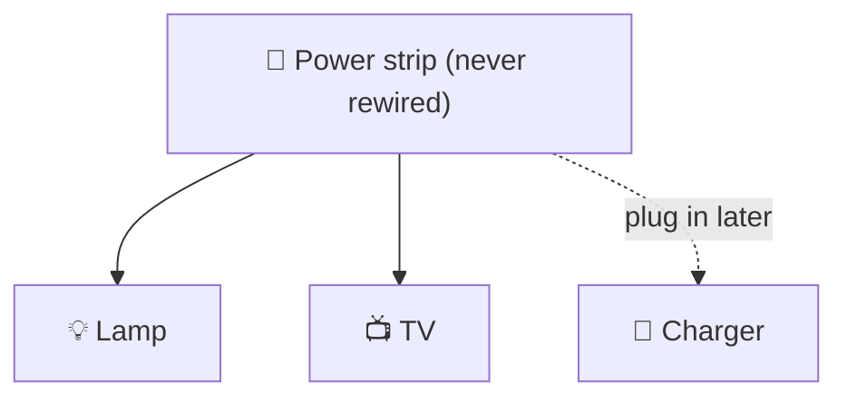

# Open/Closed (OCP)

> [!REMEMBER]
> Add new code. Don't edit old code. Like a power strip: plug in, no rewiring.



## The rule

- **Open** for extension: you can add new behaviour.
- **Closed** for modification: you don't reopen working code to do it.
- The trick: a small **extension point** (an interface) that new classes plug into.

## See it

```csharp before title="Before: every discount edits the same method" snippet="samples/Lld.Samples.OopSolid/Ocp/Before/Discounts.cs#DiscountCalculator"
```
```csharp after title="After: each discount is a rule that plugs in" snippet="samples/Lld.Samples.OopSolid/Ocp/After/Discounts.cs#IDiscountRule,LoyaltyDiscount,FestivalDiscount,DiscountCalculator"
```

**What changed:** a new discount is a new class. Months later, `FirstOrderDiscount` arrived and `DiscountCalculator`
didn't change at all:

```csharp snippet="samples/Lld.Samples.OopSolid/Ocp/After/Discounts.cs#FirstOrderDiscount"
```

## Smell it

- A `switch` or `if` chain that grows with every feature.
- "To add X, edit these five places."
- Fear of touching a class because everything depends on it.

## In this app

```csharp snippet="src/Lld.Content.Authoring/Validation/IContentRule.cs#IContentRule"
```

Every content check is its own rule class. This spec added eleven rules without editing the validator.

## Interview questions

### What is the Open/Closed Principle?

Code should be open for extension and closed for modification: you add behaviour with new code instead of changing
code that works and is tested.

### How do you make code open for extension?

Find what varies, put it behind a small interface, and let new classes implement it (Strategy, plug-ins, rules).

### Does OCP mean never editing a class?

No. You still fix bugs and refactor. OCP is about the expected kind of change (new discounts, new rules) not needing
edits to working code.

### How does OCP relate to polymorphism?

Polymorphism is the mechanism: callers depend on an interface, so a new implementation is a new class.

### What is the risk of OCP?

Adding extension points nobody needs. Wait until a second or third variation appears (YAGNI).

## Go deeper

### Where do the extension points go?

Only where change **really** happens. Ask: "what kind of change have we seen twice already?" Discounts, payment
methods, file formats, validation rules: yes. Every `if` in the codebase: no.

### Ways to stay open

| Tool | Example |
|---|---|
| Strategy / rules | `IDiscountRule`, `IContentRule` |
| Decorator | wrap a service to add caching or logging |
| Events | publish "order placed"; new handlers subscribe |
| Configuration | a price table in settings, no code at all |

### C# and .NET notes

- Register rules in DI and inject `IEnumerable<IDiscountRule>`: a new rule is one class plus one registration line.
- `IOptions<T>` keeps values (rates, limits) out of code entirely.

> [!APP]
> Device database changes are open/closed too: each schema step is a new `ISchemaMigration` class, and shipped steps
> are never edited ([source](../../../src/Lld.App.Data/Schema/ISchemaMigration.cs)).

### In a design interview

- When the interviewer says "and later we'll add…", that's your extension point: draw the interface.
- Answer follow-ups with "new class, no edits": it's the strongest signal of a good design.

### Misconceptions

- "Closed means final/sealed." No: closed means you don't need to change it to extend the system.
- "Every class needs an interface for OCP." Only where change is likely.

> [!WORK]
> **From my work:** an extension point that paid off, or one nobody ever used. (Add your story here.)

### Related

- [Polymorphism](../polymorphism/lesson.md) · [Single Responsibility](../srp/lesson.md) ·
  [Liskov Substitution](../lsp/lesson.md)
