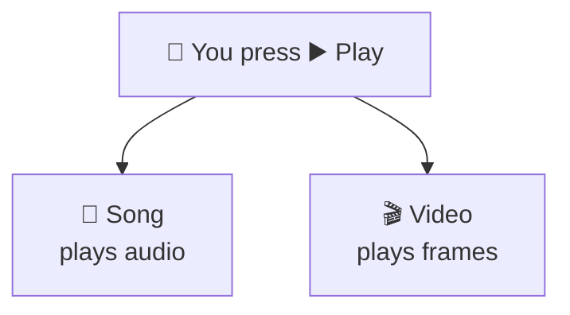

# Polymorphism

> [!REMEMBER]
> Same button. Each thing plays its own way.



## The rule

- The caller uses **one** general type (`IShippingMethod`).
- Each object brings its **own** behaviour (`Post`, `Courier`, `Drone`).
- New kind? **Add a class.** Don't edit every `switch`.

## See it

```csharp before title="Before: three switches on a type code" snippet="samples/Lld.Samples.OopSolid/Polymorphism/Before/Shipping.cs#Shipping"
```
```csharp after title="After: each method answers for itself" snippet="samples/Lld.Samples.OopSolid/Polymorphism/After/Shipping.cs#IShippingMethod,Post,Courier,Pickup"
```

**What changed:** every `switch (carrier)` became a member each carrier implements. Adding drones later is one new
class, and checkout code doesn't change at all:

```csharp snippet="samples/Lld.Samples.OopSolid/Polymorphism/After/Shipping.cs#Drone"
```

## Smell it

- The same `switch` on a type code in several places.
- `if (x is Circle) … else if (x is Square) …` in callers.
- `default: throw "unknown type"`.

## In this app

```csharp snippet="src/Lld.Content.Authoring/Validation/ContentValidator.cs#ContentValidator.Validate"
```

The validator runs every rule without knowing what any of them checks. Spec 004 added eleven rules; this method
didn't change.

## Interview questions

### What kinds of polymorphism does C# have?

Subtype (virtual methods, interfaces: picked at runtime), parametric (generics) and ad hoc (overloads, operators:
picked at compile time).

### How does polymorphism help the Open/Closed Principle?

Callers depend on an abstraction; each variant is a class. A new variant is a new class, not an edit to every
`switch`.

### When is a switch better than polymorphism?

When the set of types is **closed** and new **operations** keep coming (shapes, syntax nodes). Records + one
`switch` keep each operation in one place.

### Is method overloading polymorphism? What's the catch?

Yes, ad hoc, but the compiler picks the overload from the variable's declared type, not the object's real type.

### What is the State pattern?

An object hands its behaviour to a state object, one class per status. Change status, swap the object: no `if`
chains.

## Go deeper

### When a switch is the better design

```csharp snippet="samples/Lld.Samples.OopSolid/Polymorphism/Language/Shapes.cs#Shape,Circle,Rectangle,Geometry"
```

| Expect more new… | Prefer |
|---|---|
| **Types** (carriers, payment methods, rules) | Polymorphism |
| **Operations** (area, perimeter, render) | Records + `switch` |

This trade-off is called the **expression problem**.

### When behaviour depends on two types

The fee for a **vehicle** in a **spot**, or a collision between **two** shapes:

- Small, closed sets → `switch` on a tuple: `(vehicle, spot) switch { … }`.
- Really just prices → a lookup table from configuration.
- A big, stable tree with many operations → the **Visitor** pattern (rare in business code).

### C# traps

```csharp snippet="samples/Lld.Samples.OopSolid/Polymorphism/Language/Shapes.cs#Describer"
```

- A `Circle` in a `Shape` variable gets `"a shape"`: overloads are picked at compile time.

```csharp snippet="samples/Lld.Samples.OopSolid/Polymorphism/Language/Shapes.cs#Generic"
```

- Generics + `INumber<T>` (static abstract members): one `Sum<T>` for `int`, `decimal`, `double`.

> [!APP]
> This app uses both styles. `AccessRequest`'s statuses are classes (State pattern,
> [source](../../../src/Lld.Domain/Access/AccessRequestStates.cs)); link kinds are a closed set of records handled by
> one `switch` in `LinkRewriter.Route` ([source](../../../src/Lld.Content.Authoring/Links/LinkRewriter.cs)).

### In a design interview

1. Listen for "**types of** / **kinds of** / **depending on**". Each is an interface.
2. Name it after the role: `IPaymentMethod`, `IFeePolicy`.
3. Draw two implementations, mention a third.
4. "Now add X?" → "That's a new class; nothing else changes."

### Misconceptions

- "Polymorphism needs inheritance." Interfaces and generics give it too.
- "Every switch is a smell." Only the same switch, repeated, on a growing type.
- "Polymorphism is slow." Nanoseconds; the JIT often removes it.

> [!WORK]
> **From my work:** a growing `switch` you replaced, or a strategy hierarchy that should have been a switch. (Add
> your story here.)

### Related

- [Inheritance](../inheritance/lesson.md) · [Abstraction](../abstraction/lesson.md) ·
  [Encapsulation](../encapsulation/lesson.md)
