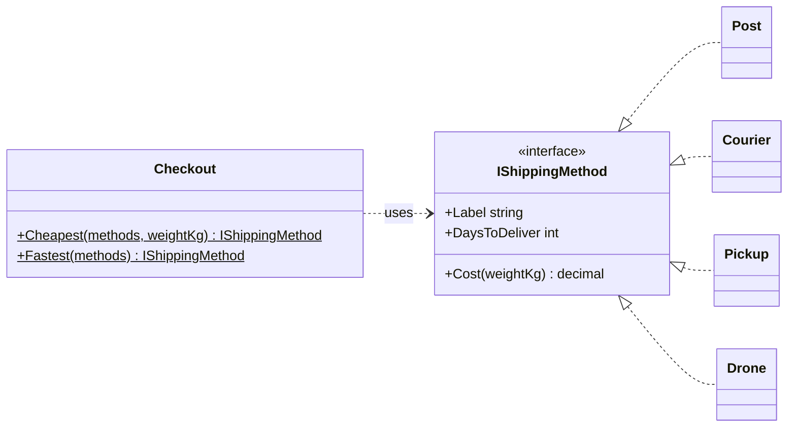

# Polymorphism

## The idea

**Polymorphism means one piece of code can work with values of many types, and each type supplies its own
behaviour.** Checkout asks a shipping method for its cost; it doesn't know or care whether that is the post, a
courier or a drone. The *call* is the same; the *behaviour* depends on the object that receives it.

The word means "many forms", and C# has three distinct kinds. Interviewers like to hear all three named:

| Kind | What varies | C# mechanism | Decided |
|---|---|---|---|
| **Subtype** (inclusion) | the object's class | `virtual`/`override`, interfaces | at runtime |
| **Parametric** | a type parameter | generics: `List<T>`, `Largest<T>` | at compile time (code shared or specialised) |
| **Ad hoc** | the argument types | overloading, operators, generic math | at compile time |

When people say "polymorphism" in an OOP design discussion, they usually mean the first: **subtype polymorphism**,
where the method that runs is chosen at runtime from the object's actual type (*dynamic dispatch*). It is what lets
you add new behaviour by adding a class, without editing the code that uses it. That property is the foundation of
the Open/Closed Principle later in this module.



`Checkout` depends on one interface. Four classes implement it; the fourth, `Drone`, was added later without
changing `Checkout` at all. Tap `IShippingMethod` in the diagram to trace it.

> [!INTERVIEW]
> A strong answer names the three kinds, then focuses on subtype polymorphism: "the caller depends on an abstraction;
> the runtime picks the implementation, so new variants are new classes, not edits to every `switch`". Then mention
> when a `switch` is the better choice (closed sets of types), which shows judgement.

## The problem it solves

The classic problem is the **type code**: an enum or string that says what kind of thing something is, plus
behaviour that branches on it. It starts as one harmless `switch`. Then the cost needs a switch, the label needs one,
the delivery estimate needs one, tracking URLs need one. Each switch lives wherever someone needed it.

Adding a variant now means **finding every switch in the codebase** and adding a case to each. The compiler can't
help: a missing case in a `switch` over an enum compiles fine and throws at runtime (or silently falls into a default
branch, which is worse). This is "shotgun surgery": one logical change, many scattered edits.

Polymorphism moves the question "what kind are you?" from the caller to the object. Each variant is one class that
answers *every* question about itself. Adding a variant is adding one class, and the compiler makes sure it answers
all of them (it must implement every interface member). The callers stay closed to change.

There is a second benefit that is easy to miss: **testability**. Code that depends on `IShippingMethod` can be tested
with a fake method that returns whatever the test needs. Code that switches on an enum can only be tested with the
real variants.

## How a violation looks

> [!SMELL]
> **The same `switch` (or `if/else if` chain) on a type code in several places.** Three switches on `Carrier` is
> three places to forget when a carrier is added.

> [!SMELL]
> **Type checks before acting.** `if (shape is Circle c) ... else if (shape is Rectangle r) ...` scattered through the
> code, especially in classes other than the shapes themselves.

> [!SMELL]
> **Boolean or enum parameters that select behaviour.** `Calculate(order, isExpress: true)`. Each value is a variant
> waiting to become a type.

> [!SMELL]
> **A `default:` branch that throws "unknown type".** It is an admission that the compiler can't check this code and
> that adding a variant will find this line at runtime.

## Worked example: replace a type code with polymorphism

A shop offers three carriers. Every fact about a carrier is a switch:

```csharp before title="Before: three switches on a type code" snippet="samples/Lld.Samples.OopSolid/Polymorphism/Before/Shipping.cs#Shipping"
```
```csharp after title="After: each method answers for itself" snippet="samples/Lld.Samples.OopSolid/Polymorphism/After/Shipping.cs#IShippingMethod,Post,Courier,Pickup"
```

The refactoring is mechanical, which is part of why it is safe:

1. Create an interface with one member per switch (`Cost`, `DaysToDeliver`, `Label`).
2. Create one class per enum value and move each case's body into the matching member.
3. Replace `Carrier` values with instances of those classes; replace each switch call with a member call.
4. Delete the switches (and eventually the enum).

The sample's test checks that the *After* classes return exactly what the *Before* switches did for each carrier,
which is the test you want while refactoring: behaviour unchanged, structure improved.

Now the payoff. Code that chooses a shipping method knows only the interface:

```csharp snippet="samples/Lld.Samples.OopSolid/Polymorphism/After/Shipping.cs#Checkout"
```

A year later the shop adds drone delivery:

```csharp snippet="samples/Lld.Samples.OopSolid/Polymorphism/After/Shipping.cs#Drone"
```

One new class. `Checkout.Fastest` picks it immediately; nothing else changed and nothing else was re-tested. In the
*Before* design the same feature would have meant a new enum value and three edited switches, and a fourth switch
somewhere in a reporting module that nobody remembered, found in production.

> [!TIP]
> Where do the instances come from? Usually from configuration or dependency injection: register every
> `IShippingMethod` and inject `IEnumerable<IShippingMethod>`. The one place that knows all the variants is the
> composition root, not the business logic.

## Worked example: when a switch is the better design

Polymorphism makes **adding types** cheap and **adding operations** expensive: a new operation on shipping methods
(say, `CarbonFootprint`) means editing every class. Sometimes it is the other way round: the set of types is fixed
and small, and new operations keep arriving. Shapes in a geometry library, nodes in a syntax tree, messages in a
protocol.

For that shape of problem, modern C# offers a different tool: **records for the data and pattern matching for the
operations**.

```csharp snippet="samples/Lld.Samples.OopSolid/Polymorphism/Language/Shapes.cs#Shape,Circle,Rectangle,Geometry"
```

Adding `Perimeter`, `BoundingBox` or `ToSvg` is one new method in one place, without touching the types. This
trade-off has a name in programming-language circles, **the expression problem**: object-oriented designs make new
types easy, functional designs make new operations easy, and you choose based on which you expect more of.

| Expect more new… | Prefer | Cost when the other happens |
|---|---|---|
| Types (carriers, payment methods, rules) | Subtype polymorphism | A new operation edits every class |
| Operations (area, perimeter, render) | Pattern matching on a closed set | A new type edits every switch |

The smell from the previous section was about switches **scattered** through callers on a type that **keeps
growing**. A switch expression that lives in one place, over a closed family the code owns, is a design choice, not a
smell.

> [!PITFALL]
> C# doesn't yet check that a switch over a class hierarchy covers every type, so `Geometry` needs the throwing
> `_` arm. Keep such switches in one place next to the types, and add a test that runs every operation over one
> instance of every type: a new type without a case then fails the build's tests instead of production.

## When behaviour depends on two types

Virtual dispatch picks a method from **one** object's runtime type: the receiver of the call. Some problems depend on
two: the fee for a vehicle depends on the vehicle *and* the spot; a collision in a game depends on both objects; a
discount depends on the customer tier *and* the product category. This is called **double dispatch**, and it comes up
as an interview follow-up more often than you would expect.

There are three common answers, from simplest to most structured:

- **A switch on a tuple of types.** C# pattern matching handles it directly:
  `(vehicle, spot) switch { (Truck, LargeSpot) => ..., (Car, _) => ..., _ => ... }`. Clear when both families are
  small and closed; it is the same trade-off as the previous section, in two dimensions.
- **A lookup table.** When the combinations are really *data* (a price per vehicle size and spot size), put them in a
  dictionary keyed by both values, loaded from configuration. No classes at all, and the business can change prices
  without a release.
- **The Visitor pattern.** Each element calls back `visitor.Visit(this)`, so the second dispatch happens on the
  visitor with the element's static type. It suits compilers and document models with many operations over a stable
  tree, and it is a classic GoF pattern you will meet in the design patterns module. It is rarely the right answer
  in a business application, where the first two options are simpler.

The judgement interviewers look for is noticing that the problem *is* two-dimensional, and choosing the simplest
mechanism that keeps every combination in one place, instead of scattering `if (vehicle is Truck && spot is ...)`
across the codebase.

## In this app

LLD Guide uses **both** designs, each where it fits, which makes it a good study.

**Subtype polymorphism: the access request's states.** The approval rules differ by status, and new statuses with new
rules are plausible (Expired, Escalated). Each status is a class:

```csharp snippet="src/Lld.Domain/Access/AccessRequestStates.cs#IAccessRequestState,AccessRequestStates.DecidedState"
```

`AccessRequest.Approve` just calls `State.Approve(this, now)`; the state object decides. This is the **State
pattern**, which is polymorphism applied to an object's lifecycle. Notice that "approved" and "rejected" share one
class, `DecidedState`, configured with a label: the variation between them is data, not behaviour.

**A polymorphic loop: validation rules.** The content validator has no idea how many rules exist or what they check:

```csharp snippet="src/Lld.Content.Authoring/Validation/ContentValidator.cs#ContentValidator.Validate"
```

Each `IContentRule` answers `Check`. Spec 004 added eight rules for snippets, Before / After, callouts, interview
questions and module maps; `Validate` didn't change by a single character.

**Pattern matching: where a link points.** Lesson links are resolved into a closed family of records (`Lesson`,
`CheatSheet`, `SameDocument`, `RepositoryFile`, `External`, `Invalid`), and one method turns each into an app route:

```csharp snippet="src/Lld.Content.Authoring/Links/LinkRewriter.cs#LinkRewriter.Route"
```

The set of link kinds is fixed by Markdown and the app's routes; what keeps growing is the operations on links
(validate, rewrite, count). So the app uses records plus a switch, exactly the trade-off from the previous section.
`LinkTarget` even has a private constructor so no one outside the file can add a kind.

> [!APP]
> Parametric polymorphism is everywhere too: `Result<T>` carries any value or an error, and
> `IContentCatalog` returns `IReadOnlyList<LessonSummary>` the same way the device SQLite catalog and the in-memory
> catalog both do. Generic code is written once and checked by the compiler for every type it is used with.

## C# and .NET specifics

**Overloads are not polymorphic.** The compiler picks an overload from the *declared* type of the argument:

```csharp snippet="samples/Lld.Samples.OopSolid/Polymorphism/Language/Shapes.cs#Describer"
```

A `Circle` held in a `Shape` variable gets `"a shape"`. If you want the runtime type to decide, use a virtual method,
an interface, or a `switch` on the value.

**Generics are parametric polymorphism, checked at compile time:**

```csharp snippet="samples/Lld.Samples.OopSolid/Polymorphism/Language/Shapes.cs#Generic"
```

Constraints (`where T : IComparable<T>`) say what a type must be able to do. **Static abstract interface members**
(C# 11) let generic code call operators and static members: `INumber<T>` gives `T.Zero` and `+`, so one `Sum<T>` works
for `int`, `decimal` and `double`. That is ad hoc polymorphism (operators differ per type) delivered through
parametric polymorphism.

**Interfaces vs base classes for dispatch.** Both give runtime polymorphism. Interfaces leave each implementation free
to have any base class and are easy to fake in tests; abstract base classes can share code and state. The next lesson
compares them properly.

**Performance.** Virtual and interface calls cost an indirection, which is negligible in business code. Sealed classes
and the JIT's guarded devirtualisation remove much of it anyway. Don't avoid polymorphism for speed unless a profiler
says so in a hot loop.

**Variance.** `IEnumerable<out T>` is covariant: an `IEnumerable<Circle>` can be passed where an
`IEnumerable<Shape>` is expected. `Action<in T>` is contravariant. Variance is what makes polymorphism work through
generic interfaces.

## Trade-offs and when not to

- **Don't create a hierarchy for one variant.** An interface with a single implementation and no test seam is
  indirection without benefit. Wait for the second variant, then refactor (the mechanical steps above are quick).
- **Closed families with growing operations** read better as records and switch expressions, as shown above.
- **Simple data differences aren't behaviour.** Two carriers that differ only in price per kilo are one class with two
  configurations, not two classes.
- **Polymorphism hides control flow.** Reading `method.Cost(weight)` doesn't tell you which code runs. Good names, small
  interfaces and a single composition root keep that manageable; a debugger's "go to implementation" does the rest.
- **Too many tiny strategies** can scatter one feature across dozens of files. If every variant is three lines, a
  dictionary of delegates or a switch may be clearer.

> [!WORK]
> **From my work:** a growing `switch` on a type code you replaced with polymorphism, or a strategy hierarchy that would
> have been simpler as a switch. (Add your story here.)

## Using it in a design interview

Polymorphism is how a design survives the interviewer's follow-up questions. Almost every LLD round ends with "now
add X", and the strongest answer is "that's a new class; nothing else changes". To be able to say that, plan for it
from the start:

1. **Find the axis of change.** Listen for words like *types of*, *kinds of*, *different*, *depending on*: "different
   payment methods", "fees depend on the vehicle and the time", "elevators use different scheduling strategies".
   Each is a candidate interface.
2. **Name the interface after the role, not the variants.** `IPaymentMethod`, `IFeePolicy`, `ISchedulingStrategy`.
   Give it the smallest set of members the callers need.
3. **Draw two implementations, mention a third.** Two show the shape; a third ("and later, a loyalty-points payment")
   shows you expect change. Don't draw ten.
4. **Show who chooses the implementation.** A factory, configuration, or the user's choice stored with the order.
   "The checkout receives the method; it never switches on a type."
5. **Answer the follow-up with the design.** "Add surge pricing" → a new `IFeePolicy`, or a decorator that wraps the
   existing policy. "Add an express elevator" → a new scheduling strategy for that elevator bank.

Equally important is knowing when *not* to: if the interviewer asks for a fixed set of three message types in a
protocol, a sealed family of records and one `switch` is a fine, modern answer. Saying why shows you understand the
trade-off rather than applying a rule.

## Common misconceptions

**"Polymorphism requires inheritance."** Interfaces give subtype polymorphism without inheriting any code, and
generics give parametric polymorphism with no hierarchy at all. In modern C#, interfaces are the usual route.

**"Every switch statement is a smell."** A switch over a closed family, kept in one place, is often the clearest
design. The smell is the *same* switch on a *growing* type code repeated across callers.

**"Overloading is runtime polymorphism."** Overload resolution happens at compile time from declared types. Only
virtual methods, interface calls and runtime type checks look at the object's actual type.

**"Polymorphism is slow."** An indirect call costs nanoseconds and is often removed by the JIT. Design for clarity and
change; measure before trading it for speed.

**"More strategies means a more flexible design."** A strategy for every `if` scatters simple logic across files.
Introduce the abstraction when there are real variants, or when tests need to substitute behaviour.

## Related

- [Inheritance](../inheritance/lesson.md): one way to get subtype polymorphism, with more coupling than an interface.
- [Abstraction](../abstraction/lesson.md): polymorphism is what makes one abstraction serve many implementations.
- [Encapsulation](../encapsulation/lesson.md): each state class in the State pattern encapsulates the rules of one
  status.
- Later in this module: *Open/Closed* (add behaviour by adding types), *Liskov Substitution* (what makes substitution
  safe) and *Dependency Inversion*.

## Interview questions

### What kinds of polymorphism are there in C#?

Subtype polymorphism (virtual methods and interfaces; the runtime type picks the method), parametric polymorphism
(generics; one definition for many types) and ad hoc polymorphism (overloading and operators; the compiler picks by
argument types). Generic math with static abstract interface members combines the last two.

### How does polymorphism help you follow the Open/Closed Principle?

Callers depend on an abstraction, and each variant is a class implementing it. Adding a variant means adding a class;
callers don't change. A type code with `switch` statements, by contrast, needs an edit in every switch for every new
variant.

### How do you replace a switch on a type code with polymorphism?

Create an interface with one member per question the switches answer, one class per type-code value, move each case's
body into the matching member, replace the type-code values with instances (often from dependency injection), and
replace switch calls with member calls. Keep a test that compares old and new results while you refactor.

### When is a switch statement better than polymorphism?

When the set of types is closed and small but new operations keep being added: shapes, syntax-tree nodes, protocol
messages. Records plus switch expressions keep each operation in one place. Polymorphism makes new types cheap;
pattern matching makes new operations cheap (the expression problem).

### Is method overloading polymorphism? What is the catch?

It is ad hoc polymorphism, but resolved at compile time from the declared types of the arguments. A `Circle` in a
`Shape` variable calls the `Shape` overload. If the behaviour must depend on the runtime type, use virtual methods,
interfaces or pattern matching instead.

### What is the State pattern, and how does it relate to polymorphism?

An object delegates its behaviour to a state object for its current status; each status is a class implementing the
same interface. Changing status swaps the state object, so behaviour changes without `if` chains. It is subtype
polymorphism applied to a lifecycle, like the access request's Pending and Decided states in this app.

### Does polymorphism hurt performance?

A virtual or interface call adds an indirection, which is negligible in nearly all business code, and the JIT
devirtualises many calls (especially on sealed types). Optimise only where a profiler shows a hot path.
