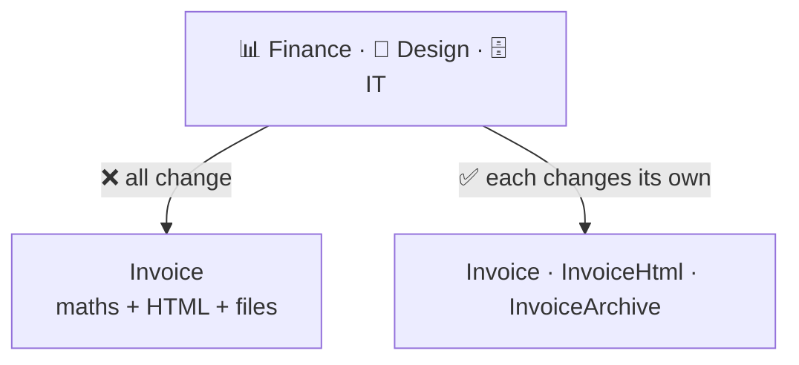

# Single Responsibility (SRP)

> [!REMEMBER]
> One class, one boss. Only one person should ever ask you to change it.



## The rule

- A class should have **one reason to change**.
- "Reason" = **one person or team** who asks for changes (finance, design, IT).
- It's about **who changes it**, not about the class being small.

## See it

```csharp before title="Before: three bosses in one class" snippet="samples/Lld.Samples.OopSolid/Srp/Before/Invoice.cs#Invoice"
```
```csharp after title="After: one class per boss" snippet="samples/Lld.Samples.OopSolid/Srp/After/Invoice.cs#Invoice,InvoiceHtml,InvoiceArchive"
```

**What changed:** design can restyle the HTML without touching the tax maths; IT can move invoices to the cloud
without touching either. The sample tests prove both versions print the same invoice.

## Smell it

- Describing the class needs "and" ("calculates **and** renders **and** saves").
- Names like `Manager`, `Processor`, `Helper`.
- Unrelated changes keep landing in the same file.

## In this app

```csharp snippet="src/Lld.Application/Access/AccessRequests.cs#RejectAccessRequest"
```

Every auth use case is its own class: `RejectAccessRequest` only rejects. Changing how approval works can't break it.

## Interview questions

### What is the Single Responsibility Principle?

A class should have one reason to change, meaning it serves one actor (a person or team). Their changes then never
break code another team relies on.

### Does SRP mean a class should do one thing?

Not exactly. It means one reason to change. A class can have several methods if they all serve the same actor.

### How do you find a class's responsibilities?

Ask who would ask you to change each method. If the answers are different people, split along those lines.

### Can you overdo SRP?

Yes: splitting things that always change together scatters one idea over many files. Split by actor, not by line count.

### How does SRP relate to cohesion?

SRP is cohesion applied to change: everything in the class changes for the same reason, so it belongs together.

## Go deeper

### The original wording

Robert C. Martin: "A module should be responsible to one, and only one, **actor**." The classic example: payroll's
`Employee` with `CalculatePay` (finance), `ReportHours` (HR) and `Save` (IT). A change for finance silently changes
HR's report because both reuse a shared helper.

### How to split, step by step

1. List the methods.
2. Next to each, write **who asks for changes** to it.
3. Group methods by that name. Each group becomes a class.
4. Keep the shared data in one small type (here `Invoice`) that the others read.

### SRP at other levels

- **Methods:** one level of abstraction (see [Abstraction](../abstraction/lesson.md)).
- **Projects:** this app's layers (Domain, Application, Infrastructure) each change for a different reason.

> [!APP]
> The content packer, the validator and the reader are three classes for the same content: packing changes when the
> app's data needs change, validation when authoring rules change, reading when the folder layout changes.

### In a design interview

- For a parking lot: `ParkingLot` (spaces), `FeeCalculator` (pricing), `TicketPrinter` (output).
- Say who owns each: "operations, finance, the kiosk vendor".

### Misconceptions

- "One method per class." No, one **reason to change**.
- "SRP means small." A small class can mix two bosses; a large one can serve one.

> [!WORK]
> **From my work:** a "God class" with many owners, and how you split it. (Add your story here.)

### Related

- [Coupling & cohesion](../coupling-cohesion/lesson.md) · [Open/Closed](../ocp/lesson.md) ·
  [Interface Segregation](../isp/lesson.md)
