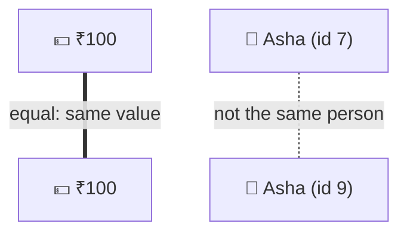

# Value objects & immutability

> [!REMEMBER]
> A ₹100 note is a ₹100 note. You don't care which one.



## The rule

- A **value object** is defined by its **values** (₹100, `asha@example.com`).
- An **entity** is defined by its **identity** (customer 7), even when its values change.
- Value objects are **valid from birth** and **never change**: "changing" one gives you a new one.

## See it

```csharp before title="Before: strings and decimals for everything" snippet="samples/Lld.Samples.OopSolid/ValueObjects/Before/Transfers.cs#Transfers"
```
```csharp after title="After: Money and AccountNumber check themselves" snippet="samples/Lld.Samples.OopSolid/ValueObjects/After/Money.cs#Money,AccountNumber,Transfers"
```

**What changed:** rupees + dollars now throws; a 5-digit account number can't exist; swapping `from` and `amount`
won't compile. The checks live **once**, inside the types.

## Smell it

- `string email`, `decimal amount, string currency` passed everywhere.
- The same validation copied in many places.
- Two parameters of the same type that are easy to swap.

## In this app

```csharp snippet="src/Lld.Domain/Identity/EmailAddress.cs#EmailAddress.Create"
```

Every email in the app is an `EmailAddress`: trimmed, lower-cased and checked **once**, then trusted everywhere.

## Interview questions

### What is a value object?

A small type defined only by its values, like `Money` or `EmailAddress`. Two with the same values are equal, and it
never changes.

### Value object vs entity?

An entity has an identity that stays while its data changes (customer 7). A value object has no identity: ₹100 is
₹100.

### What is primitive obsession?

Using strings and numbers for domain ideas. Validation gets copied around, and swapped arguments compile.

### Why make value objects immutable?

They can be shared and cached safely, used as dictionary keys, and passed between threads without locks.

### How do you build one in C#?

A `record` or `readonly record struct` gives value equality; validate in the constructor (or `init` accessors) so an
invalid one can't exist.

## Go deeper

### record vs readonly record struct

| | `sealed record` (class) | `readonly record struct` |
|---|---|---|
| Lives on | heap | inline / stack |
| Can be `null` | yes | no (has a default) |
| Good for | `EmailAddress`, `AccountNumber` | small numbers: `Money`, `Points` |
| Watch out | — | `default(Money)` skips the constructor |

### Immutability in C#

- `init` and `readonly` stop changes after construction.
- `with` makes a modified copy, but **skips the constructor**: validate in `init` (see Encapsulation).
- `IReadOnlyList<T>` is read-only *for you*, not frozen; use `ImmutableArray<T>` or a copy for a true snapshot.

### Where value objects pay off most

- Money and currencies, quantities with units, date ranges.
- Ids: `CustomerId` and `OrderId` can't be mixed up, unlike two `Guid`s.
- Anything you validate: email, phone, postcode, account number.

> [!APP]
> `Error` and `ContentIssue` in this app are records too: two errors with the same code and message are equal, which
> makes them easy to compare in tests.

### When not to

- Don't wrap every string: a person's display name with no rules can stay a `string`.
- EF Core needs a little setup (value converters, owned types) to store value objects.

### In a design interview

- Spot values with **rules**: money, time ranges, coordinates. Make them types.
- Say "entity" vs "value object" for each noun: it shows you think about identity.

### Misconceptions

- "Records are always value objects." Only if they model a value and validate it.
- "Immutable means slow." Small value objects are cheap, and safe sharing saves defensive copies.

> [!WORK]
> **From my work:** a bug from mixed-up ids, currencies or units. (Add your story here.)

### Related

- [Encapsulation](../encapsulation/lesson.md) · [Composition over inheritance](../composition-over-inheritance/lesson.md)
