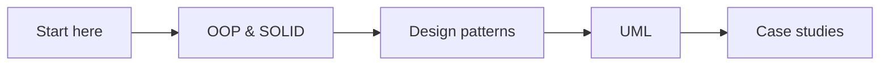
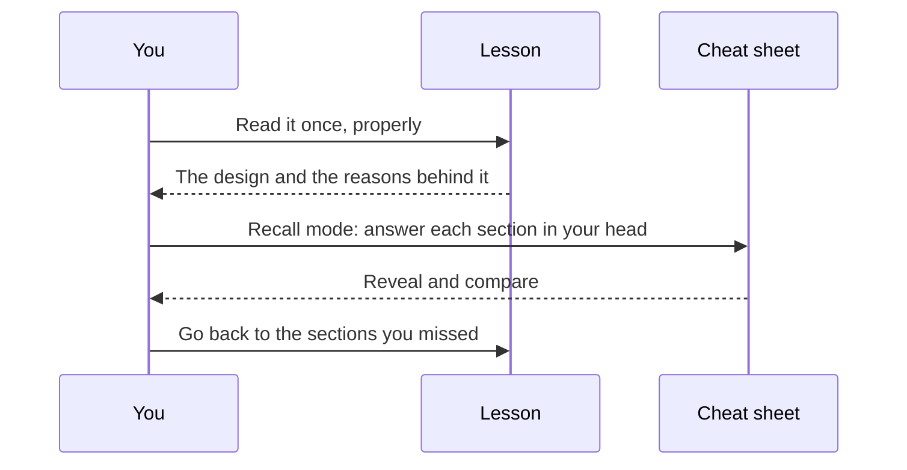

# How to use LLD Guide

LLD Guide teaches low-level design: how to turn requirements into classes, relationships and code you can defend in an
interview. Every topic comes as a pair: a **lesson** to learn it properly and a **cheat sheet** to revise it in a couple
of minutes.

## The modules, in reading order

The modules build on each other, so read them top to bottom the first time. After that, jump to whatever you need.

- **OOP & SOLID**: objects, encapsulation and the five principles that keep classes easy to change.
- **Design patterns**: the 23 classic patterns with C# samples, and when *not* to use them.
- **UML**: class, sequence, state and activity diagrams, the language of every design discussion.
- **Case studies**: real systems designed class by class, from requirements to working code. The first one is
  [this app's own sign-in](../../case-studies/auth/lesson.md).

## Lessons and cheat sheets

A lesson explains the idea, shows the design and walks through the code. Its **cheat sheet** squeezes the same lesson
into a page you can read in under two minutes: requirements, the key classes, the patterns and a short pitch.

- The **Cheat sheet** button at the top of every lesson opens its pair.
- The **Revise** tab lists every cheat sheet, grouped by module.

## Reading a lesson

- **On this page** jumps to any section. On a wide screen the outline stays beside the text, highlights where you are
  and ticks the sections you have read.
- **Diagrams**: tap a class to see what it is connected to. In a sequence diagram, choose *step through* to play the
  messages one at a time. *Expand* shows any diagram full screen.
- **Code**: a type name with a dotted underline is explained in the lesson. Tap it for a one-line reminder.
- **Aa** changes the text size. The app remembers where you stopped and opens the lesson there next time.

## The loop that makes it stick

## Before an interview

1. Open **Revise** and pick the topics on the job description.
2. Turn on **Recall** and say each answer out loud before you reveal it.
3. Finish with the *30-second pitch* of each case study: it is the answer to "tell me about a design you built".

## Offline

Lessons and cheat sheets are part of the app. They open without a network connection and without signing in.
